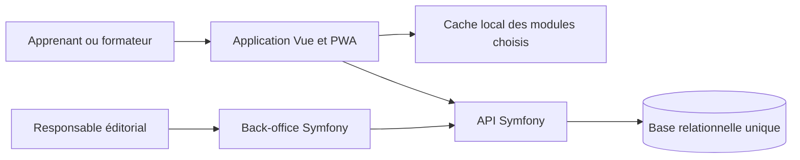

# Projet de site de formation à la médiation numérique

Date de cadrage : 15 octobre 2026. Ce document est une proposition, à confirmer avec les futurs utilisateurs avant le développement. **Base de réalisation privilégiée : adaptation du code de DevDoc dans un projet distinct, en conservant son style et ses composants Vue.**

## 1. Publics et objectifs retenus

Le site accueillera **deux publics** : les adultes et seniors qui apprennent à utiliser le numérique, et les futurs médiateurs ou professionnels qui apprennent à les accompagner. Les formations seront **libres et gratuites**, utilisables en autonomie et dans des ateliers animés par une structure. Le site ne réalisera aucune démarche administrative à la place d'un usager.

Résultat attendu pour un adulte ou senior : savoir refaire seul un geste utile (envoyer un courriel, trouver un service officiel, préparer une démarche). Résultat attendu pour un médiateur : savoir diagnostiquer un besoin, expliquer simplement, faire pratiquer la personne, vérifier son autonomie et l'orienter lorsque la demande dépasse son rôle.

## 2. Décision d'architecture avant le plan

### Forme du produit

S'inspirer de **DevDoc**, la plateforme pédagogique déjà présente dans l'environnement de travail : cours par catégorie et niveau, recherche, exercices, QCM avec correction, progression, accès hors ligne et back-office. L'accueil proposera deux entrées claires : **« J'apprends le numérique »** et **« J'accompagne des personnes »**. Un sujet commun, comme la messagerie ou la CAF, pourra avoir une leçon pratique pour l'usager et une fiche pédagogique pour le médiateur.

Commencer par une application web responsive, utilisable sur ordinateur, tablette et téléphone, y compris avec une connexion faible pendant les ateliers. **Les cours et les exercices sont publics et accessibles sans compte.** Depuis le 16 octobre 2026, un **compte apprenant facultatif** (adresse e-mail pour se connecter, pseudo affiché, mot de passe) permet de retrouver des cours, parcours et QCM **personnalisés** : un administrateur les réserve à une personne par le connecteur de rédaction. Finalité : proposer un contenu adapté à la situation d'une personne accompagnée ; accès : la personne et les administrateurs ; conservation : jusqu'à la suppression du compte, possible depuis l'espace personnel. Aucune progression, note ni visite n'est enregistrée sur le serveur ; une progression individuelle pourra être réétudiée après le lancement, sans conditionner l'accès aux formations libres.

Séparer les **contenus éditoriaux** (leçons, consignes, captures, liens officiels, dates de vérification) du **moteur d'exercices** (questions, réponses, retours pédagogiques). Chaque fiche sur un service extérieur porterait un responsable éditorial, une source officielle et une date de dernière revue. Une page périmée pourrait être retirée du catalogue jusqu'à sa vérification.

### Technologie proposée : reprendre DevDoc comme socle

| Couche | Choix proposé | Raison |
| --- | --- | --- |
| Interface | Reprendre Vue 3, Vue Router, Vite, les composants de cours et la recherche de DevDoc | Adapter navigation, vocabulaire et affichage des leçons illustrées. |
| Exercices | Adapter les vues de QCM et leur correction | Donner un retour immédiat au visiteur sans compte ni sauvegarde de score. |
| Connexion faible et hors ligne | Reprendre la PWA et son repli IndexedDB après audit ; ajouter le téléchargement explicite d'un module et de ses captures | Permettre à une structure de préparer l'atelier en ligne puis de consulter les supports sans réseau, avec date de mise à jour visible. |
| API et administration | Reprendre Symfony, Doctrine, API Platform et EasyAdmin | Adapter les entités et formulaires éditoriaux aux parcours, fiches de services et captures. |
| Base de données | Conserver une seule base MySQL au lancement | Réutiliser l'exploitation connue de DevDoc, avec de nouvelles migrations pour le domaine métier. |

La séparation Vue/Symfony est déjà présente dans DevDoc et répond au besoin d'administration des contenus. Le code sera repris dans **un nouveau projet isolé**, puis spécialisé pour la médiation numérique. Une API et une base uniques suffisent au lancement : la progression et les résultats de quiz n'exigent pas le micro-service QCM/MongoDB de DevDoc. Comme tu assureras la maintenance, les mises à jour de contenus et de captures devront passer par le back-office avec un processus de publication simple, et l'exploitation devra rester limitée à ces composants essentiels.

**Contrainte de reprise visuelle :** garder l'identité visuelle de DevDoc, sa mise en page, ses couleurs, sa typographie, ses styles de cartes et de boutons, ainsi que ses comportements sur ordinateur et mobile. Réutiliser en priorité `AppHeader`, `AppHeaderMobile`, `AppNavigation`, `AppButton`, `AppCard`, `CourseCard`, `PageContent`, les composants de sommaire, de recherche et de QCM, avec leurs styles associés. Les nouveaux écrans de médiation et les cours illustrés par des captures seront assemblés à partir de ces composants. Les ajustements nécessaires à l'accessibilité et à la lisibilité des captures seront faits dans le même langage visuel.

Reprise concrète : partir d'un état Git identifié et propre de DevDoc, conserver l'historique et l'attribution adaptés au mode de copie choisi, installer le projet dans ce dossier, puis faire fonctionner un parcours existant avant de modifier le modèle pédagogique. Ne pas copier les fichiers d'environnement, secrets, données de production, contenus personnels, dépendances installées ou fichiers générés. Le checkout DevDoc consulté le 15 octobre 2026 contient des modifications locales et de nombreux fichiers de build non suivis : ils doivent rester dans DevDoc et ne constituent pas une base de copie fiable.

| Reprendre directement comme point de départ | Adapter | Écarter du premier périmètre |
| --- | --- | --- |
| Structure Vue/Symfony, styles et composants Vue, navigation cours, recherche, lecteur de page, QCM, EasyAdmin, tests existants | Catégories/niveaux, textes, contenus de l'accueil, modèle de cours, fiches de services, gestion des images, contrôles d'accès et cache hors ligne | Éditeur de code Monaco, contenus de programmation, micro-service QCM/MongoDB, agents de génération IA, suivi des visites et fonctions sans besoin pédagogique validé |

Cette sélection est un **audit de réutilisation à faire avant la copie** : les dépendances entre modules, les tests et les droits de réutilisation du code et des médias doivent être vérifiés. Une fonction retirée peut impliquer des routes, entités, migrations, menus et tests à retirer ensemble. DevDoc comporte notamment une recherche qui charge tous les contenus au démarrage, des contenus masqués encore lisibles dans l'API et un cache hors ligne qui peut garder des cours supprimés : ces comportements devront être revus pour le nouveau projet.

**Décision avant la reprise intégrale :** réaliser un essai court dans une copie isolée. Conserver un cours, son édition dans EasyAdmin, un QCM et le mode hors ligne ; retirer un premier ensemble de fonctions de programmation et mesurer les dépendances cassées ainsi que les tests à adapter. Si cette simplification reste maîtrisable, continuer à partir de la copie de DevDoc. Si elle exige de reconstruire une grande partie du modèle et des parcours, créer le nouveau projet Vue/Symfony et y reprendre le style, les composants Vue, les cours, les QCM et l'administration utiles. Dans les deux cas, le résultat demeure un projet indépendant, sans base ni déploiement partagés avec DevDoc, et conserve la continuité visuelle demandée.

**Résultat de l'essai (15 octobre 2026) :** simplification maîtrisable. Le projet continue à partir d'une copie du commit `fe8f559` de DevDoc, allégée des exercices de code, comptes apprenants, favoris, notes, suivi des visites, résultats de QCM enregistrés, agents IA et services externes de DevDoc. Inventaire et reste à adapter : `docs/conception/reprise-devdoc.md`.

Le modèle métier initial serait : **parcours → modules → leçons → activités/quiz**, plus **fiches de service**, **captures pédagogiques** et **fiches d'atelier**. Chaque contenu a un niveau, un statut (brouillon, en revue, publié, à réviser), une source et une date de vérification. Les tentatives et scores de quiz ne sont pas conservés sur le serveur dans la première version.

### Principes de conception

- Accessibilité vérifiée dès les maquettes : navigation clavier, textes lisibles, contraste, sous-titres/transcriptions, contrôles compréhensibles, zoom et impression. Prévoir une revue selon le RGAA et des essais avec de vrais apprenants.
- Langage simple, séquences courtes, démonstration puis exercice, possibilité de recommencer sans sanction. Des variantes « débutant » et « accompagnant » peuvent partager un même objectif.
- Deux niveaux de lecture pour chaque sujet commun : gestes à effectuer soi-même pour les adultes et seniors ; conseils d'animation et points de vigilance pour les médiateurs. Aucun terme professionnel nécessaire pour accéder au parcours débutant.
- Pour les ateliers à faible connexion : pages légères, captures redimensionnées, aucun exercice dépendant obligatoirement d'une vidéo en ligne, module téléchargeable avant la séance, indication claire si une source officielle nécessite le réseau et signalement de la date du dernier contenu disponible hors ligne.
- Aucun identifiant, dossier médical, numéro de sécurité sociale ou donnée d'un usager réel dans les exercices. Utiliser des cas fictifs. Les éventuelles données de compte de la plateforme seraient limitées au nécessaire, avec durée de conservation définie.
- Les modules sur ViaTrajectoire, Doctolib, MDPH, Ameli, FranceConnect, Mon espace santé, CAF et France Travail seraient des guides de repérage et d'accompagnement, avec renvois vers leurs sites officiels. Ils ne supposent aucune intégration technique, affiliation ou accès aux comptes de ces services.
- Distinguer l'apprentissage de FranceConnect de son utilisation comme connexion au site. Une connexion du site via FranceConnect nécessiterait une éligibilité, une habilitation et une qualification spécifiques ; elle ne fait pas partie de la première version.
- Ne pas présenter le site comme un portail officiel de l'État ou reprendre son identité visuelle sans vérifier les règles applicables.
- Adapter le code de DevDoc dans ce projet distinct et préserver son fonctionnement à chaque étape. Garder la première version sans micro-service de résultats ni historique de visites. La génération de cours passe par un assistant de rédaction, qui publie après contrôles et relecture favorable d'un autre agent (voir « Assistant de rédaction »).

### Captures d'écran dans les cours

Les cours sur les services utiliseront des **captures réelles des pages publiques**, par exemple l'accueil de France Travail ou de la CAF, pour montrer où regarder et quel bouton repérer. Une séquence type comportera une capture, un repère numéroté, une consigne courte, puis un exercice où l'apprenant retrouve seul l'action. Les étapes décisives seront aussi expliquées en texte : l'image ne sera jamais l'unique moyen de comprendre le parcours.

Pour chaque capture, enregistrer : service, URL de la page source, date de prise de vue, auteur, étape du parcours, texte alternatif, légende et date de prochaine vérification. Dans le back-office, le formateur doit pouvoir remplacer une image sans réécrire tout le cours. Prévoir une image optimisée pour mobile et un agrandissement lisible, y compris en version imprimée.

Les captures seront préparées sur des pages publiques ou avec des données entièrement fictives. Aucun nom, identifiant, message, dossier, rendez-vous ou information de santé d'une personne réelle ne sera publié. Les écrans personnels inaccessibles sans connexion pourront être expliqués par une illustration pédagogique clairement indiquée comme telle. Avant publication, vérifier les conditions de réutilisation des éléments graphiques du service et attribuer la source ; une capture ne doit pas laisser croire que la formation est un service officiel.

Comme l'interface de ces sites change, une capture devra être revue dès qu'un apprenant signale un décalage et selon une cadence éditoriale définie pour chaque service. Le lien vers la page officielle restera visible à côté de l'illustration.

### Assistant de rédaction (MCP)

Décision du 15 octobre 2026 : reprendre l'idée du MCP de création de cours de DevDoc (`cundovar/mcp-creation-cours-devdoc`), en l'adaptant. Il prépare des **brouillons** ; seule une personne publie, depuis le back-office. **Révisé le 15 octobre 2026 :** l'assistant publie lui-même (`publier_cours`) quand aucun contrôle bloquant ne reste et qu'un autre connecteur a donné un avis favorable ; il peut modifier un cours publié. Le passage « en revue » pour une relecture humaine reste possible.

- **Rôle du serveur MCP :** fournir des outils, les règles et des vérifications. La rédaction est faite par l'assistant conversationnel qui l'utilise (Claude, ChatGPT). Pas d'appel direct à des modèles d'IA ni d'orchestration n8n côté serveur, contrairement à DevDoc.
- **Accès (décision du 15 octobre 2026) :** le serveur MCP est un **connecteur** hébergé par le site (`/mcp`), ajouté dans claude.ai ou ChatGPT avec ses comptes habituels. La connexion passe par OAuth : un administrateur du back-office l'autorise une fois, sans clé à copier. Le connecteur permet seulement de lire le catalogue et les règles, créer ou modifier des brouillons, capturer une page autorisée passer un brouillon « en revue » ou le publier après une relecture favorable d'un autre connecteur. Chaque connecteur (Claude, ChatGPT) est un agent distinct. Le serveur local en Node et ses clés d'accès sont retirés.
- **Captures web :** un navigateur automatisé visite les pages publiques en HTTPS, sans connexion ni saisie de formulaire. Les adresses locales et privées sont refusées. Le navigateur s'exécute dans un service Docker isolé sur Netcup (Node, Chromium et Playwright) ; l'application OVH lui transmet une demande HTTPS avec un jeton et conserve les images et leurs métadonnées. Chaque capture reçoit automatiquement sa source, sa date et son service, puis des repères numérotés, un texte alternatif et une légende. Les écrans d'un compte personnel sont remplacés par une illustration fictive signalée comme telle.
- **Règles de la médiation :** un référentiel écrit dans le dépôt (`regles/`), daté et sourcé (posture « faire avec », consentement, confidentialité, identifiants jamais demandés, limites du rôle et orientation, Aidants Connect, langage clair, RGAA), validé par le responsable éditorial et fourni aux agents. Un modèle de cours par public : démonstration, pratique, vérification de l'autonomie pour « apprendre » ; objectifs, déroulé, vigilance, limites et orientation pour « accompagner ».
- **Contrôles avant revue :** contrôles automatiques (source, date et texte alternatif de chaque image, lien officiel, mention « site non officiel », absence de donnée personnelle, étape clé décrite en texte) et relecture par un second agent selon la grille du médiateur, jointe au brouillon.
- **Constat du 15 octobre 2026 sur la capture automatique :** le site de la CAF redirige les navigateurs automatiques vers une page de vérification anti-robots, comme ameli.fr (refus 403). Ces protections ne sont jamais contournées : les captures de la fiche CAF se font à la main puis sont déposées avec leur source. francetravail.fr et impots.gouv.fr acceptent la capture de leurs pages publiques ; service-public.fr renvoie vers service-public.gouv.fr.
- **Veille :** une tâche planifiée du serveur refait les captures, les compare aux précédentes et passe le cours en « à réviser » quand la page officielle a changé.

Ordre de réalisation : 1) statuts éditoriaux et gestion des captures dans le back-office (fait) ; 2) référentiel de règles validé et règles des brouillons (fait le 15 octobre 2026 : `regles/`, premier jet à valider) ; 3) MCP de rédaction et de vérification (fait, puis remplacé le 15 octobre 2026 par le connecteur `/mcp` avec OAuth, voir `docs/fonctionnalites/connecteur.md` ; la relecture vient d'un autre connecteur que l'auteur) ; 4) captures automatiques (fait : moteur `capture/` appelé par le site, exécuté par le service Netcup `capture-service/`, outil `capturer_page`, ouvert à tous les domaines publics en https, avec refus des adresses locales et privées) ; 5) veille. La fiche CAF sert de premier cas complet.

## 3. Parcours pédagogiques proposés

| Bloc | Compétence vérifiable | Exercice ou livrable |
| --- | --- | --- |
| Bases numériques | Pour l'usager : manipuler ordinateur, tablette, smartphone, navigateur, fichiers, messagerie et documents bureautiques | Réaliser une tâche guidée puis la refaire seul sur son appareil |
| Sécurité et autonomie | Pour l'usager : reconnaître un message suspect et protéger ses accès ; pour le médiateur : expliquer ces réflexes | Repérer les risques dans un cas fictif et choisir une action sûre |
| Pédagogie adultes et seniors | Évaluer le niveau de départ, reformuler, adapter le rythme et laisser pratiquer | Conduire un échange simulé avec consignes et retour pédagogique |
| Animation d'atelier | Définir objectif, durée, matériel, déroulé, adaptations et évaluation | Produire une fiche d'atelier réutilisable |
| Services du quotidien | Pour l'usager : se repérer sur le service ; pour le médiateur : guider sans prendre la main inutilement | Retrouver une étape sur une capture et expliquer le parcours avec des données fictives |
| Cadre de l'accompagnement | Respecter le consentement, la confidentialité et la limite de son rôle | Décider quand guider, orienter ou recourir à un dispositif professionnel habilité |

La liste des services serait répartie en fiches distinctes : ViaTrajectoire, Doctolib, MDPH, Ameli, FranceConnect, Mon espace santé, CAF, France Travail et outils de visioconférence. Chaque fiche préciserait le public concerné, les prérequis, les gestes à expliquer, les points sensibles, les captures, la source et la date de vérification. Une fiche sur Aidants Connect pourrait être ajoutée pour traiter le cadre de la délégation par des professionnels habilités, sans promettre que la plateforme délivre cette habilitation.

## 4. Plan de réalisation

### Ordre de priorité pour un lancement rapide

| Priorité | À livrer | Preuve que c'est viable |
| --- | --- | --- |
| 1. Socle indépendant | Copie propre de DevDoc, démarrage local, styles et composants conservés ; suppression ou désactivation des entrées de programmation visibles | Le nouveau site démarre sans dépendre de DevDoc et ses pages publiques s'ouvrent sur ordinateur et mobile. |
| 2. Deux accès publics clairs | Accueil « J'apprends le numérique » / « J'accompagne des personnes », catalogue et page de cours ; aucun compte apprenant | Un visiteur trouve le bon cours en quelques clics et le lit sans inscription. |
| 3. Contenu pilote complet | Au moins un cours pratique pour adulte/senior et un cours pour médiateur ; une fiche CAF avec captures datées et consignes textuelles | Chaque public peut terminer un vrai parcours et refaire l'action proposée. |
| 4. Édition autonome | Back-office réservé au responsable éditorial pour corriger texte, lien et capture, puis publier | Tu peux mettre à jour une fiche et sa capture sans modifier le code. |
| 5. Connexion faible et contrôle final | Images optimisées, support imprimable, lecture hors ligne d'un module préparé, vérifications mobile/clavier/liens | Le cours pilote reste utilisable lors d'un atelier avec réseau lent ou coupé. |

Un quiz public court avec correction expliquée peut accompagner les cours pilotes si son adaptation depuis DevDoc reste simple. La plateforme ne doit pas attendre un système de score, de certificat, de réservation, de statistiques ou l'assistant de rédaction pour être mise en service.

### Phase 0 — Cadrage utilisateur et éditorial

Valider avec des adultes, seniors et médiateurs les deux entrées du site, le vocabulaire et les gestes prioritaires. Auditer les écrans, entités, routes, tests et dépendances de DevDoc pour confirmer le tableau « reprendre / adapter / écarter ». Identifier le commit source et le mode de copie du code. Définir un processus de publication et de révision que tu peux assurer seul. Choisir les premiers modules pour chacun des deux publics. **Livrables :** parcours prioritaires, critères de réussite, charte éditoriale, procédure de maintenance et inventaire de reprise de DevDoc.

### Phase 1 — Prototype pédagogique

Créer une copie isolée du code de DevDoc à partir du commit choisi et vérifier qu'elle démarre et que les contrôles de référence passent. Réaliser l'essai de simplification décrit plus haut et décider, preuves à l'appui, entre poursuite de cette copie et reprise ciblée de composants. Sur la base retenue, adapter les écrans existants pour les deux entrées de l'accueil, le catalogue, une leçon illustrée par des captures d'un service, un exercice, une fiche service et une fiche d'atelier imprimable. Comparer visuellement les composants et la mise en page avec DevDoc sur ordinateur et mobile. Tester le vocabulaire, la lisibilité des captures et les interactions avec des utilisateurs des deux publics, y compris au clavier et avec une connexion simulée lente. **Critère de sortie :** le socle retenu fonctionne, le style et les composants DevDoc sont conservés, et les participants comprennent quoi faire, terminent un exercice et savent retrouver la prochaine étape, même avec la description textuelle seule.

### Phase 2 — Première version utilisable

Adapter progressivement le front Vue et l'API Symfony repris : modèle éditorial, back-office, gestion des captures, navigation, parcours « apprendre » (bases numériques et services) et « accompagner » (pédagogie adaptée et animation d'atelier). Livrer d'abord un cours complet par public et une fiche CAF illustrée. Adapter un quiz public court si cela n'allonge pas le lancement ; conserver et ajuster l'impression et les mentions sur les sources. Ajouter la préparation hors ligne du module pilote. **Critère de sortie :** un adulte ou senior et un médiateur peuvent chacun suivre un parcours complet sans compte et sans aide technique ; un rédacteur peut remplacer une capture ou corriger une fiche puis la republier.

### Phase 3 — Vérification et pilote

Faire une revue d'accessibilité, de sécurité et de données personnelles ; tester les parcours sur plusieurs tailles d'écran et en connexion lente ou coupée ; vérifier les liens, les captures et le contenu des services auprès des sources officielles. Piloter au moins un atelier réel et un usage autonome par un adulte ou senior. Vérifier que tu peux mettre à jour seul un cours, une capture et une sauvegarde. **Critère de sortie :** les problèmes bloquants sont corrigés ; un module préparé reste consultable sans réseau ; chaque capture est lisible, décrite et reliée à sa source ; la maintenance courante est documentée.

### Phase 4 — Extension guidée par l'usage

Compléter les autres fiches de services et enrichir les scénarios. Étudier ensuite seulement le suivi de progression, les attestations, la gestion de cohortes ou la réservation d'ateliers, selon les besoins constatés. Pour chaque fonctionnalité impliquant des données personnelles, définir sa finalité, ses accès et sa durée de conservation avant développement.

## 5. Décisions confirmées et points restants

Confirmé : fiche pilote sur la CAF ; un parcours (catégorie) est rattaché à l'un des deux publics par son champ « public » dans le back-office ; accès direct pour adultes et seniors **et** parcours pour médiateurs ; formations libres et gratuites, également utilisables par une structure en atelier ; fonctionnement avec connexion faible ; maintenance assurée par toi ; **compte apprenant facultatif, limité aux contenus personnalisés** (16 octobre 2026).

À préciser : nom de la structure et nom définitif du site (« Médiation numérique » provisoirement) et éventuels besoins de gestion des ateliers ; choix des premiers sujets ; fréquence de revue des fiches de services ; hébergement et budget ; éventuelle demande future d'attestation ou de suivi individuel.

## Sources de référence consultées

- [RGAA et méthode de contrôle de l'accessibilité](https://design.numerique.gouv.fr/accessibilite-numerique/rgaa/).
- [DesignGouv : alternatives textuelles pour les images informatives](https://design.numerique.gouv.fr/en/outils/diagnostic-flash/).
- [France Travail : espace candidat et services](https://www.francetravail.fr/candidat/).
- DevDoc local : `README.md`, `docs/fonctionnalites/index.md` et `docs/conception/architecture.md`, consultés le 15 octobre 2026.
- [Symfony : sécurité et contrôle d'accès](https://symfony.com/doc/current/security.html).
- [CNIL : minimisation et organisation des traitements](https://www.cnil.fr/fr/organiser-les-processus-internes).
- [FranceConnect : étapes pour devenir fournisseur de service](https://docs.partenaires.franceconnect.gouv.fr/fs/devenir-fs/pilotage-etapes/).
- [Aidants Connect : programme de formation](https://aidantsconnect.beta.gouv.fr/static/guides_aidants_connect/Mednum_Programme_de_formation_Aidants_Connect.pdf).
- [Système de Design de l'État : cadre d'utilisation](https://www.systeme-de-design.gouv.fr/v1.14/fr/premiers-pas/vous-etes-designer).
