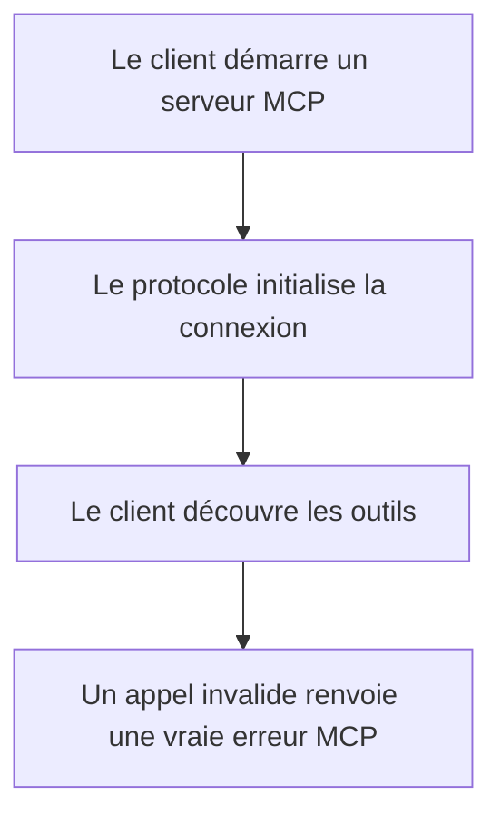
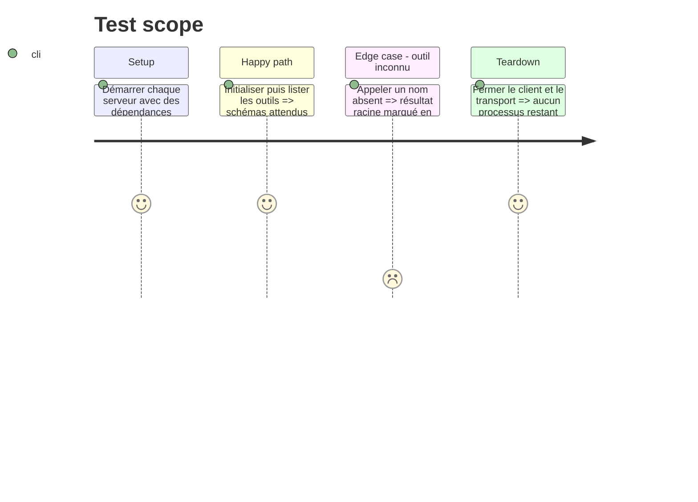

# Instruction: Fiabiliser le contrat MCP

## Architecture projection

> Tree of the final files. ✅ create · ✏️ modify · ❌ delete

```txt
MCP/agents-cours/
├── package.json                                             ✏️
├── src/interfaces/mcp/CreateurMCPServer.js                  ✏️
├── src/interfaces/mcp/ReviseurMCPServer.js                  ✏️
└── test/mcp/
    ├── createur-server.test.js                              ✅
    └── reviseur-server.test.js                              ✅
```

## User Journey



## Test Scope



## Tasks to do

### `1)` Installer une base de tests MCP

> Rendre les deux serveurs vérifiables sans appeler Symfony ni DeepSeek.

1. Ajouter le script Vitest au paquet MCP.
2. Injecter des doubles de use cases dans les tests.
3. Tester l'initialisation et la découverte complète des outils sur `stdio`.

### `2)` Corriger le contrat de résultat

> Respecter le schéma MCP pour les succès et les erreurs.

1. Déplacer `isError` à la racine du résultat d'appel d'outil.
2. Normaliser les erreurs inconnues en message sûr.
3. Vérifier qu'aucun journal applicatif n'est écrit sur `stdout`.

## Test acceptance criteria

| Task | Acceptance criteria |
| ---- | ------------------- |
| 1 | Les deux serveurs s'initialisent et publient respectivement leurs 8 et 5 outils sans accès réseau. |
| 2 | Un outil inconnu retourne `isError: true` au niveau attendu par un client MCP. |
