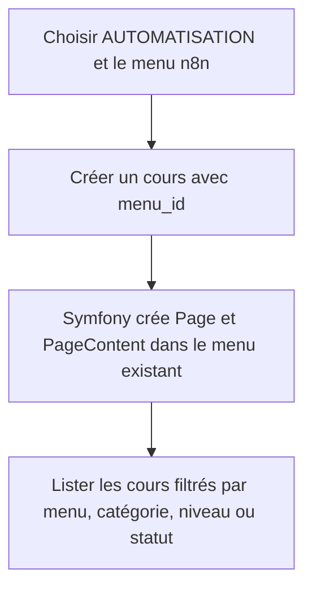
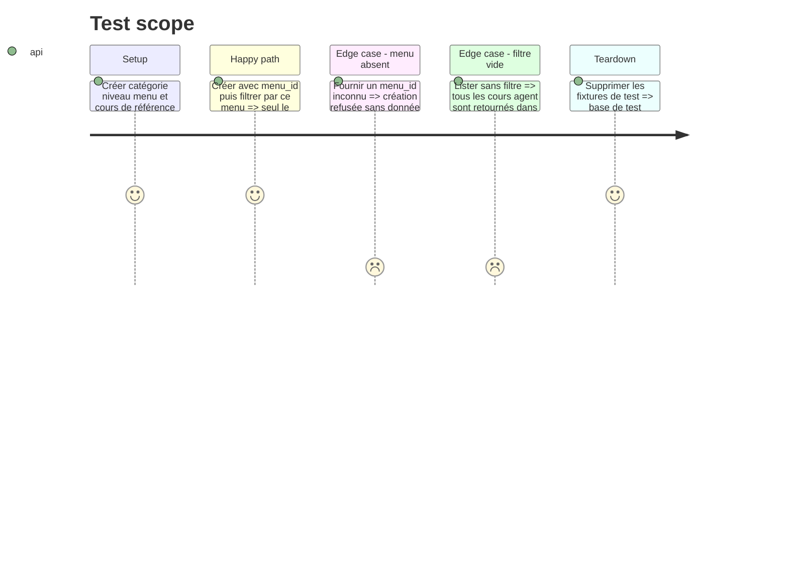

# Instruction: Rattacher et rechercher les cours

## Architecture projection

> Tree of the final files. ✅ create · ✏️ modify · ❌ delete

```txt
MCP/agents-cours/
├── src/domain/ports/ICoursRepository.js                     ✏️
├── src/domain/use-cases/CreerCours.js                       ✏️
├── src/domain/use-cases/ListerCours.js                      ✏️
├── src/infrastructure/api/SymfonyApiCoursRepository.js      ✏️
├── src/interfaces/mcp/CreateurMCPServer.js                  ✏️
└── test/domain/
    ├── creer-cours.test.js                                  ✅
    └── lister-cours.test.js                                 ✅
src/
├── Controller/Api/AdminCrud/ApiAgentCourseController.php    ✏️
├── Domain/PageContent/Repository/PageContentRepositoryInterface.php ✏️
└── Infrastructure/PageContent/Repository/DoctrinePageContentRepository.php ✏️
tests/Controller/Api/AdminCrud/ApiAgentCourseControllerTest.php ✅
```

## User Journey



## Test Scope



## Tasks to do

### `1)` Compléter `creer_cours`

> Permettre le rattachement à un menu existant ou la création nommée d'un menu.

1. Ajouter `menu_id` et `nouveau_menu_label` au schéma MCP.
2. Mapper ces champs vers `menuId` et `nouveauMenuLabel` dans le use case.
3. Retourner aussi `menuId`, `pageId` et `slug` fournis par Symfony.

### `2)` Ajouter `lister_cours`

> Exposer une liste complète et filtrable au lieu de la seule liste récente.

1. Accepter catégorie, menu, niveau, statut, limite et décalage.
2. Construire les paramètres HTTP dans le repository MCP.
3. Retourner des résultats structurés incluant catégorie, menu, niveau, statut et slug.

### `3)` Étendre la recherche Symfony

> Faire appliquer les filtres et la pagination par Symfony.

1. Ajouter `menuId`, limite et décalage à la route de liste des cours.
2. Étendre le repository Doctrine avec des paramètres optionnels de pagination.
3. Tester les filtres isolés et combinés.

## Test acceptance criteria

| Task | Acceptance criteria |
| ---- | ------------------- |
| 1 | Un cours créé avec `menu_id` apparaît sous ce menu et aucun menu supplémentaire n'est créé. |
| 2 | `lister_cours` retourne tous les cours attendus et respecte chaque filtre exposé. |
| 3 | Un filtre ou identifiant invalide produit une erreur explicite sans écriture partielle. |
