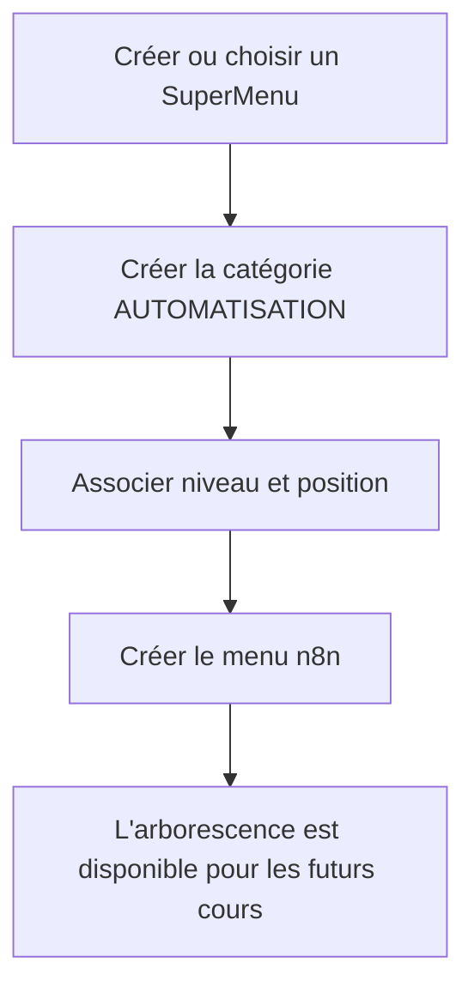
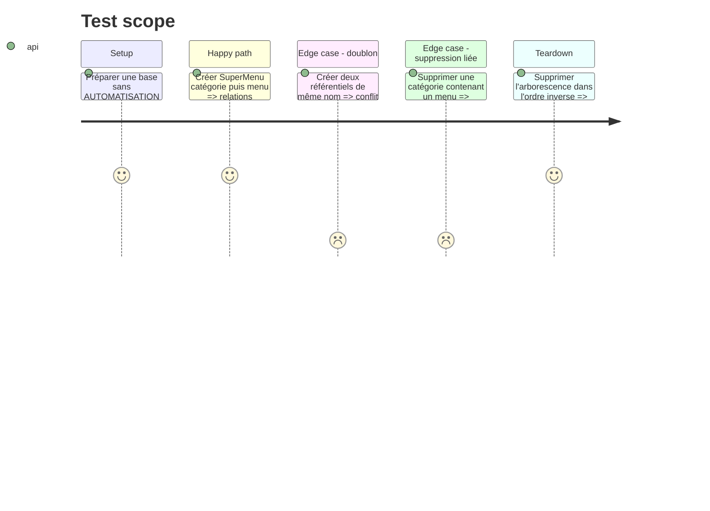

# Instruction: Gérer l'arborescence de navigation

## Architecture projection

> Tree of the final files. ✅ create · ✏️ modify · ❌ delete

```txt
MCP/agents-cours/
├── src/domain/ports/ICoursRepository.js                     ✏️
├── src/domain/use-cases/GererReferentiels.js                ✅
├── src/infrastructure/api/SymfonyApiCoursRepository.js      ✏️
├── src/infrastructure/di/container.js                       ✏️
├── src/interfaces/mcp/CreateurMCPServer.js                  ✏️
└── test/domain/gerer-referentiels.test.js                   ✅
src/
├── Controller/Api/AdminCrud/ApiCategoryController.php       ✏️
├── Controller/Api/AdminCrud/ApiSuperMenuController.php      ✅
├── Controller/Api/AdminCrud/ApiPositionMenuController.php   ✅
├── Domain/PositionMenu/Repository/PositionMenuRepositoryInterface.php ✏️
└── Infrastructure/PositionMenu/Repository/DoctrinePositionMenuRepository.php ✏️
tests/Controller/Api/AdminCrud/
├── ApiCategoryControllerTest.php                            ✅
├── ApiSuperMenuControllerTest.php                           ✅
└── ApiPositionMenuControllerTest.php                        ✅
```

## User Journey



## Test Scope



## Tasks to do

### `1)` Exposer les référentiels MCP

> Gérer catégories, niveaux, SuperMenus et positions depuis le serveur créateur.

1. Ajouter les outils de liste, création, modification et suppression autorisés.
2. Centraliser validation et résolution des identifiants dans `GererReferentiels`.
3. Étendre le port et le repository HTTP sans accès direct à Doctrine.

### `2)` Compléter les API d'administration Symfony

> Fournir des routes cohérentes sous `/api/admin` pour toute l'arborescence.

1. Ajouter le CRUD SuperMenu protégé par clé API.
2. Ajouter le CRUD des positions et compléter son repository hexagonal.
3. Permettre à une catégorie de recevoir `superMenuId`, `niveauCoursId` et `positionMenusId`.
4. Conserver les protections contre la suppression d'éléments encore liés.

### `3)` Compléter la gestion des menus

> Couvrir le cycle CRUD du groupe qui contient les cours.

1. Ajouter `supprimer_menu` au MCP.
2. Exposer les relations catégorie, niveau et position dans les réponses.
3. Vérifier les erreurs de références absentes et de menu non vide.

## Test acceptance criteria

| Task | Acceptance criteria |
| ---- | ------------------- |
| 1 | Le client MCP peut construire et relire `SuperMenu → Category → Menus` sans accès direct à la base. |
| 2 | Toutes les mutations sont protégées par `/api/admin` et refusent une clé absente ou invalide. |
| 3 | Une suppression destructive est refusée tant que des enfants sont associés. |
