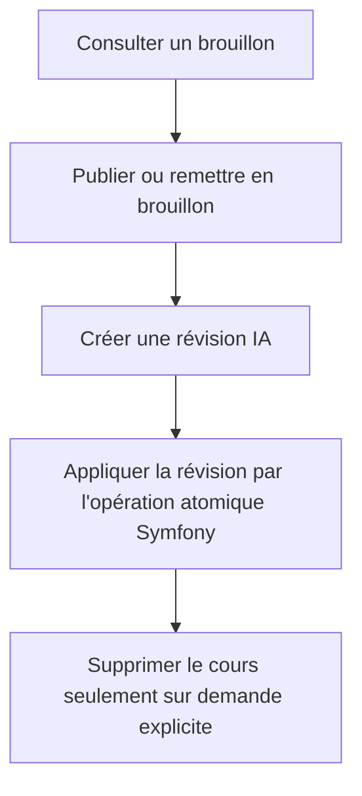
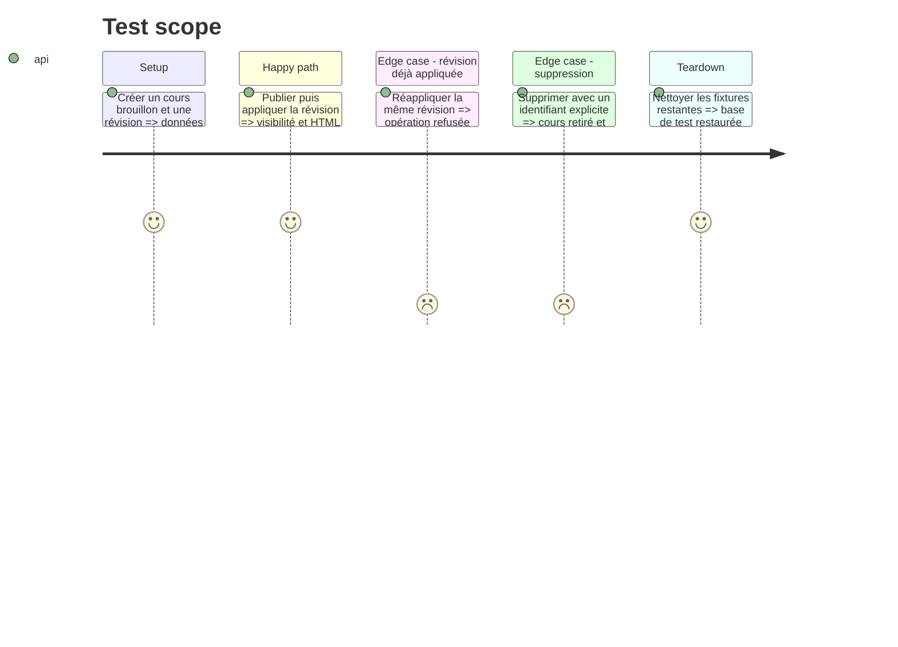

# Instruction: Gérer le cycle de vie et les révisions

## Architecture projection

> Tree of the final files. ✅ create · ✏️ modify · ❌ delete

```txt
MCP/agents-cours/
├── src/domain/ports/ICoursRepository.js                     ✏️
├── src/domain/use-cases/GererCours.js                       ✅
├── src/domain/use-cases/ReviserCours.js                     ✏️
├── src/infrastructure/api/SymfonyApiCoursRepository.js      ✏️
├── src/infrastructure/di/container.js                       ✏️
├── src/interfaces/mcp/CreateurMCPServer.js                  ✏️
├── src/interfaces/mcp/ReviseurMCPServer.js                  ✏️
└── test/domain/
    ├── gerer-cours.test.js                                  ✅
    └── reviser-cours.test.js                                ✅
src/
├── Application/AgentCourse/Command/DeleteAgentCourseCommand.php ✅
├── Application/AgentCourse/Handler/DeleteAgentCourseHandler.php ✅
└── Controller/Api/AdminCrud/ApiAgentCourseController.php    ✏️
tests/Controller/Api/AdminCrud/ApiAgentCourseLifecycleTest.php ✅
```

## User Journey



## Test Scope



## Tasks to do

### `1)` Exposer le cycle de vie des cours

> Permettre publication, retour en brouillon et suppression explicite.

1. Ajouter `publier_cours`, `mettre_cours_en_brouillon` et `supprimer_cours`.
2. Réutiliser la mise à jour Symfony pour la visibilité.
3. Ajouter une commande et un handler Symfony transactionnels pour supprimer le contenu et nettoyer ses relations.
4. Exposer le handler par une route Symfony de suppression.

### `2)` Rendre l'application d'une révision atomique

> Utiliser l'endpoint Symfony déjà dédié à l'application d'une révision.

1. Remplacer le workflow MCP en plusieurs lectures et écritures par l'appel `POST .../appliquer`.
2. Mapper la réponse contenant cours et révision.
3. Empêcher explicitement la réapplication d'une révision déjà appliquée côté Symfony.

### `3)` Stabiliser les erreurs métier

> Fournir des résultats MCP exploitables et sans ambiguïté.

1. Distinguer introuvable, validation, conflit et erreur distante.
2. Marquer toutes les erreurs avec `isError` à la racine.
3. Ne jamais inclure de secret ou de réponse brute sensible.

## Test acceptance criteria

| Task | Acceptance criteria |
| ---- | ------------------- |
| 1 | Un cours passe de brouillon à publié puis revient en brouillon via le MCP. |
| 2 | Une révision est appliquée en une seule opération Symfony et ne peut pas l'être deux fois. |
| 3 | Une suppression ou mutation impossible retourne une erreur MCP explicite et ne laisse aucun état partiel. |
