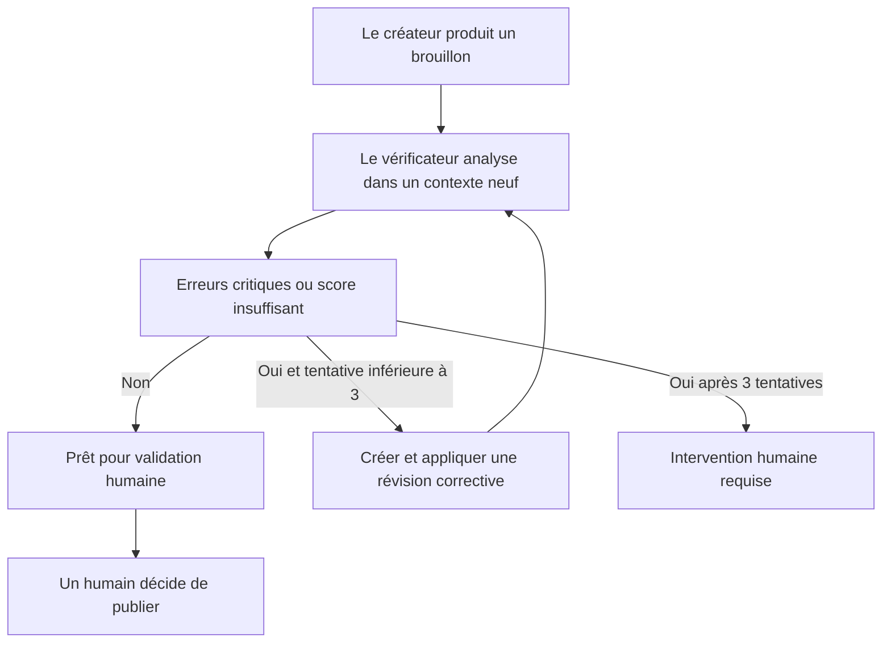
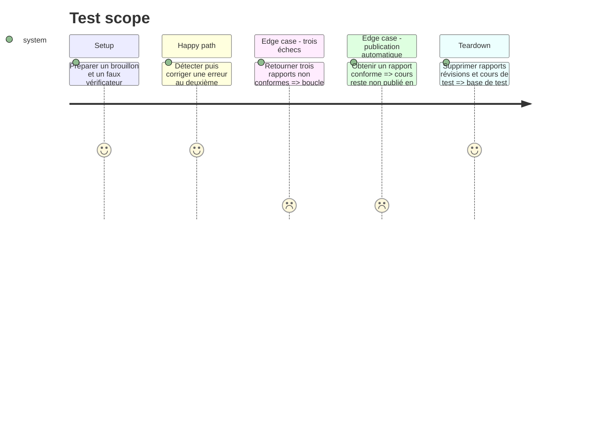

# Instruction: Ajouter l'agent vérificateur et la boucle de correction

## Architecture projection

> Tree of the final files. ✅ create · ✏️ modify · ❌ delete

```txt
MCP/agents-cours/
├── config/config.js                                         ✏️
├── package.json                                             ✏️
├── src/domain/entities/RapportVerification.js               ✅
├── src/domain/ports/IVerificationService.js                 ✅
├── src/domain/use-cases/BoucleVerification.js               ✅
├── src/domain/use-cases/VerifierCours.js                    ✅
├── src/infrastructure/di/container.js                       ✏️
├── src/infrastructure/ia/DeepSeekVerificationService.js     ✅
├── src/interfaces/mcp/VerificateurMCPServer.js              ✅
├── src/interfaces/mcp/verificateurServer.js                 ✅
└── test/verification/
    ├── boucle-verification.test.js                          ✅
    ├── rapport-verification.test.js                         ✅
    └── verificateur-server.test.js                          ✅
migrations/VersionAgentCourseVerification.php                ✅
src/
├── Controller/Api/AdminCrud/ApiAgentCourseController.php    ✏️
├── Controller/Api/AdminCrud/ApiAgentCourseVerificationController.php ✅
├── Domain/AgentCourseVerification/Repository/AgentCourseVerificationRepositoryInterface.php ✅
├── Entity/AgentCourseVerification.php                       ✅
└── Infrastructure/AgentCourseVerification/Repository/DoctrineAgentCourseVerificationRepository.php ✅
tests/Controller/Api/AdminCrud/ApiAgentCourseVerificationControllerTest.php ✅
```

## User Journey



## Test Scope



## Tasks to do

### `1)` Définir un rapport de vérification structuré

> Rendre chaque verdict explicable, stockable et exploitable.

1. Définir verdict, score, sévérité, erreurs factuelles, problèmes techniques, problèmes pédagogiques et corrections demandées.
2. Exiger une justification pour chaque constat et signaler les affirmations non vérifiables.
3. Rejeter les réponses du modèle qui ne respectent pas le schéma attendu.

### `2)` Créer un agent vérificateur séparé

> Vérifier sans réutiliser le contexte conversationnel du créateur.

1. Ajouter un port de vérification et une implémentation IA configurable.
2. Utiliser un prompt, une température et un contexte distincts du générateur.
3. Ajouter les outils `verifier_cours`, `lancer_boucle_verification` et `voir_verifications`.
4. Démarrer le troisième serveur par `npm run mcp:verificateur`.

### `3)` Implémenter la boucle limitée

> Corriger les problèmes sans cycle infini ni écrasement silencieux.

1. Vérifier le brouillon courant.
2. En cas d'échec, transformer le rapport en demande de révision ciblée.
3. Enregistrer et appliquer la correction comme une révision Symfony.
4. Recommencer au maximum trois fois.
5. Terminer par `pret_validation_humaine` ou `intervention_humaine_requise`.

### `4)` Persister l'audit dans Symfony

> Conserver toutes les tentatives et empêcher la publication automatique.

1. Ajouter l'entité et le repository de rapports liés au cours et à la révision produite.
2. Exposer création, liste et lecture des vérifications sous `/api/admin`.
3. Refuser la publication par l'API tant que le dernier rapport n'est pas prêt pour validation humaine.
4. Laisser l'action finale de publication à un administrateur authentifié.

## Test acceptance criteria

| Task | Acceptance criteria |
| ---- | ------------------- |
| 1 | Chaque rapport respecte un schéma stable et distingue erreur critique, avertissement et information. |
| 2 | Le vérificateur fonctionne dans un contexte séparé et ne possède aucun outil de publication. |
| 3 | La boucle s'arrête dès la conformité ou après exactement trois échecs, avec toutes les versions conservées. |
| 4 | Un cours généré ne peut jamais être publié automatiquement; un humain authentifié reste nécessaire. |
