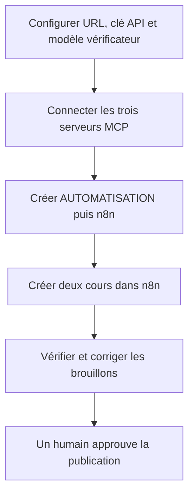
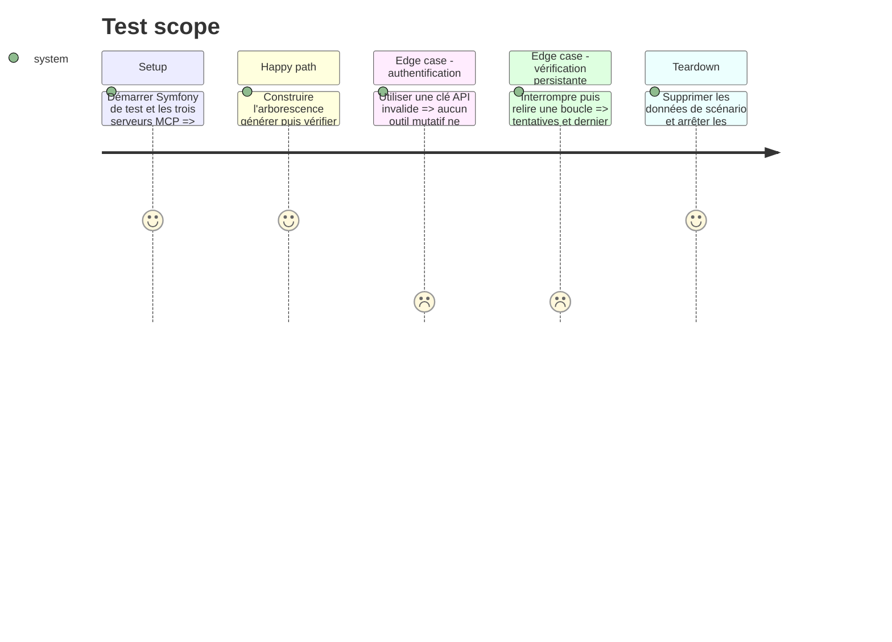

# Instruction: Valider l'intégration et documenter

## Architecture projection

> Tree of the final files. ✅ create · ✏️ modify · ❌ delete

```txt
MCP/agents-cours/
├── .env.example                                             ✏️
├── README.md                                                ✏️
├── docs/QUICKSTART.md                                       ✏️
├── docs/mcp-config.example.json                             ✅
├── package.json                                             ✏️
└── test/integration/symfony-workflow.test.js                ✅
documentations/API_MCP_DOCUMENTATION.md                      ✏️
```

## User Journey



## Test Scope



## Tasks to do

### `1)` Ajouter le scénario d'intégration complet

> Vérifier le besoin utilisateur réel sur les deux dépôts.

1. Démarrer Symfony avec une base de test isolée.
2. Piloter les trois serveurs MCP avec le SDK client officiel.
3. Créer l'arborescence, deux cours et leurs boucles de vérification.
4. Confirmer qu'aucune publication ne se produit sans action humaine.
5. Nettoyer les données même en cas d'échec.

### `2)` Fournir une configuration cliente sûre

> Rendre les serveurs installables sans enregistrer de secrets.

1. Ajouter un exemple de configuration pour les trois commandes `stdio`.
2. Documenter les variables d'environnement sans valeurs sensibles.
3. Vérifier que `.env` reste ignoré dans le dépôt MCP.

### `3)` Mettre la documentation à niveau

> Décrire les outils, paramètres, effets, vérifications et limites réels.

1. Documenter l'arborescence Symfony et le mapping des outils.
2. Expliquer la boucle, sa limite de trois tentatives et l'escalade humaine.
3. Signaler clairement les outils qui écrivent ou suppriment.
4. Ajouter un exemple complet sous `AUTOMATISATION → n8n`.
5. Expliquer que n8n reste optionnel et dans quels scénarios l'ajouter.

## Test acceptance criteria

| Task | Acceptance criteria |
| ---- | ------------------- |
| 1 | Le scénario complet passe, conserve les rapports et ne laisse aucune donnée de test. |
| 2 | Un client MCP connecte les trois serveurs à partir de l'exemple sans secret versionné. |
| 3 | La documentation reflète exactement les outils, les limites du contrôle IA et le rôle obligatoire de l'humain. |
