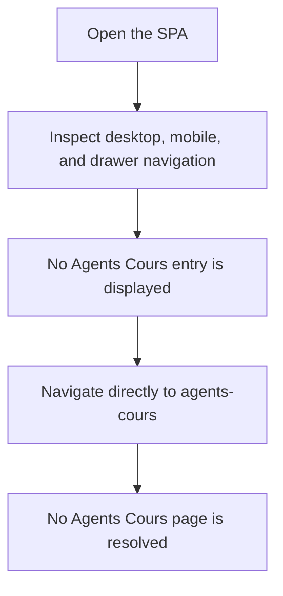
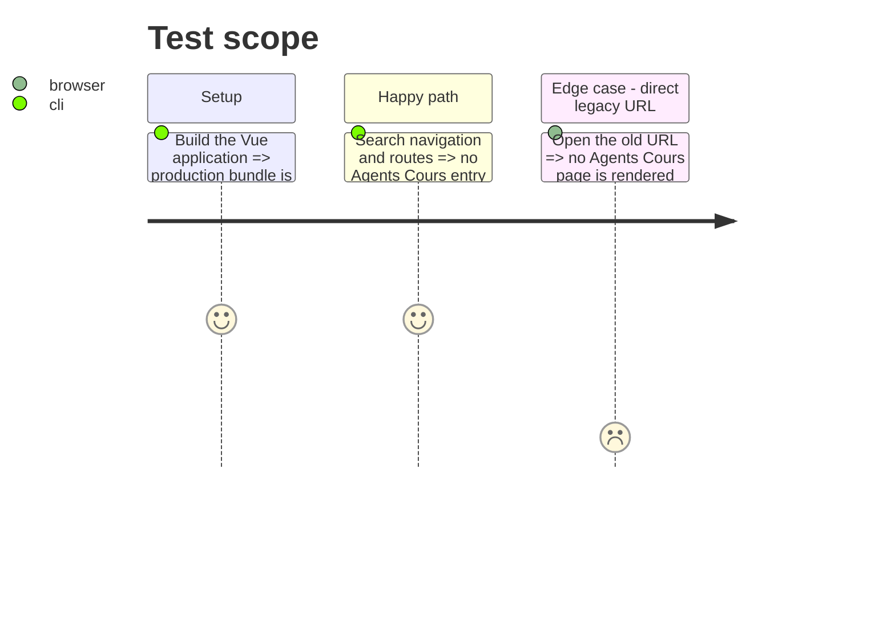

# Instruction: Remove the obsolete Agents Cours SPA surface

## Architecture projection

> Tree of the final files. ✅ create · ✏️ modify · ❌ delete

```txt
front/src/
├── components/
│   ├── features/agents/
│   │   ├── ❌ AgentsCoursForm.vue
│   │   └── ❌ AgentsCoursRevisionForm.vue
│   ├── layout/
│   │   ├── ✏️ AppHeader.vue
│   │   └── ✏️ AppHeaderMobile.vue
│   └── navigation/
│       └── ✏️ MenuLinks.vue
├── router/
│   └── ✏️ index.js
├── services/
│   └── ❌ agentsCoursService.js
└── views/
    └── ❌ AgentsCours.vue
```

## User Journey



## Test Scope



## Tasks to do

### `1)` Remove route and navigation access

> Make the obsolete page unreachable from the SPA and remove every navigation entry that points to it.

1. Remove the lazy view import and route definition.
2. Remove desktop, mobile, and drawer navigation links.

### `2)` Remove page-only frontend code

> Delete the view, both forms, and the Axios service that have no remaining consumers.

1. Delete the obsolete view and forms.
2. Delete the exclusively consumed service.
3. Confirm no source reference remains.

## Test acceptance criteria

| Task | Acceptance criteria |
| ---- | ------------------- |
| 1 | The SPA exposes no navigation entry or router record for Agents Cours. |
| 2 | The production Vue build succeeds and no Agents Cours frontend source reference remains. |
| 2 | Symfony and MCP agent-course code remains unchanged. |
