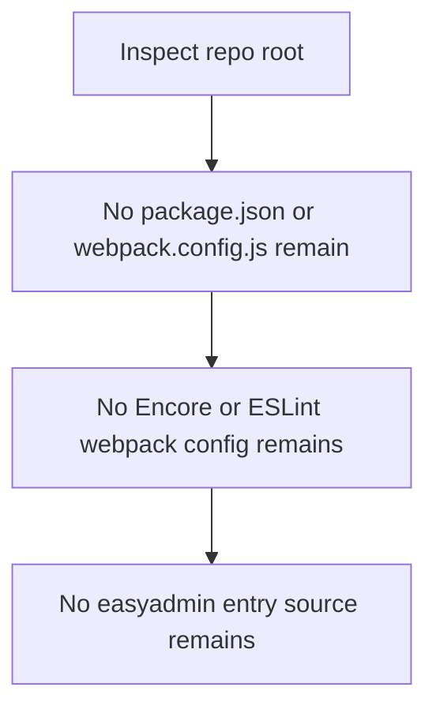
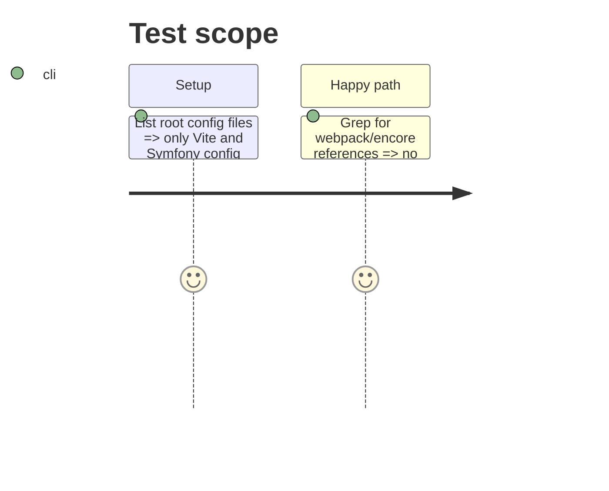

# Instruction: Remove Webpack Encore Node tooling

## Architecture projection

> Tree of the final files. ✅ create · ✏️ modify · ❌ delete

```txt
devdoc-local/
├── ❌ webpack.config.js
├── ❌ package.json
├── ❌ package-lock.json
├── ❌ eslint.config.js
├── ❌ .eslintrc.cjs
└── assets/
    └── ❌ easyadmin.js
```

## User Journey



## Test Scope



## Tasks to do

### `1)` Delete the Webpack Encore configuration

> Remove the root-level Encore and ESLint configuration files that only served the legacy EasyAdmin entry.

1. Delete `webpack.config.js`.
2. Delete `eslint.config.js` and `.eslintrc.cjs`.

### `2)` Delete the root Node manifest

> Remove the root `package.json`/`package-lock.json` whose sole purpose was building the EasyAdmin entry with Encore.

1. Delete `package.json`.
2. Delete `package-lock.json`.

### `3)` Delete the EasyAdmin entry source

1. Delete `assets/easyadmin.js`.

## Test acceptance criteria

| Task | Acceptance criteria |
| ---- | ------------------- |
| 1 | No `webpack.config.js`, `eslint.config.js`, or `.eslintrc.cjs` remain at the repo root. |
| 2 | No root `package.json` or `package-lock.json` remain. |
| 3 | No `assets/easyadmin.js` remains. |
