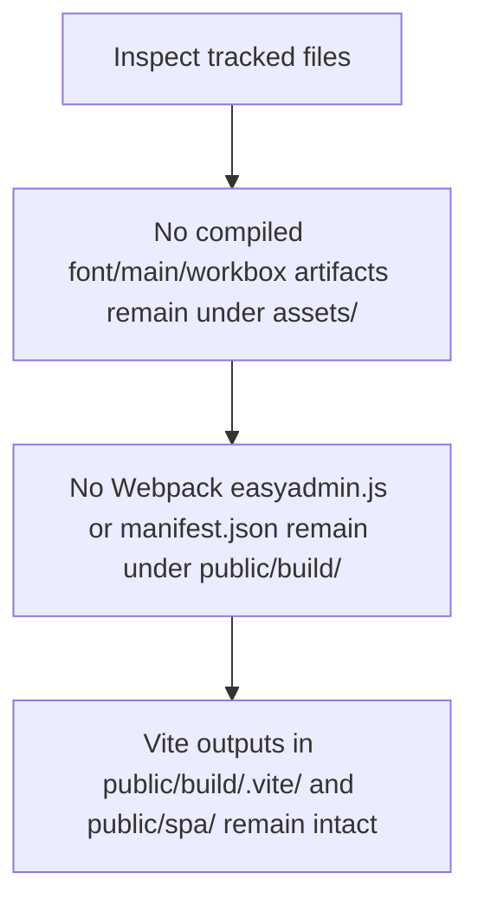
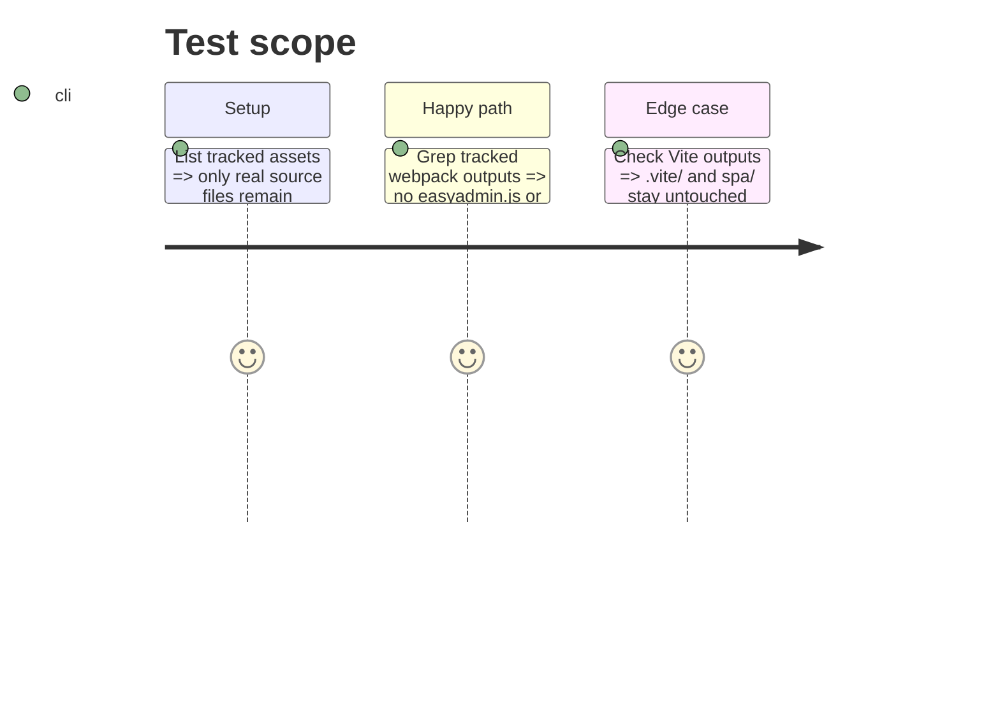

# Instruction: Remove committed build artifacts

## Architecture projection

> Tree of the final files. ✅ create · ✏️ modify · ❌ delete

```txt
devdoc-local/
├── ❌ assets/
│   ├── ❌ .vscode/settings.json
│   ├── ❌ fa-brands-400-*.{ttf,woff2}
│   ├── ❌ fa-regular-400-*.{ttf,woff2}
│   ├── ❌ fa-solid-900-*.{ttf,woff2}
│   ├── ❌ fa-v4compatibility-*.{ttf,woff2}
│   ├── ❌ main-*.css
│   ├── ❌ main-*.js
│   └── ❌ workbox-window.prod.es5-*.js
└── public/build/
    ├── ❌ easyadmin.js
    └── ❌ manifest.json
```

## User Journey



## Test Scope



## Tasks to do

### `1)` Remove build artifacts committed under `assets/`

> These hashed Font Awesome fonts, `main-*.css/js`, and `workbox-*.js` are compiled outputs committed by mistake; the real ones live in `public/build/assets/`.

1. Delete the Font Awesome font files (`fa-*.ttf`, `fa-*.woff2`).
2. Delete `main-*.css` and `main-*.js`.
3. Delete `workbox-window.prod.es5-*.js`.
4. Delete `assets/.vscode/settings.json`; remove the `assets/` directory when empty.

### `2)` Remove Webpack output under `public/build/`

1. Delete `public/build/easyadmin.js`.
2. Delete `public/build/manifest.json` (the Encore manifest; Vite uses `public/build/.vite/`).

## Test acceptance criteria

| Task | Acceptance criteria |
| ---- | ------------------- |
| 1 | No compiled `fa-*`, `main-*`, or `workbox-*` artifact remains tracked under `assets/`. |
| 2 | `public/build/easyadmin.js` and the Webpack `public/build/manifest.json` are gone; `public/build/.vite/` and `public/spa/` are untouched. |
