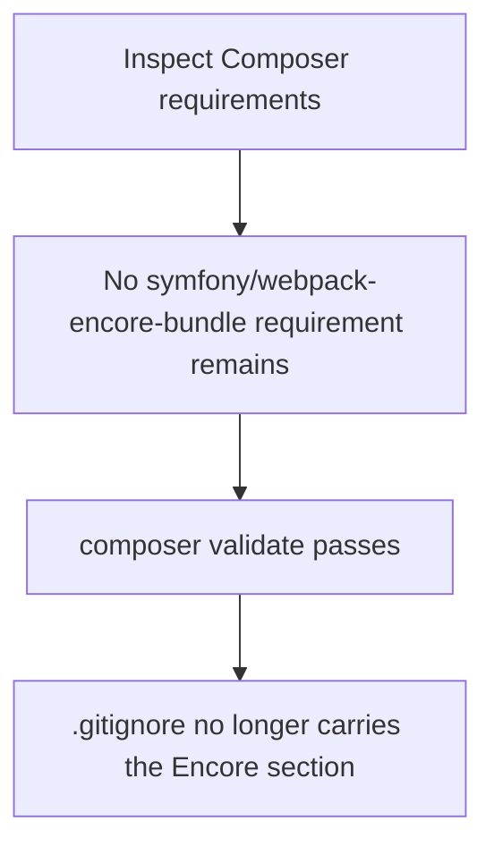
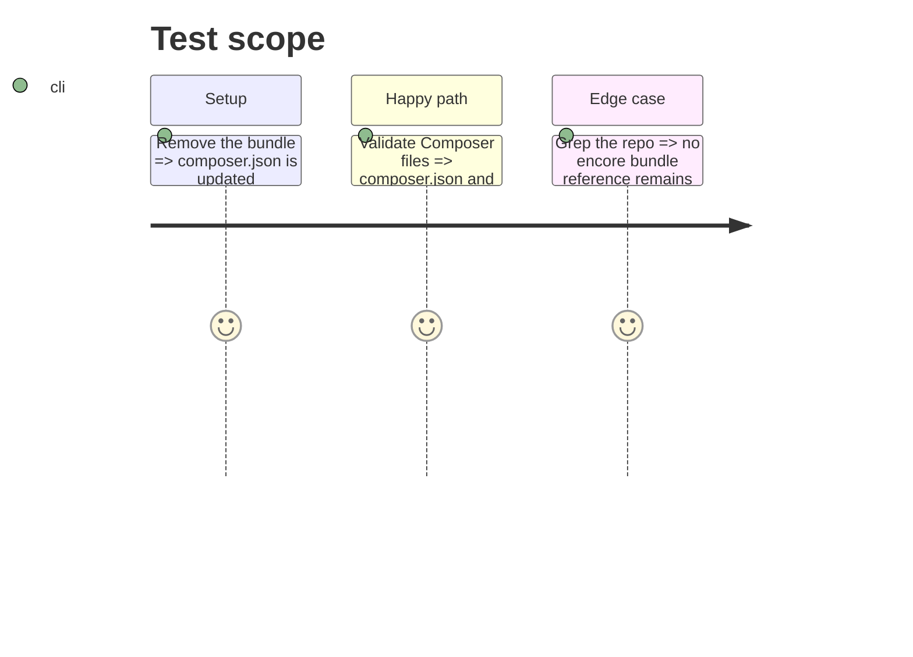

# Instruction: Remove `symfony/webpack-encore-bundle`

## Architecture projection

> Tree of the final files. ✅ create · ✏️ modify · ❌ delete

```txt
devdoc-local/
├── ✏️ composer.json
├── ✏️ composer.lock
└── ✏️ .gitignore
```

## User Journey



## Test Scope



## Tasks to do

### `1)` Remove the Composer requirement

1. Run `composer remove symfony/webpack-encore-bundle --no-interaction` so both `composer.json` and `composer.lock` are updated consistently.

### `2)` Clean up `.gitignore`

1. Remove the `###> symfony/webpack-encore-bundle ###` section (the `/node_modules/` entry it guards is no longer needed at the repo root).

## Test acceptance criteria

| Task | Acceptance criteria |
| ---- | ------------------- |
| 1 | `composer.json` and `composer.lock` no longer reference `symfony/webpack-encore-bundle`, and `composer validate` succeeds. |
| 2 | `.gitignore` no longer contains the `symfony/webpack-encore-bundle` section. |
