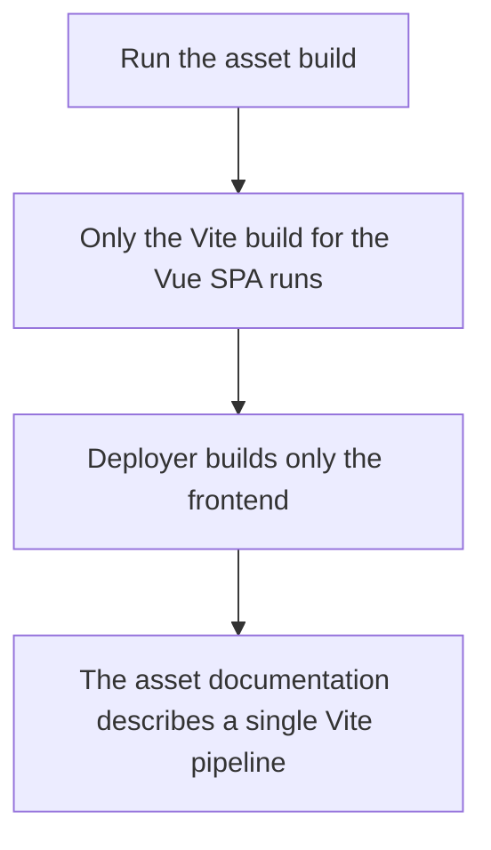
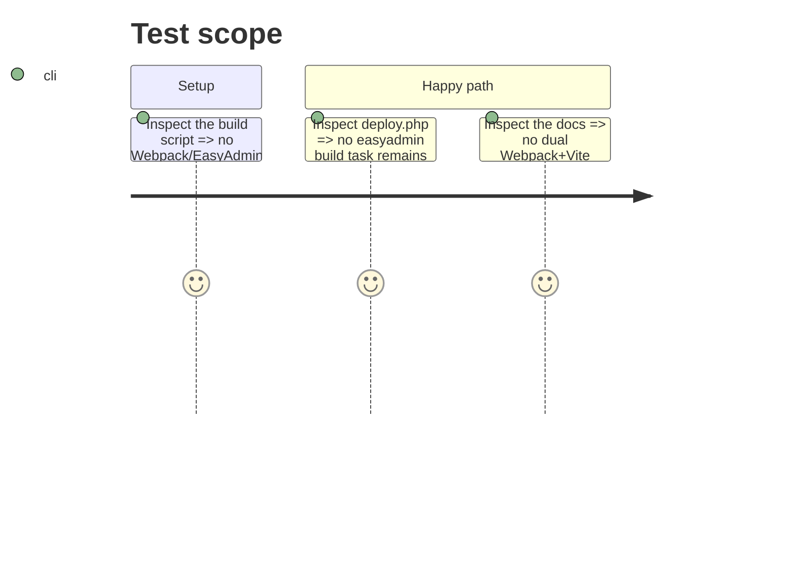

# Instruction: Update build scripts and documentation

## Architecture projection

> Tree of the final files. ✅ create · ✏️ modify · ❌ delete

```txt
devdoc-local/
├── ✏️ build-assets.sh
├── ✏️ deploy.php
└── ✏️ documentations/ASSETS_README.md
```

## User Journey



## Test Scope



## Tasks to do

### `1)` Simplify `build-assets.sh` to Vite only

1. Remove the Webpack/EasyAdmin build step and its output checks.
2. Keep the Vite build (`cd front && BUILD_OUTPUT_DIR=... PWA_OUTPUT_DIR=... npm run build`).
3. Update the summary text to describe a single Vite pipeline.

### `2)` Remove the EasyAdmin build task from `deploy.php`

1. Delete the `easyadmin:build` task.
2. Reduce `assets:build` to only `frontend:build`.

### `3)` Rewrite `documentations/ASSETS_README.md`

1. Remove all Webpack Encore sections and the dual-system structure.
2. Document the Vite-only pipeline, its commands, output layout, and Docker usage.

## Test acceptance criteria

| Task | Acceptance criteria |
| ---- | ------------------- |
| 1 | `build-assets.sh` contains no Webpack/EasyAdmin step and still builds the Vue SPA. |
| 2 | `deploy.php` no longer defines `easyadmin:build`; `assets:build` runs only `frontend:build`. |
| 3 | `ASSETS_README.md` describes only the Vite pipeline with no Webpack reference. |
