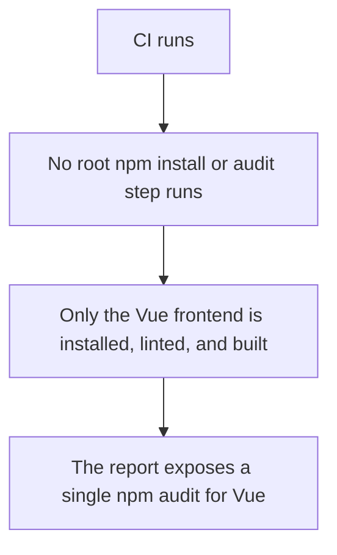
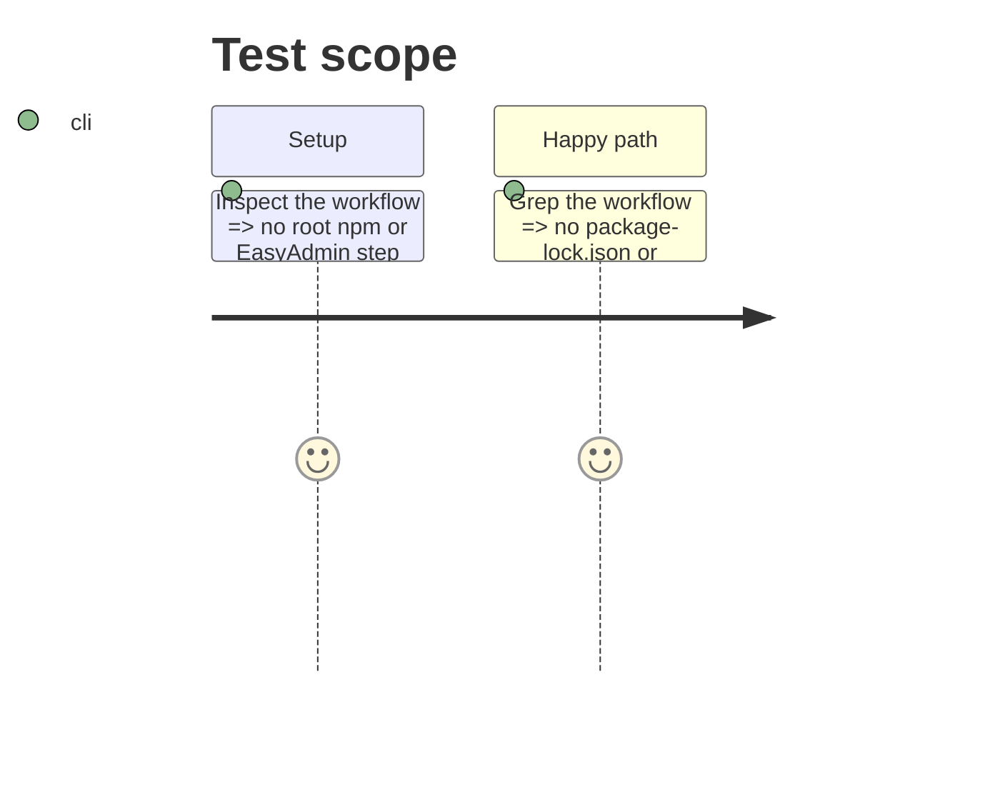

# Instruction: Update CI/CD workflow

## Architecture projection

> Tree of the final files. ✅ create · ✏️ modify · ❌ delete

```txt
devdoc-local/
└── .github/workflows/ci.yml
```

## User Journey



## Test Scope



## Tasks to do

### `1)` Drop root npm from dependency install

1. Remove the `Install root JavaScript dependencies` step.
2. Remove `package-lock.json` from the `cache-dependency-path` list (keep `front/package-lock.json`).

### `2)` Drop root npm from frontend quality

1. Remove the root `npm ci` and `npm run lint` steps and the `eslint` output id.
2. Keep the Vue `npm ci --prefix front` and `npm run check --prefix front` steps.

### `3)` Drop root npm audit from security

1. Remove the root `npm audit` step and its `root_npm_audit` output id.
2. Update the `report` job to remove the `Root npm audit` line.

### `4)` Drop EasyAdmin build from release

1. Remove the `Build EasyAdmin assets` step.
2. Keep the `Build Vue assets` step.

## Test acceptance criteria

| Task | Acceptance criteria |
| ---- | ------------------- |
| 1 | No root `npm ci`/`npm install` step or root `package-lock.json` cache path remains. |
| 2 | No root lint step remains; the Vue `npm run check` step is kept. |
| 3 | No root `npm audit` step or `Root npm audit` report line remains. |
| 4 | No `Build EasyAdmin assets` step remains; the Vue build step is kept. |
