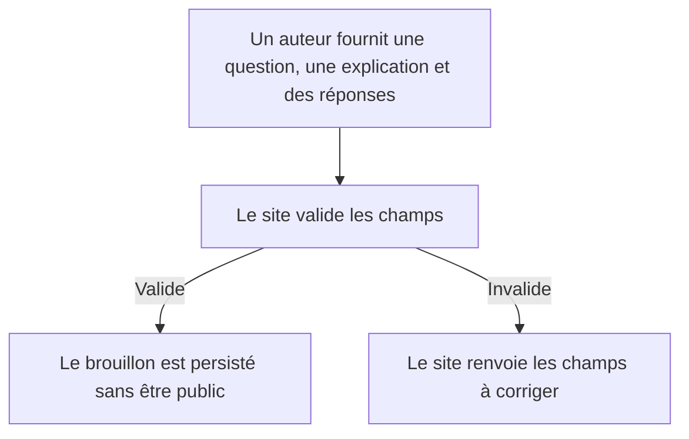
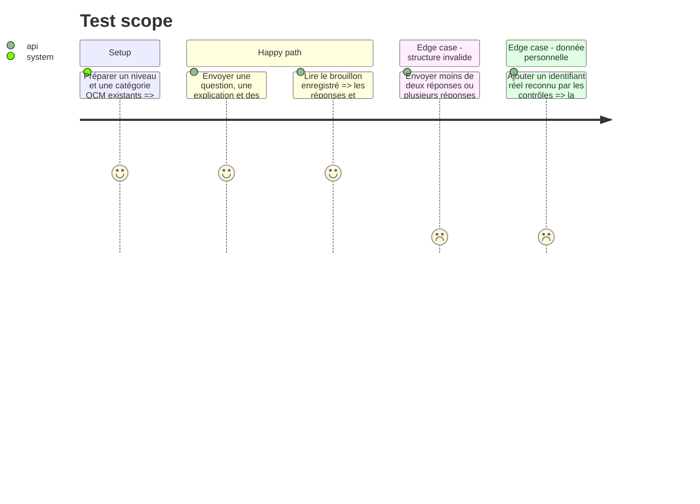

# Instruction : Stocker et contrôler un brouillon QCM

## Architecture projection

> Fichiers créés ou modifiés dans cette phase.

```txt
.
├── src/Entity/QcmDraft.php ✅ brouillon isolé du modèle public QCM
├── src/Service/Redaction/QcmDraftService.php ✅ opérations de création, lecture et mise à jour du brouillon
├── src/Service/Redaction/QcmDraftChecker.php ✅ contrôles structurels et données personnelles
├── src/Service/Redaction/PersonalDataChecker.php ✅ détection partagée des données personnelles
├── src/Service/Redaction/DraftChecker.php ✏️ délègue la détection au service partagé
├── migrations/Version* ✅ table et relations persistées
├── tests/Service/Redaction/QcmDraftServiceTest.php ✅ validation et transitions du brouillon
└── tests/Service/Redaction/PersonalDataCheckerTest.php ✅ règles de détection communes
```

## User Journey



## Test Scope



## Tasks to do

### `1)` Définir le brouillon éditorial QCM

> Séparer l'état de travail de l'entité QCM immédiatement lisible par le site.

1. Créer `QcmDraft` sans `ApiResource`, avec la question, l'explication, une collection JSON de réponses, les références de niveau et de langue/thème, le statut, l'auteur, le rapport de relecture et le QCM publié lié.
2. Garder les statuts explicites brouillon, à corriger et publié ; ne pas créer de route API publique pour cette entité.
3. Générer une nouvelle migration Doctrine ; ne jamais modifier une migration déjà commitée.

### `2)` Ajouter les opérations métier et les contrôles

> Refuser un QCM incomplet ou ambigu avant la relecture.

1. Créer `QcmDraftService` pour créer, lister, lire et modifier les brouillons, en attribuant l'identité du connecteur auteur côté serveur.
2. Créer `QcmDraftChecker` : question non vide et limitée à 255 caractères ; explication globale présente ; de 2 à 6 réponses non vides de 255 caractères maximum ; exactement une bonne réponse ; métadonnées choisies dans les références existantes.
3. Extraire la détection actuellement privée dans `DraftChecker` vers `PersonalDataChecker`, puis l'utiliser depuis les contrôles cours et QCM ; renvoyer des erreurs structurées avec le nom du champ.
4. Effacer le rapport de relecture à chaque modification du contenu.

### `3)` Tester l'isolement et les validations

> Prouver que les brouillons restent hors du catalogue public.

1. Tester les limites de champs, le nombre de réponses, l'unicité de la bonne réponse et les métadonnées inexistantes.
2. Vérifier les identifiants personnels et les cas permis pour les deux consommateurs du validateur partagé.
3. Vérifier qu'une création valide ne crée encore ni `QCM` ni `ChoicesQCM` publics.
4. Vérifier qu'une modification rend le rapport de relecture caduc.

## Test acceptance criteria

| Task | Acceptance criteria |
| --- | --- |
| 1 | Un brouillon est persisté sans être exposé par les ressources publiques `QCM` ou `ChoicesQCM`. |
| 2 | Les brouillons valides sont enregistrés ; les cas invalides renvoient une erreur exploitable ; modifier un brouillon efface la relecture. |
| 3 | Les tests prouvent l'isolation avant publication et couvrent les bornes de réponses. |
