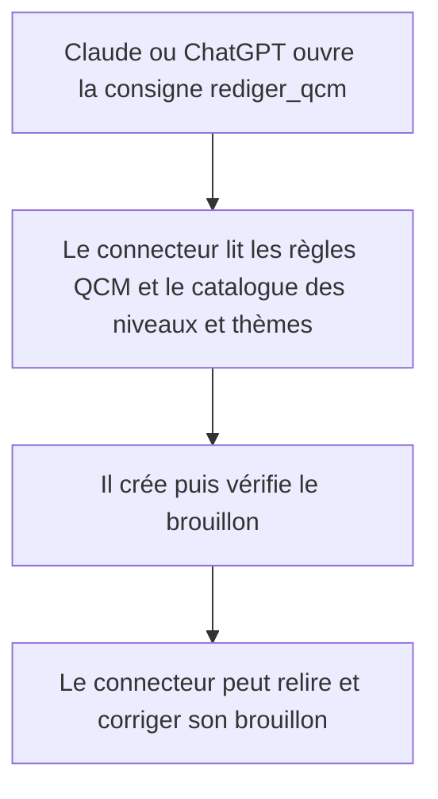
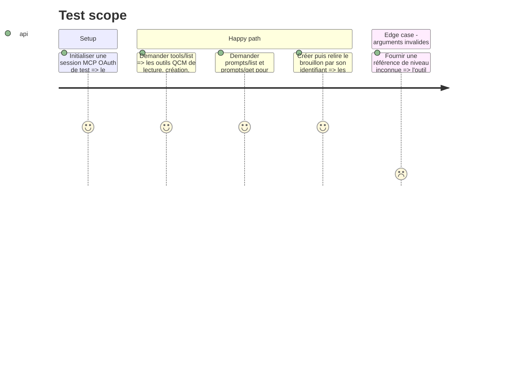

# Instruction : Exposer la rédaction QCM dans le connecteur MCP

## Architecture projection

> Fichiers créés ou modifiés dans cette phase.

```txt
.
├── src/Mcp/RedactionMcpServer.php ✏️ outils MCP, prompt de rédaction et prompt de relecture QCM
├── docs/CONNECTEUR.md ✏️ parcours d'usage et tableau des outils QCM
├── regles/README.md ✏️ index du référentiel QCM
├── regles/06-qcm.md ✅ règles de rédaction et de relecture des QCM
├── regles/controles.md ✏️ contrôles automatiques QCM
└── tests/Functional/Mcp/QcmConnectorTest.php ✅ contrat MCP et workflow d'auteur
```

## User Journey



## Test Scope



## Tasks to do

### `1)` Déclarer les outils MCP QCM

> Donner aux deux connecteurs le même contrat de création et de consultation.

1. Injecter le service de brouillons dans `RedactionMcpServer`.
2. Ajouter `lister_catalogue_qcm` pour renvoyer les identifiants et libellés des métadonnées effectivement requises par le parcours public.
3. Ajouter `lister_brouillons_qcm`, `voir_brouillon_qcm`, `creer_brouillon_qcm`, `modifier_brouillon_qcm` et `verifier_brouillon_qcm`, avec des schémas JSON explicites, des limites de taille et des annotations lecture/écriture correctes.
4. Maintenir les identifiants de brouillon distincts des identifiants des cours pour éviter toute confusion entre familles de contenus.

### `2)` Ajouter les consignes de rédaction et de relecture

> Faire apparaître le QCM comme une tâche proposée par le connecteur et encadrer sa qualité pédagogique.

1. Ajouter les prompts `rediger_qcm` et `relire_qcm`, dédiés à la question, aux distracteurs, à la réponse correcte et à l'explication.
2. Créer `regles/06-qcm.md` avec des règles de projet : une seule bonne réponse, distracteurs plausibles et non piégeux, langage clair, correction explicative et absence de données personnelles.
3. Ajouter des contrôles automatiques vérifiables à `regles/controles.md`, sans prétendre automatiser la qualité pédagogique.
4. Mettre à jour l'index des règles et `docs/CONNECTEUR.md` pour les deux clients Claude et ChatGPT.

### `3)` Tester la découverte MCP et la rédaction

> Assurer que le client peut découvrir les outils et suivre le parcours sans appel implicite.

1. Tester tools/list, prompts/list et prompts/get avec les fixtures des deux identités MCP.
2. Tester le cycle création, liste, détail, vérification et correction du brouillon.
3. Tester que les descriptions demandent la relecture d'un connecteur distinct avant publication.

## Test acceptance criteria

| Task | Acceptance criteria |
| --- | --- |
| 1 | Le client MCP reçoit les outils QCM avec schémas et annotations conformes au contrat ; les erreurs de références sont compréhensibles. |
| 2 | Le client découvre les prompts QCM et les règles demandent une question claire, une seule bonne réponse, des distracteurs adaptés et une correction pédagogique. |
| 3 | Les tests fonctionnels parcourent la création et la vérification en MCP avec les identités Claude et ChatGPT. |
