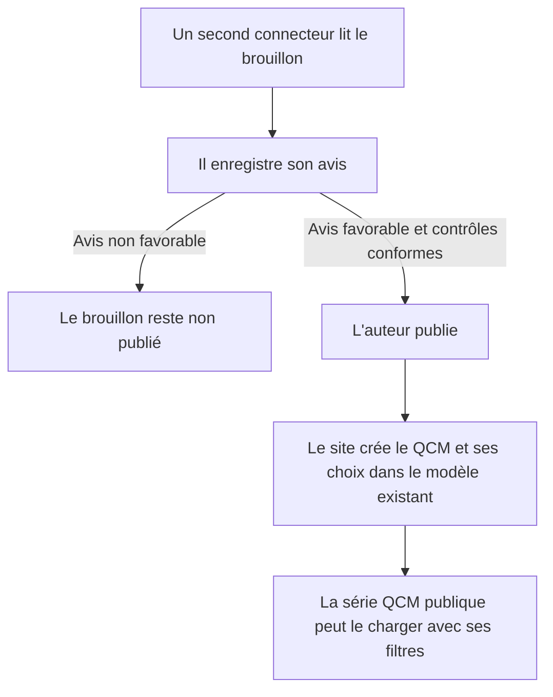
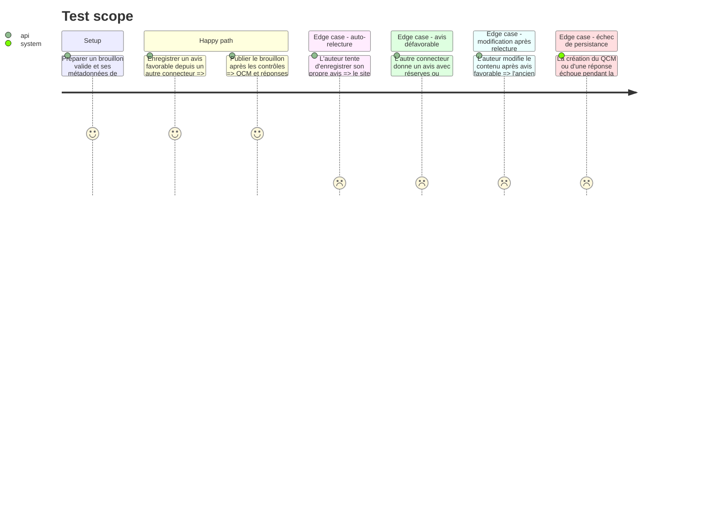

# Instruction : Relire, publier et rendre le QCM accessible

## Architecture projection

> Fichiers créés ou modifiés dans cette phase.

```txt
.
├── src/Service/Redaction/QcmDraftService.php ✏️ relecture croisée et publication atomique
├── src/Mcp/RedactionMcpServer.php ✏️ outils d'enregistrement de relecture et de publication QCM
├── docs/CONNECTEUR.md ✏️ prérequis, refus et résultat de publication
├── tests/Functional/Mcp/QcmConnectorTest.php ✏️ relecture croisée, changements et publication
└── tests/Functional/QCMApiTest.php ✅ visibilité seulement après publication et format public attendu
```

## User Journey



## Test Scope



## Tasks to do

### `1)` Implémenter la revue croisée

> Réserver l'avis au connecteur différent de l'auteur et au contenu qui a été contrôlé.

1. Ajouter `enregistrer_relecture_qcm` avec `avis`, résumé et constats liés aux identifiants des règles QCM.
2. Rejeter l'auto-relecture et enregistrer l'identité distincte du relecteur.
3. Rendre la relecture caduque après toute modification et interdire la revue d'un QCM déjà publié.

### `2)` Publier vers le modèle QCM existant

> Créer une publication cohérente, consommable par le frontend et administrable dans EasyAdmin.

1. Ajouter `publier_qcm`, réservé aux brouillons sans contrôle bloquant et ayant une relecture favorable d'un autre connecteur.
2. Dans une transaction, créer `QCM` avec la question, l'explication et les relations de métadonnées, puis créer chaque `ChoicesQCM` avec son libellé, son exactitude et son explication.
3. Enregistrer sur le brouillon son statut publié et l'identifiant du QCM créé ; empêcher une seconde publication.
4. Laisser les scores côté navigateur, sans persister de tentative ou de résultat.

### `3)` Vérifier la compatibilité publique et documenter

> Prouver que le QCM publié fonctionne avec les routes et structures déjà consommées.

1. Tester les recherches par métadonnées existantes et la sortie de l'API Platform utilisée par `front/src/views/QCM/questionQCM.vue`.
2. Vérifier qu'un brouillon n'apparaît pas dans `/api/q_c_ms` et que le QCM publié apparaît avec `titre`, `solution` et `choicesQCMs` attendus.
3. Mettre à jour le guide connecteur avec les étapes, le refus de publication, l'adresse publique du QCM et les limites de la première version.

## Test acceptance criteria

| Task | Acceptance criteria |
| --- | --- |
| 1 | Seul un autre connecteur peut fournir un avis ; toute modification efface cet avis ; un avis non favorable bloque la publication. |
| 2 | Une publication crée exactement un QCM et toutes ses réponses, ou rien si une écriture échoue. Une seconde publication ne crée pas de doublon. |
| 3 | Le QCM est absent des API publiques avant publication et rejoint le parcours existant après ; aucune tentative ou note n'est enregistrée côté serveur. |
