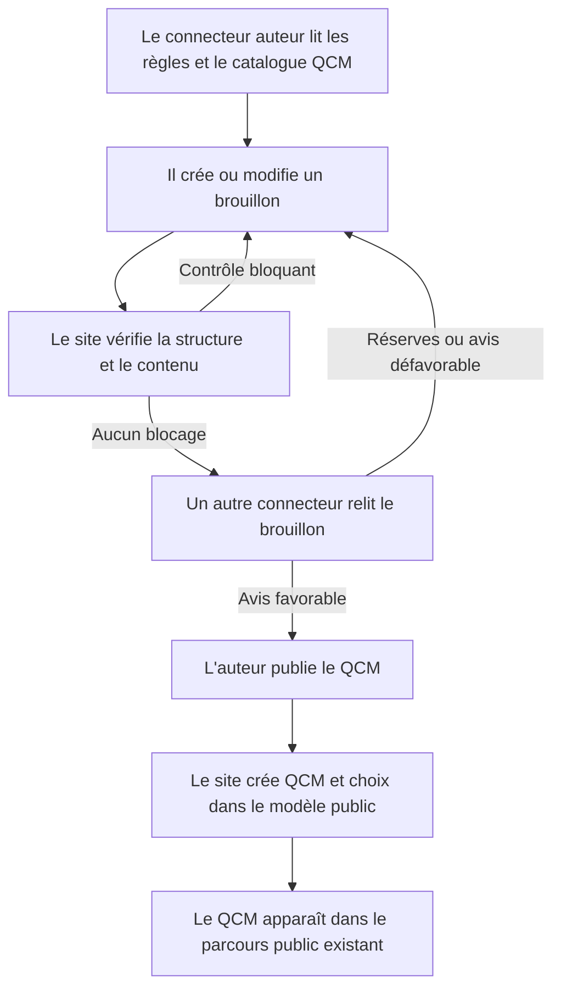

# Plan : Créer un QCM avec le connecteur MCP

## Overview

| Field | Value |
| --- | --- |
| **Goal** | Ajouter au connecteur MCP le parcours complet de rédaction, contrôle, relecture croisée et publication d'un QCM compatible avec le catalogue public existant. |
| **Source** | Demande utilisateur : « le code connecteur mcp ne propose pas de creer un qcm fait un plan pour implementer » |

## Phases

| # | Phase | File |
| --- | --- | --- |
| 1 | Brouillon et contrôles QCM | [`phase-1.md`](./phase-1.md) |
| 2 | Outils et consignes MCP | [`phase-2.md`](./phase-2.md) |
| 3 | Relecture, publication et intégration publique | [`phase-3.md`](./phase-3.md) |

## Decisions

| Decision | Why |
| --- | --- |
| Garder les QCM non publiés dans une entité de brouillon séparée de `QCM`. | Les endpoints publics actuels ne filtrent pas de statut. La séparation empêche toute exposition avant publication sans changer leur contrat. |
| À la publication, convertir le brouillon en `QCM` et `ChoicesQCM` existants. | Le frontend consomme déjà ces entités et leurs relations ; le résultat publié suit le format attendu. |
| Exiger les contrôles automatiques et l'avis favorable d'un autre connecteur avant publication. | Cela reprend le flux éditorial du connecteur de cours et empêche l'auteur de valider son propre contenu. |
| Hypothèse à confirmer : créer d'abord des QCM autonomes dans le catalogue actuel, avec ses filtres actuels de langue et de niveau. | Le modèle ne relie pas un QCM à un cours, un module ou un public. La page publique exige actuellement langue et niveau ; il faut confirmer si « langue » reste un filtre pertinent pour les QCM de médiation avant d'implémenter le parcours. |

## Architecture et périmètre

Le modèle existant représente une question par `QCM.titre`, son explication par `QCM.solution` et ses réponses par les `ChoicesQCM`. Le frontend public filtre aujourd'hui sur `LanguageQCM` et `NiveauQCM` et attend les deux valeurs pour démarrer une série. Le plan prévoit de réutiliser ces métadonnées, de les rendre visibles au connecteur par un outil de catalogue, puis de vérifier leur adéquation éditoriale avant implémentation.

Les brouillons ne deviennent pas des ressources API publiques. Aucun résultat ni score d'apprenant n'est créé. L'édition d'un QCM déjà publié et une file de relecture humaine ne font pas partie de cette première portée.

## Parcours utilisateur

## Mise en œuvre (15 octobre 2026)

Réalisé sur la branche `feat/qcm-connecteur-mcp`. Écarts et compléments par rapport au plan :

| Point | Décision prise |
| --- | --- |
| Hypothèse langue / niveau | Gardée telle quelle : le thème du QCM est l'entité `LanguageQCM` (filtre « langage » de DevDoc), sans changer le front. Le renommage du filtre public reste à décider. |
| Création des thèmes et niveaux | Non exposée au connecteur : ils se créent dans le back-office, comme le reste du catalogue public QCM. |
| Moment des contrôles | Les contrôles bloquants s'appliquent dès la création et la modification : un brouillon invalide ou contenant une donnée personnelle n'est jamais enregistré. |
| Texte → HTML | Le front affiche les champs QCM en HTML : la publication échappe le texte et forme des paragraphes. La limite de 255 caractères porte sur le texte converti. |
| Explication par réponse | Facultative, avec un avertissement (`EXPLICATION_REPONSE_MANQUANTE`) pour chaque réponse fausse sans explication. |
| Statut `a_corriger` | Fixé par une relecture avec réserves ou défavorable ; toute modification repasse le brouillon en `brouillon`. |
| Relecture partagée | Le traitement du rapport de relecture est extrait dans `ReviewReport`, utilisé par les cours et les QCM. |
| Emplacement des tests | `tests/Service/` (comme `DraftCheckerTest`) et `tests/Functional/Mcp/QcmConnectorTest.php`, qui couvre aussi l'API publique. |

Évolution du 16 octobre 2026 : les brouillons créés par le connecteur sont également visibles en lecture dans le back-office, sous QCM → Brouillons du connecteur. La validation, la correction structurée et la publication continuent d'utiliser les contrôles et la relecture du connecteur. Cela corrige la décision initiale de laisser les brouillons hors du back-office.

Évolutions du 16 octobre 2026 :

- Le connecteur peut créer un thème et un niveau QCM après accord de la personne, puis les réutiliser pour le brouillon demandé. `creer_theme_qcm` et `creer_niveau_qcm` renvoient l'identifiant existant si le nom est déjà présent ; la décision initiale de réserver la création au back-office est remplacée.
- Les brouillons créés par le connecteur sont visibles en consultation dans le back-office sous QCM → Brouillons du connecteur. Leur validation, leur correction structurée et leur publication gardent les contrôles et la relecture du connecteur ; la décision initiale de les garder hors du back-office est remplacée.
