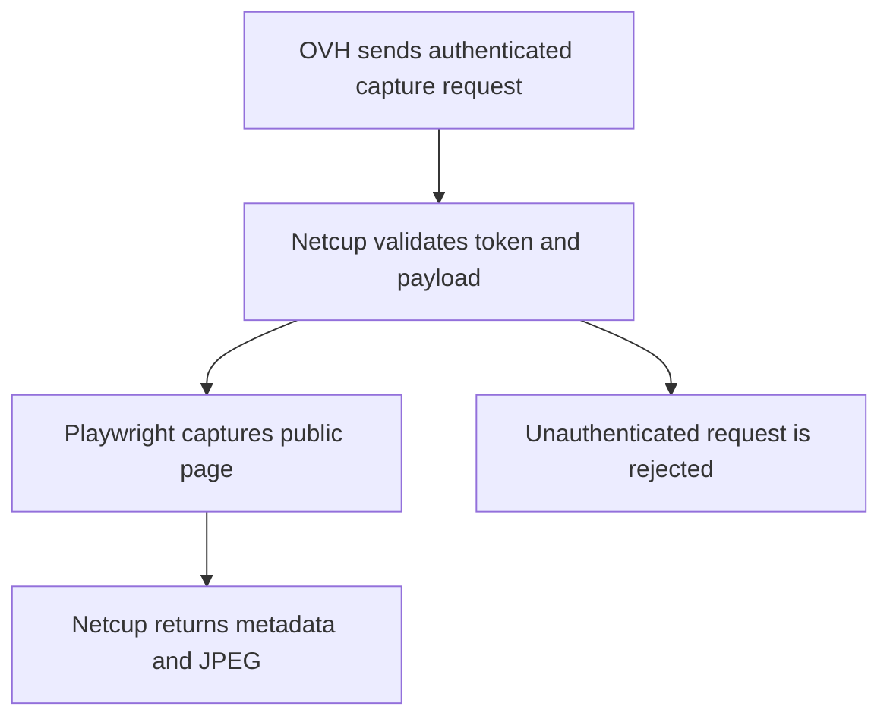
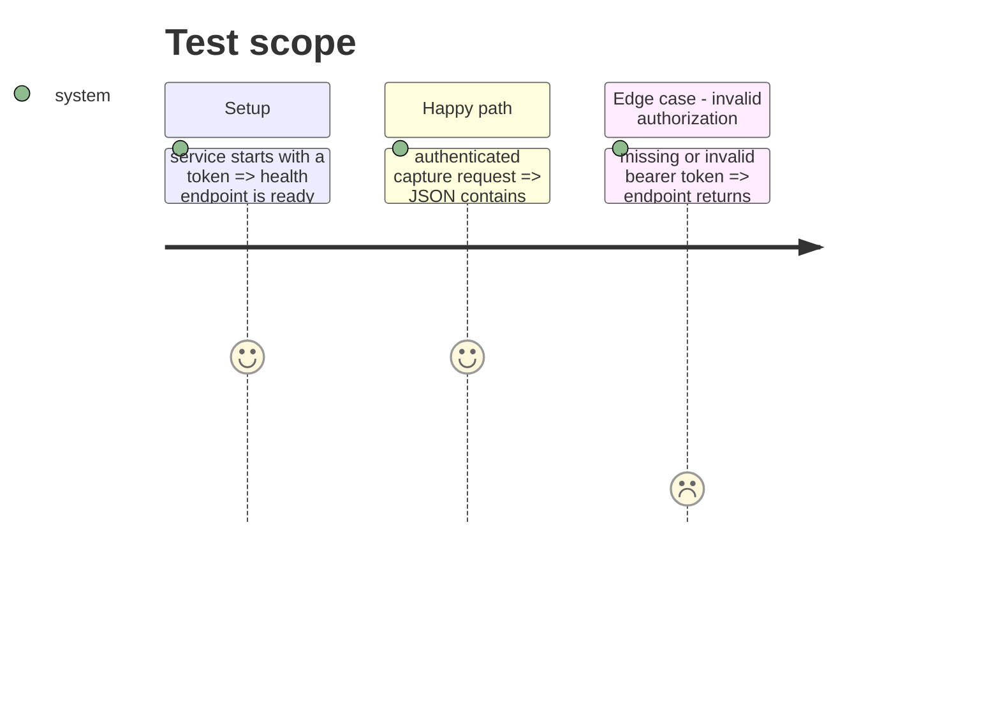

# Instruction: Capture HTTP service

## Architecture projection

> Tree of the final files. ✅ create · ✏️ modify · ❌ delete

```txt
.
├── ✅ capture-service/
│   ├── Dockerfile
│   ├── package.json
│   └── src/server.js
└── ✏️ capture/src/capturer.js
```

## User Journey



## Test Scope



## Tasks to do

### `1)` Create the isolated HTTP service

> Package the existing capture engine in a Playwright container with authenticated `/captures` and public `/health` endpoints.

1. Add a minimal Node HTTP server and strict bearer-token validation.
2. Create a non-root Playwright image which reuses the existing capture safeguards.
3. Add Node tests for authentication, health, success and refusal responses.

## Test acceptance criteria

| Task | Acceptance criteria |
| ---- | -------------------------------- |
| 1 | An authenticated request receives a capture response, and an unauthenticated request receives no capture data. |
| 2 | The service image contains Node, Chromium and Playwright, and runs as a non-root user. |
