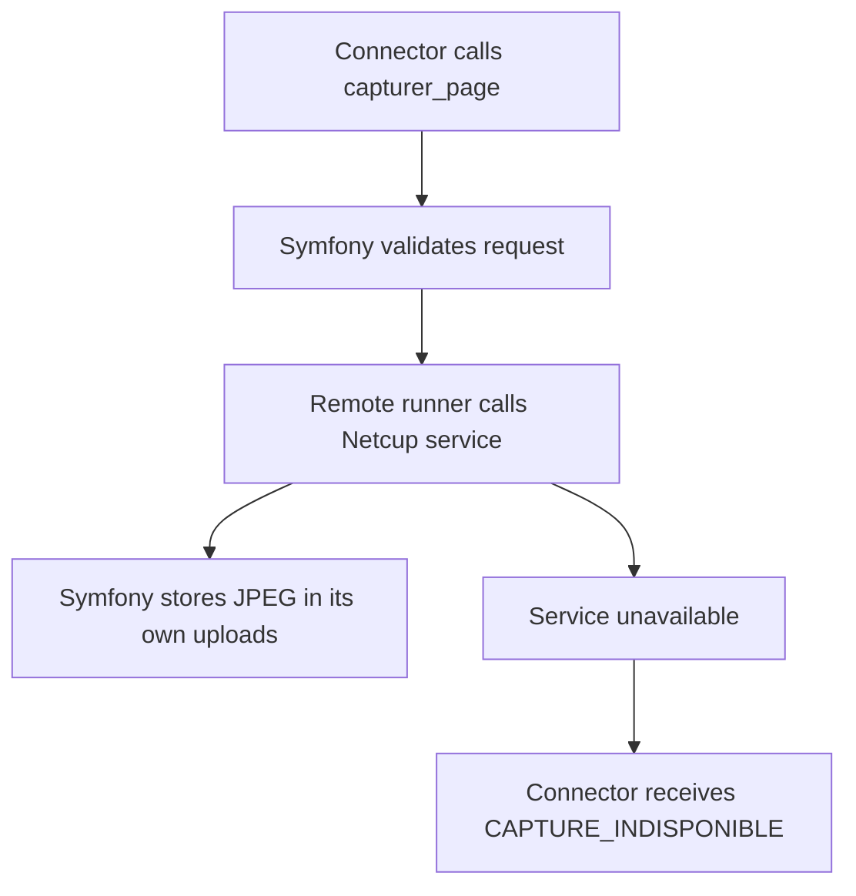
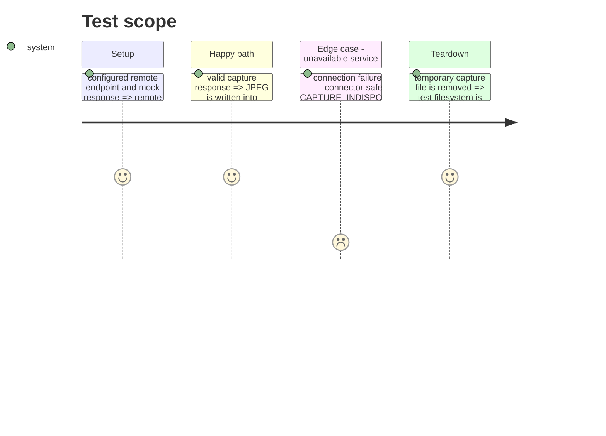

# Instruction: Symfony remote runner

## Architecture projection

> Tree of the final files. ✅ create · ✏️ modify · ❌ delete

```txt
.
├── ✅ src/Service/Capture/RemoteCaptureRunner.php
├── ✅ src/Service/Capture/ConfiguredCaptureRunner.php
├── ✅ tests/Service/RemoteCaptureRunnerTest.php
├── ✏️ config/services.yaml
├── ✏️ docs/env.example
└── ✏️ docs/CONNECTEUR.md
```

## User Journey



## Test Scope



## Tasks to do

### `1)` Add the Netcup HTTP client

> Allow Symfony to select the remote runner from environment configuration and preserve its existing local fallback for development.

1. Implement the authenticated client with response and image validation.
2. Add an environment-selected runner without exposing the bearer token in logs or responses.
3. Test valid, malformed and unavailable remote responses.

## Test acceptance criteria

| Task | Acceptance criteria |
| ---- | -------------------------------- |
| 1 | Configuring the remote URL sends the request to Netcup and stores only its returned JPEG locally. |
| 2 | Network, authentication and malformed-response failures produce `CAPTURE_INDISPONIBLE`. |
