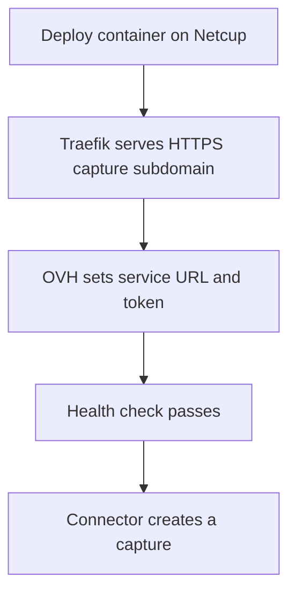
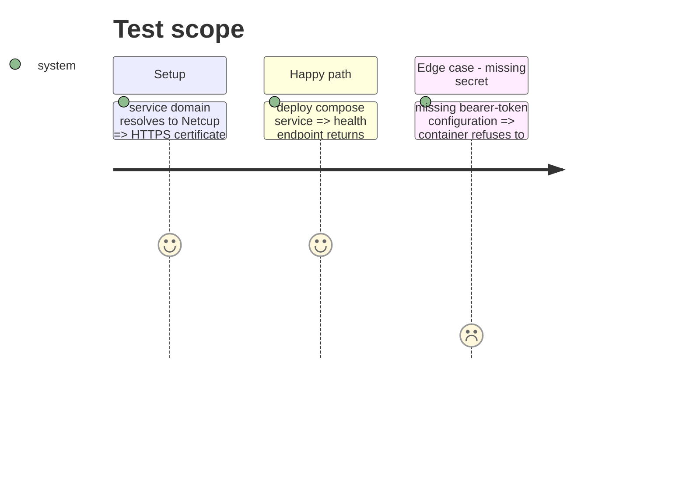

# Instruction: Netcup operation

## Architecture projection

> Tree of the final files. ✅ create · ✏️ modify · ❌ delete

```txt
.
├── ✅ deploy/netcup-capture/docker-compose.yml
├── ✅ deploy/netcup-capture/.env.example
├── ✏️ docs/HARNESS.md
└── ✏️ AGENTS.md
```

## User Journey



## Test Scope



## Tasks to do

### `1)` Provide the Netcup deployment definition

> Add a compose deployment for Netcup's Traefik proxy and document the exact production settings.

1. Configure the service for an HTTPS domain, health check and isolated network.
2. Document the DNS record, generated secret and OVH environment variables.
3. Deploy and verify the health endpoint once the DNS record exists.

## Test acceptance criteria

| Task | Acceptance criteria |
| ---- | -------------------------------- |
| 1 | The compose file exposes only HTTPS through Traefik and never publishes the service port directly. |
| 2 | The operational guide distinguishes code validation from the deployed Netcup health check. |

## Result

The service is deployed on Netcup behind Traefik at `https://capture.mediateur.varascundo.com`. Its health endpoint and an authenticated Chromium capture of `https://example.com` succeeded on 16 October 2026. The OVH environment now contains the service URL and the matching private token.
