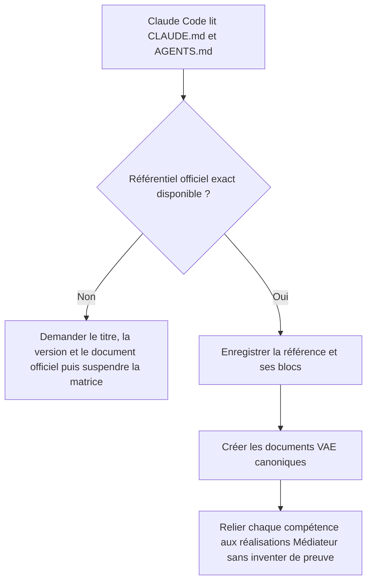
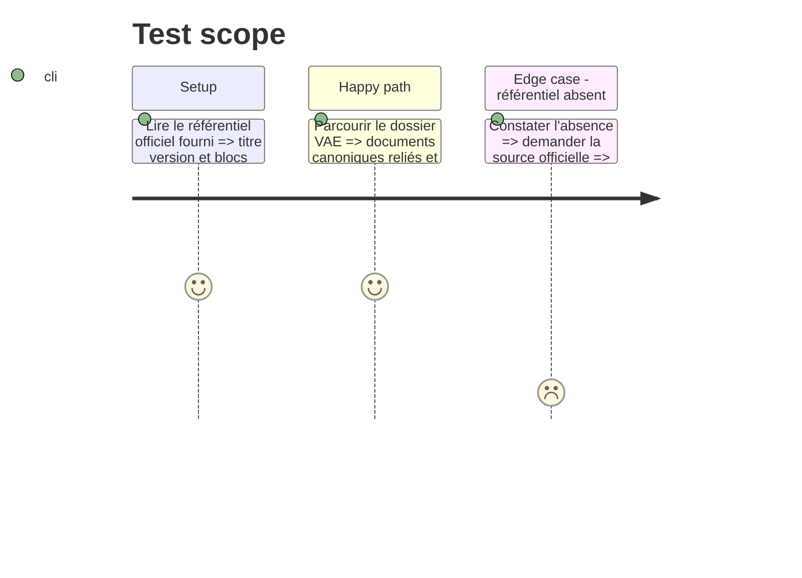

# Instruction: Cadrer le référentiel et le dossier VAE

## Architecture projection

> Tree of the final files. ✅ create · ✏️ modify · ❌ delete

```txt
.
├── ✏️ README.md
└── ✅ VAE/
    ├── README.md
    ├── rapport.md
    ├── matrice-competences.md
    ├── preuves.md
    └── journal.md
```

## User Journey



## Test Scope



## Tasks to do

### `1)` Verrouiller la source du référentiel

> Fonder toute correspondance VAE sur le programme réellement suivi.

1. Relever le titre, l'identifiant, la version et la source officielle fournis par l'utilisateur.
2. Si cette source manque, demander le document ou le lien avant de remplir les blocs et compétences.
3. Ne reprendre aucun bloc CDA de DevDoc par défaut.

### `2)` Créer les documents canoniques

> Installer une structure VAE courte qui renvoie vers les preuves techniques.

1. Créer le point d'entrée, le rapport, la matrice, le registre des preuves et le journal.
2. Définir les statuts `code`, `local`, `ci`, `prod` et `prevu` dans le registre.
3. Ajouter le lien vers `VAE/README.md` dans le README racine.

### `3)` Amorcer la matrice sans extrapolation

> Relier uniquement les compétences démontrables au projet Médiateur.

1. Inventorier les réalisations présentes dans le dépôt.
2. Pour chaque compétence, indiquer la preuve existante, la preuve manquante et le statut réel.
3. Marquer explicitement les documents formalisés a posteriori.

## Test acceptance criteria

| Task | Acceptance criteria |
| ---- | ------------------- |
| 1 | La source et la version du référentiel sont identifiables, ou la matrice reste explicitement suspendue sans compétence inventée. |
| 2 | Les cinq documents VAE sont accessibles depuis un point d'entrée unique et définissent les niveaux de preuve. |
| 3 | Chaque ligne remplie de la matrice renvoie à une réalisation Médiateur et distingue preuve existante et manque à produire. |
