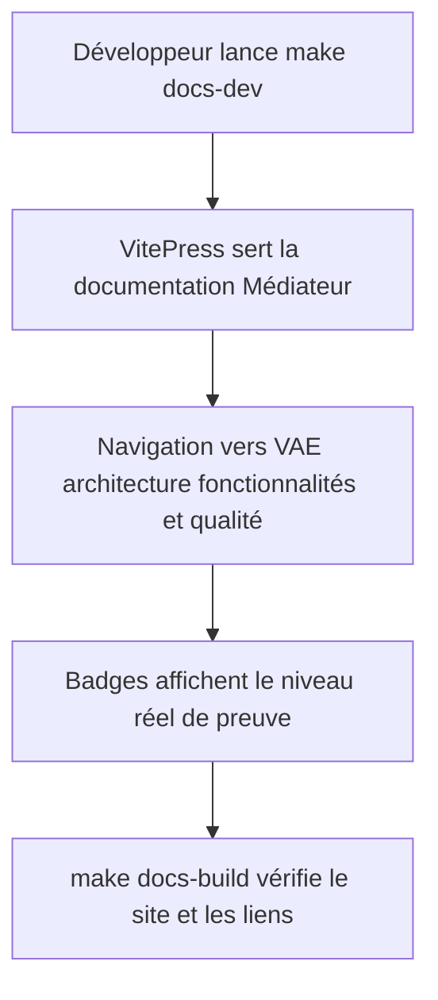
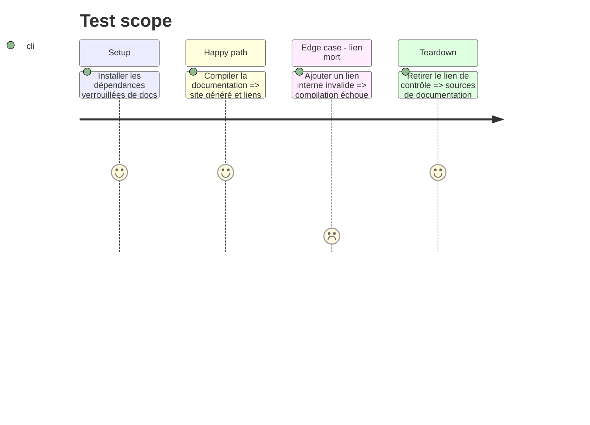

# Instruction: Installer le site VitePress indépendant

## Architecture projection

> Tree of the final files. ✅ create · ✏️ modify · ❌ delete

```txt
.
├── ✏️ .gitignore
├── ✏️ Makefile
├── ✏️ compose.yaml
└── ✏️ docs/
    ├── ✅ package.json
    ├── ✅ package-lock.json
    ├── ✏️ index.md
    └── ✅ .vitepress/
        ├── config.mjs
        └── theme/
            ├── index.js
            ├── custom.css
            └── components/
                └── Status.vue
```

## User Journey



## Test Scope



## Tasks to do

### `1)` Adapter le socle VitePress de DevDoc

> Reprendre le mécanisme sans reprendre le contenu ni l'identité de DevDoc.

1. Créer les dépendances VitePress dans `docs/` avec des versions verrouillées.
2. Configurer le titre, les liens GitHub, la navigation et les exclusions pour Médiateur.
3. Adapter le thème clair et le composant de statut aux cinq niveaux de preuve.
4. Exclure les sorties VitePress générées du suivi Git.

### `2)` Ajouter les commandes locales

> Donner à Claude Code, Codex et au développeur les mêmes commandes.

1. Ajouter un service Docker `docs` sous profil dédié, sur un port distinct des services existants.
2. Ajouter `docs-dev` et `docs-build` au Makefile et à `.PHONY`.
3. Faire échouer `docs-build` sur les liens internes morts.

### `3)` Créer la navigation initiale

> Présenter la documentation du projet par usages et preuves.

1. Prévoir les sections Présentation, Conception, Fonctionnalités, Architecture, Sécurité, Tests, Déploiement, Harness et VAE.
2. N'ajouter que les pages qui existent afin de garder une navigation valide.
3. Relier le dossier VAE canonique depuis la documentation sans le dupliquer.

## Test acceptance criteria

| Task | Acceptance criteria |
| ---- | ------------------- |
| 1 | Le site affiche l'identité Médiateur, ne contient aucune affirmation DevDoc et les badges rendent les cinq statuts. |
| 2 | `make docs-dev` sert le site sur le port documenté et `make docs-build` produit une compilation propre. |
| 3 | Toutes les entrées de navigation ouvrent une page existante et le dossier VAE reste la source canonique de sa synthèse. |
