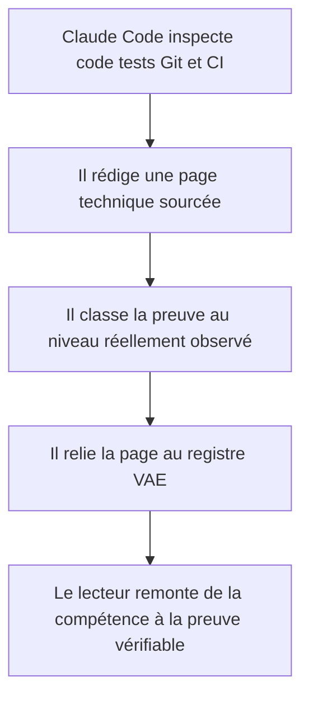
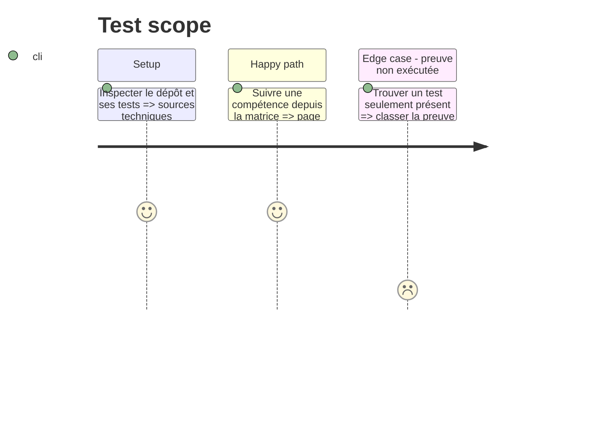

# Instruction: Documenter Médiateur et enregistrer ses preuves

## Architecture projection

> Tree of the final files. ✅ create · ✏️ modify · ❌ delete

```txt
.
├── ✏️ VAE/
│   ├── rapport.md
│   ├── matrice-competences.md
│   ├── preuves.md
│   └── journal.md
└── ✏️ docs/
    ├── index.md
    ├── ✅ conception/index.md
    ├── ✅ fonctionnalites/index.md
    ├── ✅ architecture/index.md
    ├── ✅ securite/index.md
    ├── ✅ tests/index.md
    ├── ✅ deploiement/index.md
    ├── ✅ harness/index.md
    └── ✅ vae/index.md
```

## User Journey



## Test Scope



## Tasks to do

### `1)` Rédiger depuis l'état réel du dépôt

> Décrire Médiateur avec ses propres choix, comportements et limites.

1. Documenter le besoin, les deux publics, le socle repris, l'architecture et les données.
2. Documenter les parcours, le back-office, le MCP, les captures, les PDF, le hors ligne et les accès personnalisés.
3. Documenter la sécurité, les tests, la CI, OVH et le service Netcup à partir des fichiers présents.
4. Signaler les éléments prévus et les contrôles qui n'ont pas été exécutés.

### `2)` Construire la chaîne de preuve

> Permettre une vérification simple de chaque affirmation du rapport.

1. Relier chaque synthèse à un fichier, une classe, un test, un commit ou une exécution identifiable.
2. Distinguer systématiquement code, local, CI, production et prévu.
3. Ne recopier ni statistiques, ni résultats de tests, ni identifiants de runs provenant de DevDoc.

### `3)` Mettre à jour le dossier VAE

> Transformer les pages techniques en éléments de dossier sans les dupliquer.

1. Synthétiser par bloc dans `rapport.md`.
2. Compléter la matrice et le registre avec des liens vers `docs/`.
3. Consigner dans le journal la date, la nature et le niveau de validation de chaque ajout significatif.

## Test acceptance criteria

| Task | Acceptance criteria |
| ---- | ------------------- |
| 1 | Les pages décrivent uniquement Médiateur et signalent clairement les éléments prévus ou non vérifiés. |
| 2 | Toute affirmation VAE importante peut être suivie jusqu'à une preuve identifiable avec le bon niveau de validation. |
| 3 | Le rapport reste synthétique, les détails résident dans `docs/` et le journal retrace les changements significatifs. |
