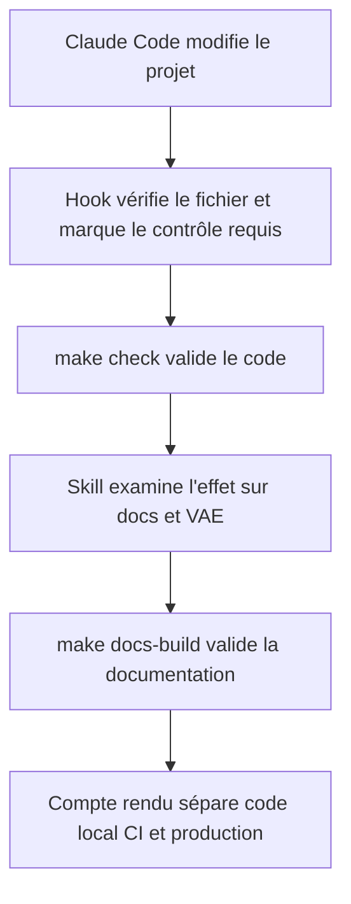
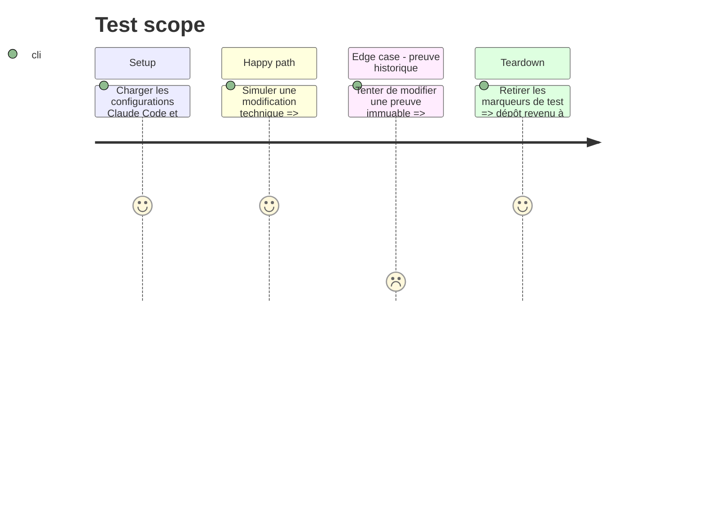

# Instruction: Synchroniser le harness avec la documentation VAE

## Architecture projection

> Tree of the final files. ✅ create · ✏️ modify · ❌ delete

```txt
.
├── ✏️ AGENTS.md
├── ✏️ .gitignore
├── ✏️ .agents/hooks/
│   ├── lib.sh
│   ├── protect-files.sh
│   ├── lint-file.sh
│   └── stop-check.sh
├── ✅ .agents/skills/vae-documentation-sync
├── ✏️ .claude/settings.json
├── ✅ .claude/skills/vae-documentation-sync/SKILL.md
├── ✏️ .codex/hooks.json
├── ✏️ .codex/rules/project.rules
├── ✏️ Makefile
└── ✏️ docs/harness/index.md
```

## User Journey



## Test Scope



## Tasks to do

### `1)` Porter seulement les garde-fous utiles

> Adapter les hooks DevDoc aux commandes et fichiers réels de Médiateur.

1. Comparer les hooks existants avant toute reprise.
2. Ajouter le lint après écriture et le marqueur de validation sans importer les contrôles des composants absents.
3. Protéger les environnements, sauvegardes, migrations commitée et preuves VAE immuables.
4. Tester les mêmes scénarios côté Claude Code et Codex.

### `2)` Créer le skill documentaire partagé

> Mettre à jour les preuves seulement après une validation réelle.

1. Créer `vae-documentation-sync` dans `.claude/skills/`.
2. L'exposer à Codex par le mécanisme partagé retenu par le dépôt.
3. Lui faire examiner le diff, les contrôles exécutés et les effets sur `docs/` et `VAE/`.
4. Lui interdire de promouvoir une preuve sans commande, run CI ou contrôle production correspondant.

### `3)` Aligner les consignes et commandes

> Rendre le workflow explicite pour tous les agents.

1. Ajouter à `AGENTS.md` la table changement vers page documentaire.
2. Documenter `make check`, `make docs-build` et les validations complémentaires de parcours.
3. Configurer les permissions et hooks sans élargir l'accès aux secrets ou aux commandes destructives.

## Test acceptance criteria

| Task | Acceptance criteria |
| ---- | ------------------- |
| 1 | Les hooks autorisent un fichier normal, refusent les cibles protégées et exigent les contrôles adaptés après un changement technique. |
| 2 | Claude Code et Codex utilisent la même règle de synchronisation et aucun statut de preuve ne monte sans justificatif. |
| 3 | Les consignes indiquent exactement quand mettre à jour VitePress et VAE, avec les commandes réelles du projet. |
