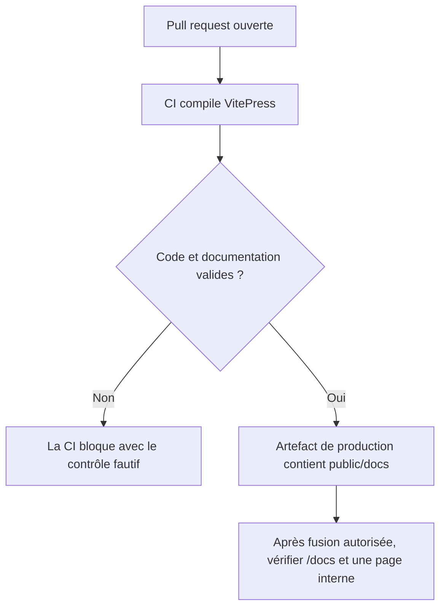
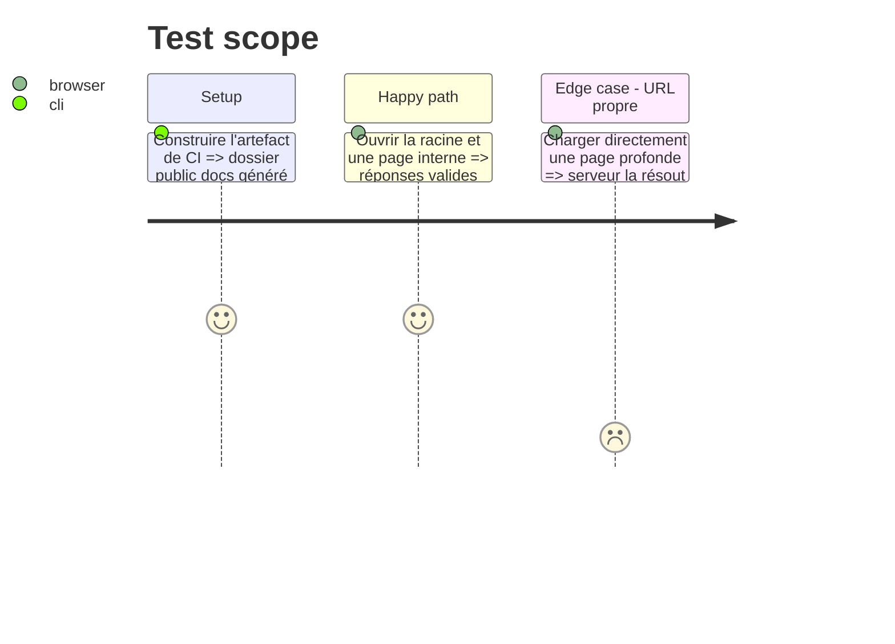

# Instruction: Intégrer la documentation à la CI et préparer sa publication

## Architecture projection

> Tree of the final files. ✅ create · ✏️ modify · ❌ delete

```txt
.
├── ✏️ .github/workflows/ci.yml
├── ✏️ docs/CI_CD.md
├── ✏️ docs/.vitepress/config.mjs
├── ✏️ public/.htaccess
└── ✏️ .htaccess
```

## User Journey



## Test Scope



## Tasks to do

### `1)` Rendre la compilation bloquante en CI

> Empêcher la fusion d'une documentation cassée.

1. Installer les dépendances verrouillées de `docs/` dans le workflow.
2. Exécuter le build VitePress comme contrôle bloquant.
3. Conserver les résultats applicatifs et documentaires séparés dans le compte rendu.

### `2)` Préparer l'artefact `/docs/`

> Inclure la documentation dans la livraison Médiateur sans dépendre de DevDoc.

1. Configurer la base VitePress selon l'URL de publication retenue.
2. Copier la sortie construite vers `public/docs/` dans l'artefact, sans versionner le build.
3. Adapter les règles Apache uniquement si elles sont nécessaires aux URL propres et aux pages internes.

### `3)` Vérifier la publication avec des preuves distinctes

> Ne déclarer la documentation publiée qu'après contrôle du site réel.

1. Vérifier le job de déploiement après une fusion explicitement autorisée.
2. Contrôler la racine `/docs/` et au moins une page interne par requête HTTP et dans le navigateur.
3. Enregistrer le run CI et le contrôle production dans `VAE/preuves.md` et `VAE/journal.md`.

## Test acceptance criteria

| Task | Acceptance criteria |
| ---- | ------------------- |
| 1 | Une page ou un lien interne invalide fait échouer la CI avant le déploiement. |
| 2 | L'artefact contient le site sous le chemin configuré et une page profonde est servie correctement. |
| 3 | Les statuts CI et production ne sont enregistrés qu'avec un run et des contrôles publics identifiables. |
