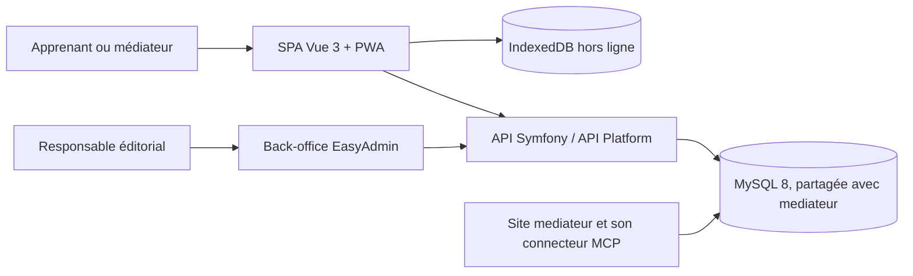

# Architecture

> Description formalisée a posteriori à partir du code. <Status is="code" />

## Vue d'ensemble

| Bloc | Rôle | Hébergement |
|---|---|---|
| SPA Vue 3 (`front/`) | Interface publique, PWA, cache hors ligne | OVH, fichiers statiques `public/spa` et `public/build` |
| Symfony 6.4 (`src/`) | API, back-office, PDF, pages serveur | OVH |
| MySQL 8.0 | Base `egflbugcundo6`, partagée avec mediateur | OVH |

Les cours se rédigent avec le connecteur MCP de mediateur ; ce site n'a ni connecteur ni moteur de capture (voir [Connecteur MCP](../fonctionnalites/connecteur.md)).

## Couches du backend

| Couche | Dossier | Contenu |
|---|---|---|
| Domaine | `src/Domain/` | Objets et contrats métier par contexte (Category, Page, QCM, User…) |
| Infrastructure | `src/Infrastructure/` | Repositories Doctrine, intégration API Platform (`ApiPlatform/PublishedContentExtension.php`), sécurité (`Security/User/HexagonalUserProvider`) |
| Entités | `src/Entity/` | 18 entités Doctrine (mapping) |
| Services applicatifs | `src/Service/` | PDF, fichiers des captures du back-office, comptes, SEO |
| Entrées | `src/Controller/`, `src/Command/` | HTTP (API, back-office, PDF), commandes console |

Cette organisation est reprise de DevDoc ([reprise](../conception/reprise-devdoc.md)) puis allégée.

## Données

- Modèle relationnel Doctrine : parcours (`Category`), contenus (`Page`, `PageContent`, `PageBlock`), niveaux (`NiveauCours`), captures (`CourseMedia`), QCM (`QCM`, `ChoicesQCM`, `NiveauQCM`, `LanguageQCM`), accès réservés (`AccesReserve`), comptes (`User`, `PasswordResetToken`), configuration (`SiteConfiguration`, `Seo`, menus, logo).
- Schéma géré uniquement par 13 migrations (`migrations/`), vérifiées en CI par montée, `doctrine:schema:validate`, retour arrière et remontée. <Status is="ci" />
- Côté client : IndexedDB (`front/src/utils/offlineDb.js`, bibliothèque `idb`) pour les modules préparés hors ligne, vidée à la déconnexion. <Status is="ci" />
- MCD, MLD et diagramme de séquence de l'accès filtré : [modèle de données](../conception/base-de-donnees.md) <Status is="local" /> ; choix structurants : [décisions d'architecture](../conception/decisions-architecture.md).

## Intégrations

- **MCP** : aucun serveur sur ce site ; le connecteur est celui de mediateur (voir le [connecteur](../fonctionnalites/connecteur.md)).
- **E-mail** : Brevo par `symfony/brevo-mailer` (mot de passe oublié).
- **Capture** : aucun moteur sur ce site depuis `a379bfe` ; les captures s'ajoutent dans le back-office (`CaptureFileManager`) ou par le connecteur de Médiateur.
