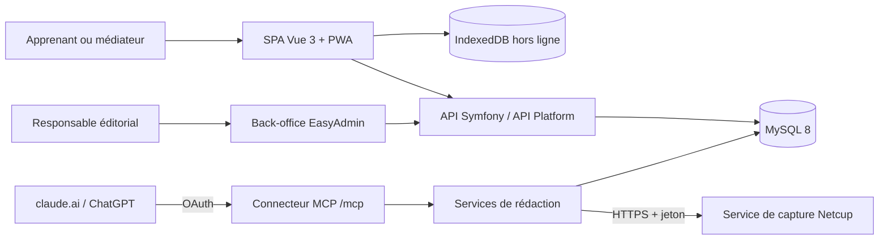

# Architecture

> Description formalisée a posteriori à partir du code. <Status is="code" />

## Vue d'ensemble

| Bloc | Rôle | Hébergement |
|---|---|---|
| SPA Vue 3 (`front/`) | Interface publique, PWA, cache hors ligne | OVH, fichiers statiques `public/spa` et `public/build` |
| Symfony 6.4 (`src/`) | API, back-office, connecteur MCP, PDF, pages serveur | OVH |
| MySQL 8.0 | Base relationnelle unique | OVH |
| Service de capture (`capture/`, `capture-service/`) | Navigateur Chromium automatisé, lecture seule | Netcup, conteneur Docker derrière Traefik |

Le service de capture est isolé : l'hébergement mutualisé OVH n'a ni Node ni Chromium, et un navigateur automatisé ne doit pas partager le serveur des données.

## Couches du backend

| Couche | Dossier | Contenu |
|---|---|---|
| Domaine | `src/Domain/` | Objets et contrats métier par contexte (Category, Page, QCM, User…) |
| Infrastructure | `src/Infrastructure/` | Repositories Doctrine, intégration API Platform (`ApiPlatform/PublishedContentExtension.php`), sécurité (`Security/User/HexagonalUserProvider`) |
| Entités | `src/Entity/` | 23 entités Doctrine (mapping) |
| Services applicatifs | `src/Service/` | Rédaction et contrôles, PDF, captures, OAuth, comptes |
| Entrées | `src/Controller/`, `src/Mcp/`, `src/Command/` | HTTP (API, back-office, PDF, OAuth), serveur MCP, commandes console |

Cette organisation est reprise de DevDoc ([reprise](../conception/reprise-devdoc.md)) puis allégée.

## Données

- Modèle relationnel Doctrine : parcours (`Category`), contenus (`Page`, `PageContent`, `PageBlock`), niveaux (`NiveauCours`), captures (`CourseMedia`), QCM (`QCM`, `ChoicesQCM`, `NiveauQCM`, `LanguageQCM`), brouillons du connecteur (`QcmDraft`), accès réservés (`AccesReserve`), comptes et OAuth (`User`, `PasswordResetToken`, `OAuthClient`, `OAuthGrant`, `OAuthAuthorizationCode`), configuration (`SiteConfiguration`, `Seo`, menus, logo).
- Schéma géré uniquement par 13 migrations (`migrations/`), vérifiées en CI par montée, `doctrine:schema:validate`, retour arrière et remontée. <Status is="ci" />
- Côté client : IndexedDB (`front/src/utils/offlineDb.js`, bibliothèque `idb`) pour les modules préparés hors ligne, vidée à la déconnexion. <Status is="ci" />
- MCD et MLD formalisés : <Status is="prevu" />

## Intégrations

- **MCP** : SDK `mcp/sdk`, serveur `src/Mcp/RedactionMcpServer.php`, exposé sur `/mcp` (voir le [connecteur](../fonctionnalites/connecteur.md)).
- **E-mail** : Brevo par `symfony/brevo-mailer` (mot de passe oublié).
- **Capture** : `RemoteCaptureRunner` appelle le service Netcup en HTTPS ; en développement, `NodeCaptureRunner` exécute le moteur local.
