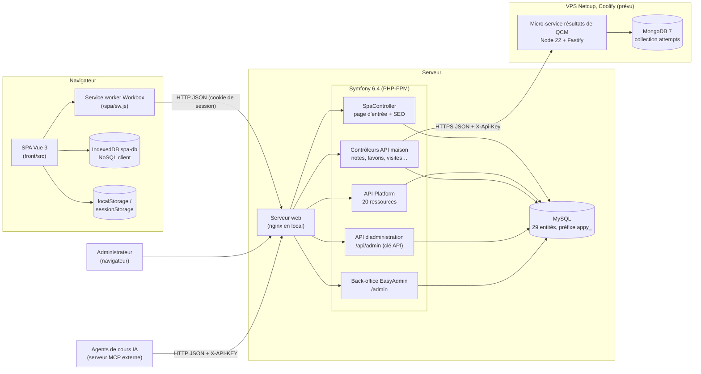
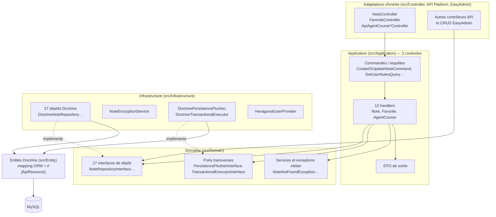
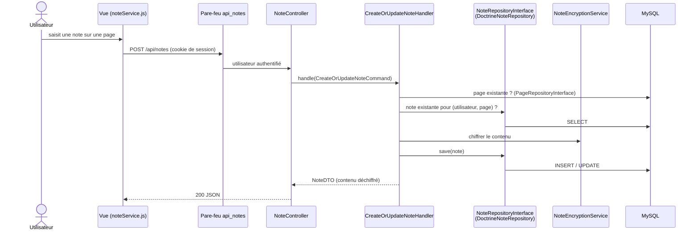
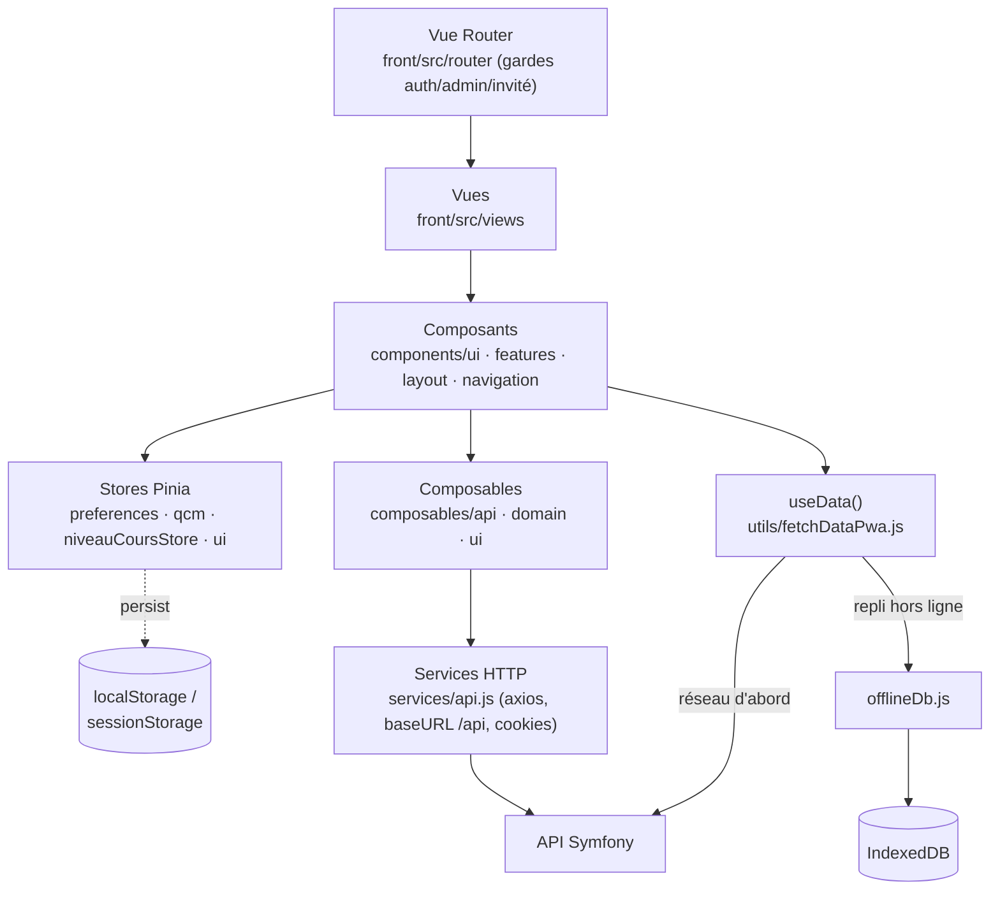
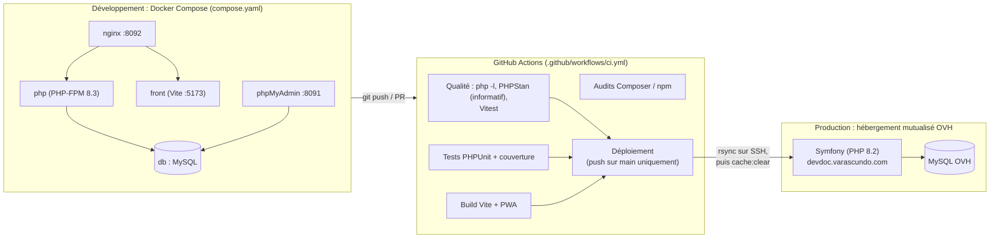
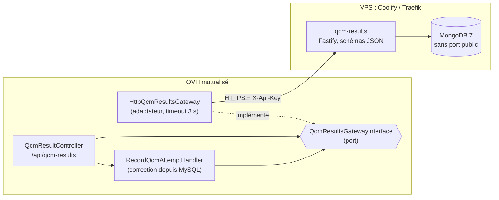

# Architecture logicielle — DevDoc

Ce document décrit l'architecture telle qu'elle existe dans le code au 2026-10-12. Chaque élément renvoie au fichier qui le porte. Les diagrammes sont en Mermaid.

## 1. Vue d'ensemble

DevDoc est une application monolithique découpée en deux parties :
- **front** : une application Vue 3 monopage (SPA), installable en PWA ;
- **back** : une API Symfony 6.4, qui sert aussi le back-office et la page d'entrée de la SPA.

Les deux communiquent en JSON sur HTTP, sous le même domaine. L'authentification passe donc par le cookie de session, sans jeton côté navigateur.

| Brique | Rôle | Preuve |
|---|---|---|
| Page d'entrée | Toute URL non API est prise par `SpaController::index` (route attrape-tout). Il rend `templates/spa/index.html.twig` avec les balises SEO de la page demandée, calculées côté serveur (`SeoService`), puis Vue prend la main | `src/Controller/SpaController.php` |
| API REST générique | Lecture publique et écriture réservée aux administrateurs des contenus (pages, catégories, QCM…) | Attribut `#[ApiResource]` sur 20 entités de `src/Entity/` ; `config/packages/security.yaml` |
| API métier | Notes chiffrées, favoris, historique de visites, personnalisation, propositions IA | `src/Controller/Api/`, `src/Controller/*Controller.php` |
| API d'administration | CRUD des cours pour les agents IA externes, sans session, authentifié par en-tête `X-API-KEY` | `src/Controller/Api/AdminCrud/`, `src/Security/ApiKeyAuthenticator.php`, [`docs/migration-mcp-vers-symfony.md`](../migration-mcp-vers-symfony.md) |
| Back-office | Gestion de tous les contenus, statistiques de visite | `src/Controller/Admin/` (EasyAdmin, `#[AdminDashboard]` sur `/admin`) |
| Base de données | Source de vérité | [`base-de-donnees.md`](base-de-donnees.md) |
| Résultats de QCM | Tentatives, progression et statistiques par question, dans un micro-service Node et MongoDB appelé uniquement par Symfony | `src/Controller/Api/QcmResultController.php`, `services/qcm-results/`, [`base-de-donnees.md` §7](base-de-donnees.md#7-stockage-nosql-côté-serveur--mongodb-résultats-de-qcm) |
| Stockage client | Mode hors ligne et préférences | [`base-de-donnees.md` §6](base-de-donnees.md#6-stockage-nosql-côté-client--indexeddb) |

## 2. Sécurité : un pare-feu par zone

| Zone (préfixe) | Pare-feu | Authentification | Accès |
|---|---|---|---|
| `/api/me-favorites`, `/api/page-visits`, `/api/notes`, `/api/customization`, `/api/proposition-ia` | Un pare-feu dédié par préfixe | Session (cookie) | Utilisateur connecté |
| `/api/admin` | `api_admin`, sans état | Clé API (`X-API-KEY`) | Agents IA autorisés |
| `/api` (le reste) | `api_public`, qui partage le contexte `main` | Session si présente | Lecture publique ; écriture réservée aux administrateurs (`access_control`) ; `/api/users` limité |
| `/admin` | `main` | Formulaire de connexion (`AuthAuthenticator`) | `ROLE_ADMIN` |

Les règles sont dans `config/packages/security.yaml`. Elles sont testées par `tests/Functional/Security/AccessControlTest.php` (16 tests).

## 3. Back-end : architecture hexagonale progressive

Le back-end suit une architecture en couches de type hexagonal (ports et adaptateurs) :
- le domaine déclare des **interfaces** de dépôt (les ports) ;
- l'infrastructure les implémente avec Doctrine (les adaptateurs) ;
- la couche application orchestre les cas d'usage, au moyen de commandes et de requêtes séparées (CQRS léger).

Les liaisons entre interfaces et implémentations sont déclarées dans `config/services.yaml`, par exemple `NoteRepositoryInterface` → `DoctrineNoteRepository`.

### Exemple de flux : enregistrer une note

Ce flux est couvert par :
- `tests/Application/Note/Handler/` (handlers, avec des dépôts simulés) ;
- `tests/Infrastructure/Note/Repository/DoctrineNoteRepositoryTest.php` (dépôt sur une vraie base SQLite) ;
- `tests/Infrastructure/Note/Service/NoteEncryptionServiceTest.php`.

### Écarts assumés par rapport à un hexagonal strict

- **Les entités sont aussi le modèle du domaine.** Elles vivent dans `src/Entity`, portent les annotations Doctrine et API Platform, et sont utilisées par le domaine. C'est un compromis pragmatique : API Platform et EasyAdmin génèrent le CRUD directement à partir de ces entités.
- **La couche application ne couvre que 3 contextes** (Note, Favorite, AgentCourse) : c'est là que se trouvent les règles métier, comme le chiffrement, la propriété d'une ressource ou la génération IA. Les autres contextes passent directement du contrôleur au dépôt, ou par API Platform.
- **Deux contrôleurs** (`ApiAgentCourseGenerationController`, `ApiCourseMediaController`) utilisent encore `EntityManagerInterface` directement.

Les options étudiées et l'état de la migration sont dans [`docs/final-hexagonal-audit.md`](../final-hexagonal-audit.md) et [`docs/architecture-hexagonale-option1.md`](../architecture-hexagonale-option1.md).

## 4. Front-end

| Couche | Responsabilité | Exemple |
|---|---|---|
| Router | Navigation et contrôle d'accès côté client (le serveur reste l'autorité) | `front/src/router/guards.js` |
| Vues et composants | Affichage ; HTML venant de l'API passé par `SafeHtml.vue` (DOMPurify) | `front/src/components/ui/SafeHtml.vue` |
| Stores Pinia | État partagé, persisté dans le navigateur au besoin | `front/src/stores/qcm.js` |
| Services | Appels HTTP centralisés | `front/src/services/api.js`, `noteService.js` |
| Données hors ligne | Copie locale des contenus, repli sans réseau | `front/src/utils/fetchDataPwa.js`, `offlineDb.js` |
| PWA | Mise en cache des pages, des fichiers compilés et de l'API publique | `front/vite.config.js` (`VitePWA`) |

## 5. Environnements et déploiement

- **Local** : `make up`, puis `make check` avant chaque livraison (lint, PHPStan, PHPUnit, Vitest, build).
- **CI** : chaque PR passe la qualité, les tests et le build. PHPStan et les audits sont informatifs, et ESLint ne tourne qu'en local. Le déploiement ne part que d'un push sur `main`.
- **Production** : les migrations ne sont **pas** exécutées par le déploiement ; elles se lancent à la main sur le serveur. Voir [`docs/CI_CD.md`](../CI_CD.md).

### Micro-service des résultats de QCM

L'hébergement mutualisé OVH ne fait tourner ni Node ni MongoDB. Le module PHP `mongodb` y est présent (1.15.3, vérifié en SSH le 2026-10-12), mais il faudrait quand même une base hébergée ailleurs. Le stockage des résultats de QCM est donc confié à un service séparé, prévu sur le VPS Netcup déjà administré avec Coolify :

- **Confiance** : le navigateur envoie seulement ses choix. Symfony vérifie la session, recalcule la correction depuis MySQL et transmet l'identifiant utilisateur. Le service n'accepte que les appels porteurs de la clé partagée.
- **Panne isolée** : toute erreur du service (réseau, délai, statut ≥ 300, réponse illisible) devient `QcmResultsUnavailableException`, et l'API renvoie 503. La correction du QCM reste affichée ; seuls l'enregistrement et la page « Ma progression » sont indisponibles.
- **Accès** : `^/api/qcm-results/stats` est réservé à `ROLE_ADMIN`, le reste de `^/api/qcm-results` à `ROLE_USER` (`config/packages/security.yaml`). Chaque utilisateur ne lit et n'efface que ses propres tentatives.
- **Tests** : handler (`tests/Application/QcmResult/`, 5 tests), adaptateur HTTP avec `MockHttpClient` (`tests/Infrastructure/QcmResult/`, 8), API HTTP avec une passerelle en mémoire (`tests/Functional/QcmResult/`, 14), service Node sur un vrai MongoDB (9).

## 6. Choix d'architecture et justification

| Choix | Pourquoi | Contrepartie |
|---|---|---|
| Monolithe Symfony qui sert aussi la SPA | Un seul déploiement et un seul domaine : session par cookie sans CORS ni jeton ; SEO calculé côté serveur pour chaque URL | Front et back livrés ensemble |
| API Platform pour les contenus | CRUD, pagination et filtres générés depuis les entités ; format JSON-LD standard | Entités couplées au framework |
| Hexagonal sur les contextes à règles métier | Règles testables sans base (handlers testés avec des dépôts simulés) ; changement de persistance localisé | Deux styles cohabitent dans le code |
| API d'administration à clé API, séparée | Les agents IA externes écrivent par l'API au lieu d'accéder directement à MySQL | Gestion et rotation des clés à prévoir |
| PWA et IndexedDB | Consultation des cours sans réseau (ENF-02) | Données locales possiblement périmées (pas de purge) |
| Micro-service Node et MongoDB pour les résultats de QCM | Données de type document, agrégations de progression, impossibles à héberger sur le mutualisé OVH ; port hexagonal côté Symfony | Une seconde infrastructure (VPS) à exploiter et sauvegarder ; pas d'intégrité référentielle entre MySQL et MongoDB |
| Docker en local, hébergement mutualisé en production | Environnement reproductible pour le développement ; coût d'hébergement réduit | Écart de version PHP (8.3 en local, 8.2 en CI et en production) ; pas de conteneurs en production |
