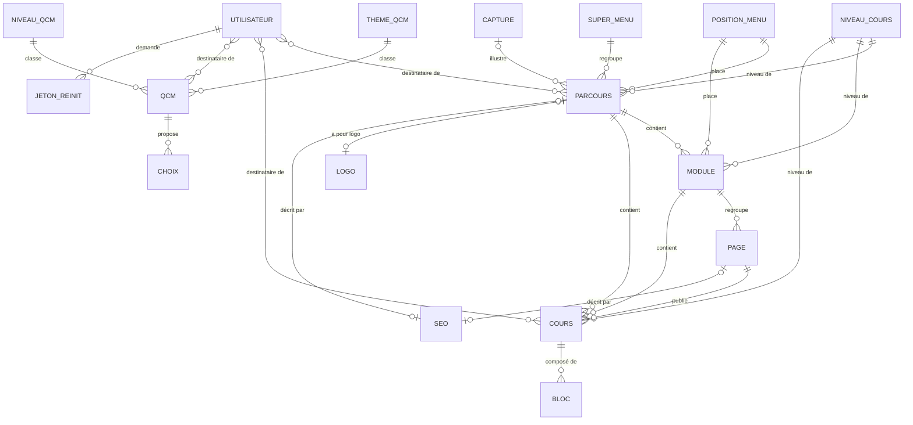
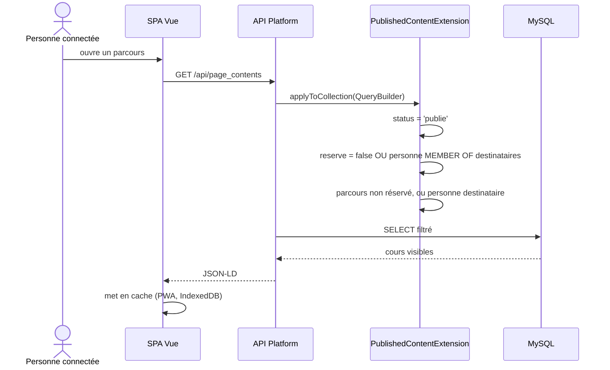

# Modèle de données

> Formalisé a posteriori le 2026-11-02 à partir des entités Doctrine et des migrations de `main2` (`30da5e5`). Le schéma ci-dessous a été produit en jouant les 13 migrations sur une base MySQL 8.0 vide, puis validé contre le mapping : [archive du contrôle](../../VAE/evidence/2026-11-02-conception/README.md). <Status is="local" />

## Schéma attendu et base réelle

| Schéma | Source | Observé |
|---|---|---|
| Attendu par le code | 18 entités (`src/Entity/`) et 13 migrations (`migrations/`, de `Version20261015093531` à `Version20261016220000`) | Oui : `doctrine:schema:validate` réussi sur la base issue des migrations <Status is="local" /> ; job « Migrations MySQL » du run [41442887513](https://github.com/cundovar/vue-symfony/actions/runs/41442887513) <Status is="ci" /> |
| Base de production `egflbugcundo6` | Partagée avec Médiateur, qui la fait évoluer ; contient aussi des tables de DevDoc | Non : aucune migration n'est jouée par Inclusion et la base n'a pas été inspectée |

`DOCTRINE_SCHEMA_FILTER` (`config/services.yaml`) fait ignorer à Doctrine les tables présentes dans la base partagée qu'Inclusion ne mappe pas : celles du connecteur de Médiateur (`oauth_*`, `qcm_draft`) et celles de DevDoc (`appy_Exo*`, `appy_Note`, `revision`, `diaporama`…). Sans ce filtre, Doctrine proposerait de les supprimer.

## MCD

Entités métier et associations (les tables techniques `messenger_messages` et `doctrine_migration_versions` sont omises).

| Entité (MCD) | Classe | Table |
|---|---|---|
| PARCOURS | `Category` | `appy_Category` |
| MODULE | `Menus` | `appy_Menus` |
| PAGE | `Page` | `appy_Page` |
| COURS | `PageContent` | `appy_PageContent` |
| BLOC | `PageBlock` | `appy_PageBlock` |
| NIVEAU_COURS | `NiveauCours` | `appy_NiveauCours` |
| CAPTURE | `CourseMedia` | `course_media` |
| SUPER_MENU, POSITION_MENU | `SuperMenu`, `PositionMenus` | `appy_SuperMenu`, `appy_PositionMenus` |
| LOGO, SEO | `Logo`, `Seo` | `appy_Logo`, `appy_Seo` |
| QCM, CHOIX | `QCM`, `ChoicesQCM` | `appy_QCM`, `appy_ChoicesQCM` |
| THEME_QCM, NIVEAU_QCM | `LanguageQCM`, `NiveauQCM` | `appy_LanguageQCM`, `appy_NiveauQCM` |
| UTILISATEUR | `User` | `appy_User` |
| JETON_REINIT | `PasswordResetToken` | `password_reset_token` |
| (configuration) | `SiteConfiguration` | `appy_SiteConfiguration`, sans association |

Les accès réservés viennent du trait `AccesReserve` (`src/Entity/AccesReserve.php`), utilisé par `Category`, `PageContent` et `QCM` : un booléen `reserve` et une association plusieurs-à-plusieurs `destinataires` vers `User`.

## MLD

Clés primaires soulignées par `PK`, clés étrangères par `FK → table`. Colonnes principales seulement ; le script complet est l'[export du schéma](../../VAE/evidence/2026-11-02-conception/schema-30da5e5.sql).

| Table | Colonnes |
|---|---|
| `appy_Category` | `id` PK, `name`, `description`, `audience`, `ordre`, `visible`, `reserve`, `superMenu_id` FK → `appy_SuperMenu`, `positionMenus_id` FK → `appy_PositionMenus`, `niveauCours_id` FK → `appy_NiveauCours`, `illustration_id` FK → `course_media` |
| `appy_Menus` | `id` PK, `label`, `category_id` FK → `appy_Category`, `positionMenus_id` FK, `niveauCours_id` FK |
| `appy_Page` | `id` PK, `slug`, `menus_id` FK → `appy_Menus`, `seo_id` FK unique → `appy_Seo` |
| `appy_PageContent` | `id` PK, `title`, `type`, `content`, `status` (non nul), `ordre`, `reserve`, `source_url`, `verified_at`, `author`, `review_report` (JSON), `reviewed_by`, `reviewed_at`, `page_id` FK → `appy_Page`, `category_id` FK → `appy_Category`, `menu_id` FK → `appy_Menus`, `niveauCours_id` FK |
| `appy_PageBlock` | `id` PK, `type`, `content`, `pageContent_id` FK → `appy_PageContent` |
| `course_media` | `id` PK, `filename` unique, `kind`, `alt_text`, `caption`, `source_url`, `captured_at`, `next_review_at`, `checksum`, `width`, `height` |
| `appy_QCM` | `id` PK, `titre`, `solution`, `reserve`, `languageQCM_id` FK, `niveauQCM_id` FK |
| `appy_ChoicesQCM` | `id` PK, `question`, `isCorrect`, `explication`, `qcm_id` FK → `appy_QCM` (non nul) |
| `appy_User` | `id` PK, `username` unique, `email` unique, `roles` (JSON), `password` (haché) |
| `password_reset_token` | `id` PK, `token_hash` unique, `expires_at`, `user_id` FK → `appy_User` |
| `acces_parcours` | (`category_id` FK, `user_id` FK) PK |
| `acces_cours` | (`page_content_id` FK, `user_id` FK) PK |
| `acces_qcm` | (`qcm_id` FK, `user_id` FK) PK |
| `appy_Seo`, `appy_Logo` | `id` PK, `category_id` FK unique, attributs SEO ou logo |
| `appy_SiteConfiguration` | `id` PK, `configKey`, `settings` (JSON), `updatedAt` |

Tables créées par les migrations mais **non mappées** à `30da5e5` : `oauth_client`, `oauth_grant`, `oauth_authorization_code` et `qcm_draft`. Elles viennent du connecteur de Médiateur, retiré d'Inclusion par `a379bfe` ; les migrations, héritées de Médiateur, n'ont pas été modifiées (règle du projet : une migration commitée ne change pas).

## Accès aux données

| Côté | Mécanisme | Règle | Preuve |
|---|---|---|---|
| Serveur, SQL | Repositories Doctrine (`src/Infrastructure/*/`), API Platform | `PublishedContentExtension` ajoute aux requêtes de l'API publique `status = 'publie'` et exclut les contenus réservés, ou ceux d'un parcours réservé, aux personnes qui n'en sont pas destinataires | `PublishedContentApiTest`, `PersonalizedContentApiTest` <Status is="ci" /> |
| Serveur, objet chargé | `CourseVisibility` | Même règle pour un cours déjà chargé (PDF, pages serveur) ; un administrateur voit tout | `CoursePdfTest` <Status is="ci" /> |
| Client, NoSQL | IndexedDB (`front/src/utils/offlineDb.js`, bibliothèque `idb`) | Modules préparés pour le hors ligne ; base vidée à la déconnexion | `offlineDb.spec.js` <Status is="ci" /> |

