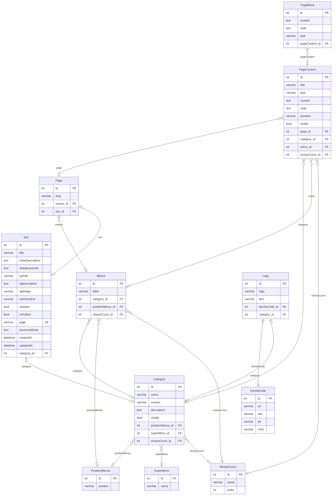
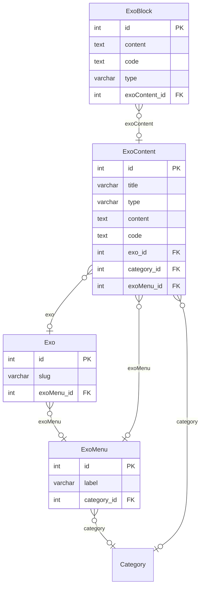
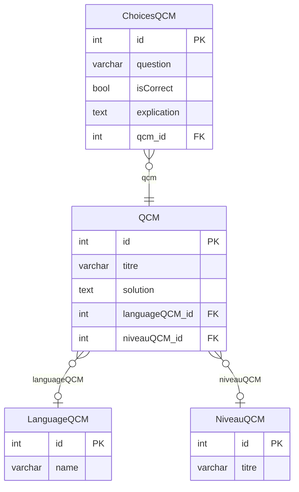
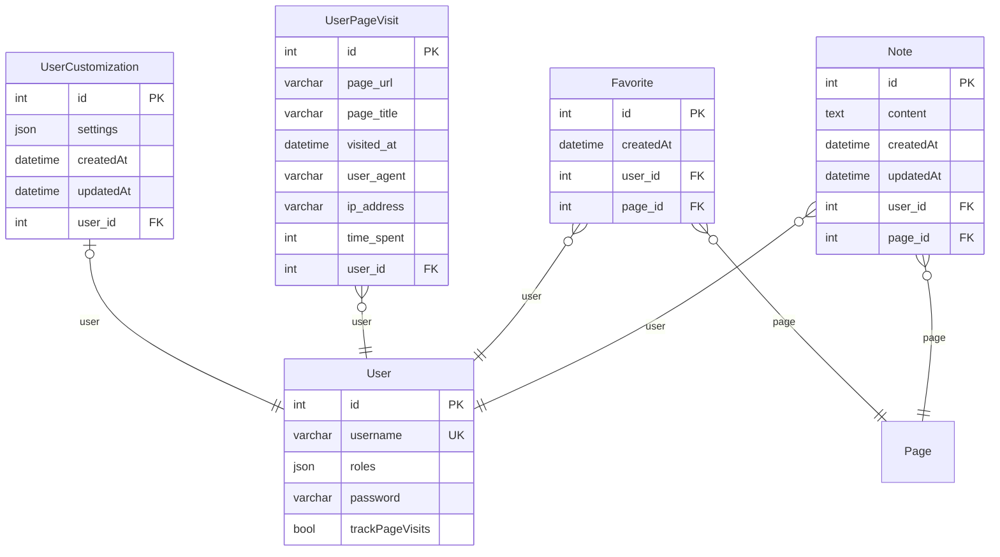
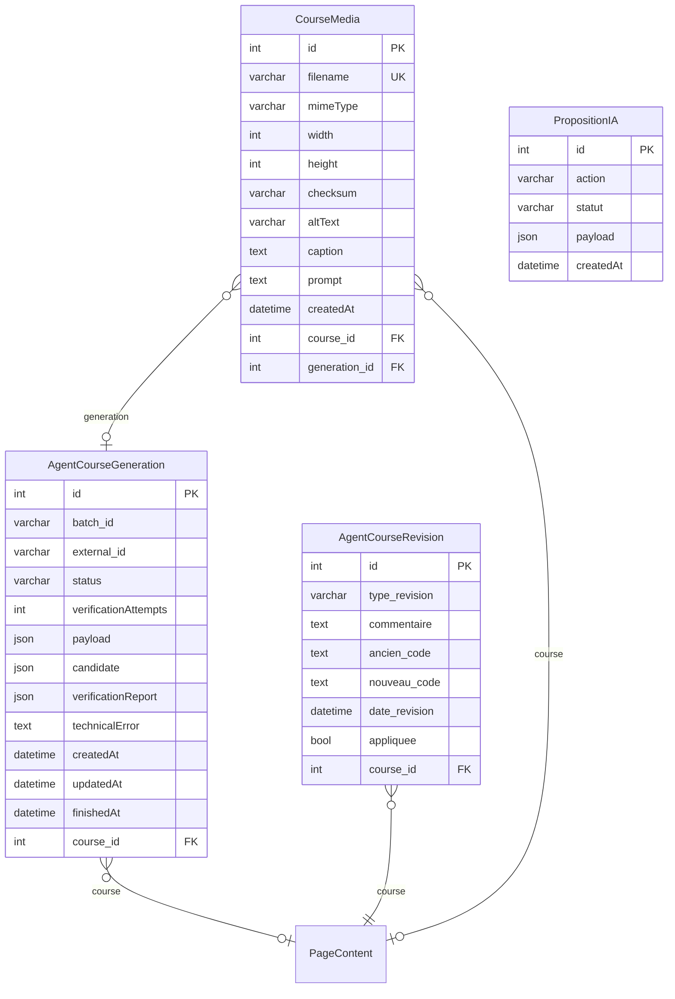
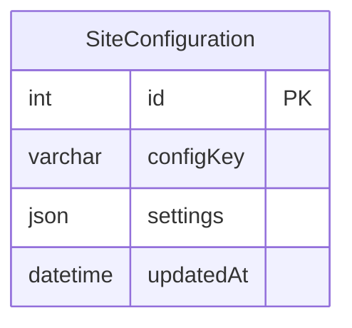

# Base de données — DevDoc

> Modèle **extrait le 2026-10-12 des métadonnées Doctrine** (mapping des entités de `src/Entity/`), puis comparé à la base MySQL locale. Il décrit le modèle tel qu'il est implémenté ; il a été formalisé après coup, comme [les besoins](besoins.md).

## 1. Méthode

- Les **29 entités** mappées par Doctrine ont été lues depuis le gestionnaire d'entités Symfony (tables, colonnes, types, clés, relations et côté propriétaire). `src/Entity/ExoCategorie.php` n'est pas une entité mappée.
- Les tables portent le préfixe `appy_` : stratégie de nommage `App\Doctrine\PrefixedNamingStrategy`, déclarée dans `config/services.yaml`. Les tables nommées explicitement font exception (`agent_course_generation`, `course_media`, `revision`, `appy_favorite`).
- Le schéma évolue uniquement par migrations Doctrine (`migrations/`, 17 migrations), jamais par SQL manuel.
- Écart entre modèle et base contrôlé par `doctrine:schema:validate` et `doctrine:schema:update --dump-sql` (lecture seule, aucun SQL exécuté) : voir §5.

## 2. Modèle conceptuel (MCD) : associations et cardinalités

35 associations. Cardinalités au sens Merise (minimum, maximum) : par exemple, « Note (1,1) — user — User (0,n) » se lit « une note appartient à exactement un utilisateur ; un utilisateur a de zéro à plusieurs notes ». La dernière colonne donne la clé étrangère du modèle logique.

| Entité (cardinalité) | Association | Entité liée (cardinalité) | Clé étrangère |
|---|---|---|---|
| AgentCourseGeneration (0,1) | course | PageContent (0,n) | `agent_course_generation.course_id` |
| AgentCourseRevision (1,1) | course | PageContent (0,n) | `revision.course_id` |
| Category (0,1) | positionMenus | PositionMenus (0,n) | `appy_Category.positionMenus_id` |
| Category (0,1) | superMenu | SuperMenu (0,n) | `appy_Category.superMenu_id` |
| Category (0,1) | niveauCours | NiveauCours (0,n) | `appy_Category.niveauCours_id` |
| ChoicesQCM (1,1) | qcm | QCM (0,n) | `appy_ChoicesQCM.qcm_id` |
| CourseMedia (0,1) | course | PageContent (0,n) | `course_media.course_id` |
| CourseMedia (0,1) | generation | AgentCourseGeneration (0,n) | `course_media.generation_id` |
| Exo (0,1) | exoMenu | ExoMenu (0,n) | `appy_Exo.exoMenu_id` |
| ExoBlock (0,1) | exoContent | ExoContent (0,n) | `appy_ExoBlock.exoContent_id` |
| ExoContent (0,1) | exo | Exo (0,n) | `appy_ExoContent.exo_id` |
| ExoContent (0,1) | category | Category (0,n) | `appy_ExoContent.category_id` |
| ExoContent (0,1) | exoMenu | ExoMenu (0,n) | `appy_ExoContent.exoMenu_id` |
| ExoMenu (0,1) | category | Category (0,n) | `appy_ExoMenu.category_id` |
| Favorite (1,1) | user | User (0,n) | `appy_favorite.user_id` |
| Favorite (1,1) | page | Page (0,n) | `appy_favorite.page_id` |
| Logo (0,1) | docDeCode | DocDeCode (0,1) | `appy_Logo.docDeCode_id` |
| Logo (0,1) | category | Category (0,1) | `appy_Logo.category_id` |
| Menus (0,1) | category | Category (0,n) | `appy_Menus.category_id` |
| Menus (0,1) | positionMenus | PositionMenus (0,n) | `appy_Menus.positionMenus_id` |
| Menus (0,1) | niveauCours | NiveauCours (0,n) | `appy_Menus.niveauCours_id` |
| Note (1,1) | user | User (0,n) | `appy_Note.user_id` |
| Note (1,1) | page | Page (0,n) | `appy_Note.page_id` |
| Page (0,1) | menus | Menus (0,n) | `appy_Page.menus_id` |
| Page (0,1) | seo | Seo (0,1) | `appy_Page.seo_id` |
| PageBlock (0,1) | pageContent | PageContent (0,n) | `appy_PageBlock.pageContent_id` |
| PageContent (0,1) | page | Page (0,n) | `appy_PageContent.page_id` |
| PageContent (0,1) | category | Category (0,n) | `appy_PageContent.category_id` |
| PageContent (0,1) | menu | Menus (0,n) | `appy_PageContent.menu_id` |
| PageContent (0,1) | niveauCours | NiveauCours (0,n) | `appy_PageContent.niveauCours_id` |
| QCM (0,1) | languageQCM | LanguageQCM (0,n) | `appy_QCM.languageQCM_id` |
| QCM (0,1) | niveauQCM | NiveauQCM (0,n) | `appy_QCM.niveauQCM_id` |
| Seo (0,1) | category | Category (0,1) | `appy_Seo.category_id` |
| UserCustomization (0,1) | user | User (0,1) | `appy_UserCustomization.user_id` |
| UserPageVisit (1,1) | user | User (0,n) | `appy_UserPageVisit.user_id` |

## 3. Modèle logique (MLD) par domaine

Notation : `PK` clé primaire, `FK` clé étrangère, `UK` valeur unique. Une entité d'un autre domaine apparaît sans ses colonnes. Côté relations, `}o` veut dire « plusieurs », `||` « exactement un », `o|` « zéro ou un ».

### Contenu des cours

### Exercices

### QCM

### Espace utilisateur

### Génération de cours par IA

### Configuration

## 4. Choix de conception

- **Intégrité référentielle portée par la base** (`onDelete`) :
  - suppression d'un utilisateur ou d'une page → ses favoris disparaissent (`CASCADE`) ;
  - suppression d'un QCM → ses choix disparaissent ;
  - suppression d'une page → son SEO disparaît ;
  - suppression d'un cours → ses révisions IA disparaissent, et ses médias et générations IA sont détachés (`SET NULL`).
- **Cycle de vie porté par Doctrine** : `orphanRemoval` sur les blocs de cours (`PageContent` → `PageBlock`), les blocs d'exercices, les choix de QCM, et les favoris et visites d'un utilisateur.
- **Contraintes d'unicité** :
  - `appy_User.username` ;
  - un favori par couple utilisateur et page (`user_page_unique`) ;
  - un élément par lot de génération IA (`generation_batch_item_unique`) ;
  - le nom de fichier d'un média ;
  - la page d'une fiche SEO.
- **Données sensibles** : le contenu des notes (`appy_Note.content`) est stocké chiffré (`NoteEncryptionService`, testé). Le mot de passe est stocké haché (`password_hashers: auto`).
- **Données semi-structurées en JSON** dans la base relationnelle : rôles utilisateur, préférences d'affichage (`UserCustomization.settings`), configuration du site, contenus et rapports de génération IA.

## 5. Écarts entre le modèle et la base (constat du 2026-10-12, base locale)

| Écart | Conséquence | Correction proposée |
|---|---|---|
| La table `revision` (entité `AgentCourseRevision`) n'existe pas : aucune migration ne la crée | Toute lecture ou écriture de révision échoue | Nouvelle migration `CREATE TABLE revision` |
| Mapping `Seo` ↔ `Page` invalide : `Seo::$pageEntity` déclare `mappedBy: "seo"`, mais `Page::$seo` n'a pas `inversedBy: "pageEntity"` | `doctrine:schema:validate` en échec ; association bidirectionnelle incohérente | Ajouter `inversedBy` côté `Page` |
| `course_media` et `agent_course_generation` ont des colonnes en `snake_case` (`mime_type`, `created_at`…) créées par la migration `Version20260901103000`, écrite à la main, alors que la stratégie de nommage attend le nom des propriétés (`mimeType`, `createdAt`…) | Requêtes Doctrine sur ces tables en échec sur une base construite par les migrations | Nommer explicitement les colonnes dans les entités (`#[ORM\Column(name: 'mime_type')]`), ou migration de renommage |
| `appy_NiveauCours.ordre` : valeur par défaut absente en base (`DEFAULT 0` dans le mapping) | Mineure | Inclure dans la prochaine migration |

Ces écarts n'ont pas été vérifiés sur la base de production (aucun accès).
