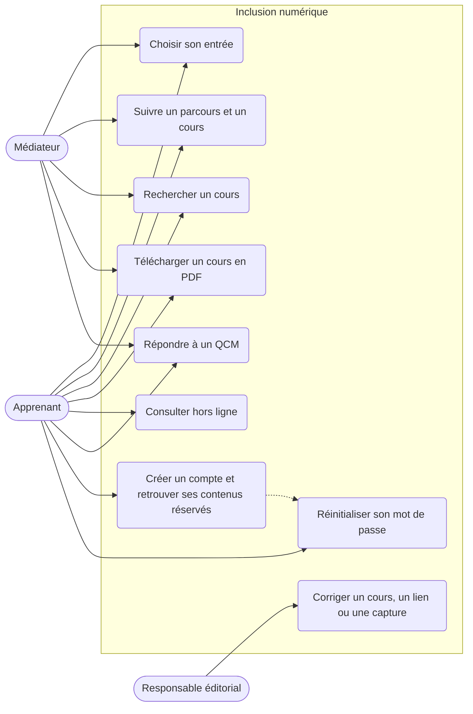

# User stories et cas d'utilisation

> Formalisé a posteriori le 2026-11-02, à partir du [plan produit](../../PLAN_APP_FORMATION_MEDIATEUR_NUMERIQUE.md) hérité de Médiateur et du code de `main2` (`30da5e5`). Ces stories n'ont pas guidé le développement : elles décrivent ce que le site fait ou doit faire, avec des critères vérifiables. <Status is="code" />

Chaque critère indique son niveau de preuve actuel. Un critère <Status is="prevu" /> n'est pas encore vérifié ; le [plan de tests](../tests/index.md) de la phase 4 en reprend la liste.

## Acteurs

| Acteur | Accès | Où |
|---|---|---|
| Apprenant (adulte, senior) | sans compte ; compte facultatif pour les contenus réservés | SPA `/spa/`, entrée « J'apprends le numérique » |
| Médiateur, professionnel, bénévole | sans compte | SPA, entrée « J'accompagne des personnes » |
| Responsable éditorial | compte `ROLE_ADMIN` | back-office `/admin` d'Inclusion ; rédaction assistée par le connecteur MCP de Médiateur, hors de ce dépôt |

## Cas d'utilisation

## Apprenant

| # | Story | Critères observables | Fonction | Preuve |
|---|---|---|---|---|
| US-A1 | En tant qu'apprenant, je veux choisir l'entrée qui me correspond pour ne voir que des cours à ma portée. | L'accueil affiche deux entrées ; `/apprendre` ne liste que les parcours `audience = apprendre`. | `AudiencePage.vue`, `Category.audience` | `CategoryAudienceApiTest` <Status is="ci" /> ; captures du 2026-11-02 <Status is="prod" /> |
| US-A2 | … suivre un cours sans créer de compte. | Un cours publié non réservé s'ouvre sans connexion ; un brouillon répond 404 dans l'API publique. | `PublishedContentExtension`, `CourseVisibility` | `PublishedContentApiTest` <Status is="ci" /> |
| US-A3 | … télécharger un cours en PDF pour l'imprimer ou le lire sans connexion. | `/cours/<slug>.pdf` renvoie un PDF pour un cours visible, 404 sinon. | `CoursePdfController`, `src/Service/Pdf/` | `CoursePdfTest` <Status is="ci" /> |
| US-A4 | … relire un cours déjà ouvert quand la connexion coupe. | Après une première visite, le cours s'affiche en mode hors ligne. | PWA, `offlineDb.js` | `offlineDb.spec.js` <Status is="ci" /> ; essai navigateur <Status is="prevu" /> |
| US-A5 | … m'entraîner avec un QCM. | Le formulaire propose un niveau et une langue (thème) ; les réponses affichent la correction. Aucun score n'est enregistré. | `front/src/views/QCM/`, `appy_QCM`, `appy_ChoicesQCM` | <Status is="code" /> ; essai <Status is="prevu" /> |
| US-A6 | … créer un compte avec un pseudo pour retrouver les cours que mon médiateur m'a réservés. | Inscription sur `/register` ; `/spa/mon-espace` liste les contenus réservés à la personne ; une autre personne ne les voit pas. | `RegistrationController`, `MonEspaceController`, `AccesReserve` | `LearnerAccountTest`, `PersonalizedContentApiTest` <Status is="ci" /> |
| US-A7 | … réinitialiser mon mot de passe. | Le lien reçu est à usage unique et expire après une heure. | `ResetPasswordController`, `PasswordResetToken` | `ResetPasswordTest` <Status is="ci" /> ; envoi réel de l'e-mail <Status is="prevu" /> |

## Médiateur

| # | Story | Critères observables | Fonction | Preuve |
|---|---|---|---|---|
| US-M1 | En tant que médiateur, je veux des fiches pour accompagner une personne sans faire à sa place. | `/accompagner` liste le parcours `audience = accompagner`. | `AudiencePage.vue` | captures du 2026-11-02 <Status is="prod" /> |
| US-M2 | … utiliser un cours en atelier, sur un écran ou imprimé. | Le cours a un sommaire, un PDF et une lecture à voix haute. | `PageContent.vue`, PDF | capture `cours-desktop.png` <Status is="prod" /> |
| US-M3 | … trouver rapidement un cours. | La recherche renvoie les cours publiés correspondant au mot saisi. | `front/src/components/features/search/` | scénario E2E hérité, non exécutable <Status is="code" /> |

## Responsable éditorial

| # | Story | Critères observables | Fonction | Preuve |
|---|---|---|---|---|
| US-E1 | En tant que responsable, je veux corriger un cours, un lien ou une capture sans toucher au code. | Le back-office liste et modifie les cours et les captures ; `/admin` exige `ROLE_ADMIN`. | EasyAdmin `src/Controller/Admin/`, `CaptureFileManager` | `BackOfficePagesTest`, `CaptureBackOfficeTest`, `AccessControlTest` <Status is="ci" /> |
| US-E2 | … qu'un brouillon reste invisible du public. | Un cours au statut `brouillon` n'apparaît ni dans l'API publique, ni dans le plan du site, ni en PDF. | `PublishedContentExtension`, `SitemapController`, `CourseVisibility` | `PublishedContentApiTest` (dont `testSitemapOnlyListsPublishedPages`), `CoursePdfTest` <Status is="ci" /> |
| US-E3 | … rédiger avec un assistant IA. | Hors périmètre de ce dépôt : la rédaction passe par le connecteur de Médiateur, qui écrit dans la base partagée. `/mcp` répond 404 ici. | — | `RemovedFeaturesTest` <Status is="ci" /> ; contrôle du 2026-11-02 <Status is="prod" /> |

## Hors périmètre

Suivi de progression, scores enregistrés, attestations, réservations et statistiques ([conception](index.md#exigences-retenues)).
