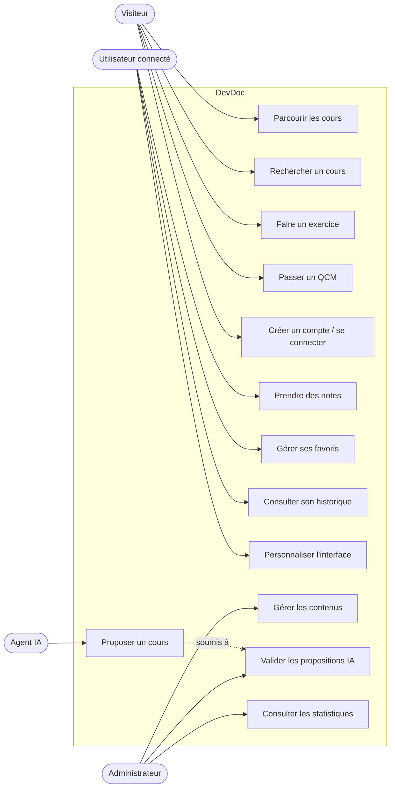
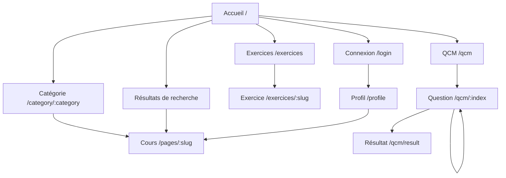

# Expression des besoins — DevDoc

> **Document formalisé a posteriori** le 2026-10-12, à partir de l'application existante (code, routes, règles de sécurité) et de l'historique Git. Il ne s'agit pas d'un cahier des charges antérieur au développement : il reconstitue les besoins auxquels l'application répond et la chronologie réelle de leur réalisation.

## 1. Contexte

DevDoc est une plateforme pédagogique de documentation pour le développement web. Elle réunit en un seul endroit :

- des cours organisés par technologie (Symfony, Vue.js, React, WordPress) et par niveau ;
- des exercices de code ;
- des QCM d'auto-évaluation ;
- un espace personnel (notes, favoris, historique, personnalisation).

Elle est accessible sur ordinateur et sur mobile, et utilisable hors connexion (PWA).

## 2. Acteurs

| Acteur | Description | Source dans le code |
|---|---|---|
| Visiteur | Consulte les cours, les exercices et les QCM sans compte | Routes front publiques (`front/src/router/index.js`) |
| Utilisateur connecté | Visiteur authentifié : notes, favoris, historique, personnalisation, profil | `ROLE_USER` (`config/packages/security.yaml`), `authGuard` (`front/src/router/guards.js`) |
| Administrateur | Gère les contenus, les menus, les niveaux et les propositions de cours IA | `ROLE_ADMIN`, `/admin` (EasyAdmin), `adminGuard` |
| Agent IA (système externe) | Propose ou crée des cours soumis à validation | `/api/proposition-ia`, `/api/admin/agent-cours` (protégés par `ROLE_ADMIN`) |

## 3. User stories

Format : *En tant que… je veux… afin de…* ; critères d'acceptation vérifiables dans l'application.

### Consulter les cours

| ID | User story | Critères d'acceptation |
|---|---|---|
| US-01 | En tant que visiteur, je veux choisir une technologie depuis l'accueil afin d'accéder à ses cours. | L'accueil affiche les technologies ; un clic ouvre `/category/:category`. |
| US-02 | En tant que visiteur, je veux parcourir les cours d'une catégorie par menu et par niveau afin de suivre une progression. | Les menus sont groupés par catégorie ; filtrage par niveau de cours (`NiveauCours`). |
| US-03 | En tant que visiteur, je veux lire un cours avec un sommaire et du code coloré afin de m'y retrouver dans un contenu long. | Page `/pages/:slug` ; sommaire cliquable (ancres) ; coloration Prism. |
| US-04 | En tant que visiteur, je veux rechercher un cours par mot-clé afin de le trouver sans naviguer dans les menus. | Champ de recherche sur ordinateur et mobile ; liste de résultats cliquables. |

### S'exercer et s'évaluer

| ID | User story | Critères d'acceptation |
|---|---|---|
| US-05 | En tant que visiteur, je veux faire des exercices de code afin de mettre en pratique un cours. | Liste `/exercices` ; détail `/exercices/:slug` avec éditeur de code. |
| US-06 | En tant que visiteur, je veux répondre à un QCM filtré par langage et difficulté afin d'évaluer mon niveau. | `/qcm` puis une question par écran (`/qcm/:index`) ; filtres langage et difficulté (API `/language/{language}/difficulty/{difficulty}`). |
| US-07 | En tant que visiteur, je veux voir mon score et les bonnes réponses à la fin du QCM afin de comprendre mes erreurs. | Page `/qcm/result` ; réponses correctes affichées. |

### Espace personnel

| ID | User story | Critères d'acceptation |
|---|---|---|
| US-08 | En tant que visiteur, je veux créer un compte et me connecter afin d'avoir un espace personnel. | `/register`, `/login` ; déconnexion protégée par CSRF. |
| US-09 | En tant qu'utilisateur connecté, je veux prendre des notes sur un cours afin de garder mes remarques au même endroit. | Éditeur de note sur la page de cours ; notes chiffrées en base (`NoteEncryptionService`) ; liste dans le profil. |
| US-10 | En tant qu'utilisateur connecté, je veux mettre un cours en favori afin de le retrouver rapidement. | Bouton favori ; liste « mes favoris ». |
| US-11 | En tant qu'utilisateur connecté, je veux consulter mon historique de pages vues afin de reprendre où j'en étais. | Historique et statistiques personnelles ; suppression d'une entrée ou de tout l'historique. |
| US-12 | En tant qu'utilisateur connecté, je veux personnaliser les couleurs de l'interface afin de l'adapter à mes préférences. | Formulaire de couleurs (fond, texte, menus, catégories) ; valeurs par défaut restaurables. |
| US-13 | En tant que visiteur non connecté, je ne dois pas accéder au profil. | Redirection vers l'accueil (`authGuard`) ; API protégée par `ROLE_USER`. |

### Administration

| ID | User story | Critères d'acceptation |
|---|---|---|
| US-14 | En tant qu'administrateur, je veux gérer catégories, menus, cours, exercices et QCM afin de faire évoluer le contenu sans toucher au code. | Back-office `/admin` (EasyAdmin, `src/Controller/Admin/`) réservé à `ROLE_ADMIN` : catégories, menus, pages, exercices, QCM, niveaux, SEO, utilisateurs. |
| US-15 | En tant qu'administrateur, je veux valider ou refuser les cours proposés par un agent IA afin de garder la maîtrise du contenu publié. | Propositions listées ; actions accepter / refuser / relire. |
| US-16 | En tant qu'administrateur, je veux voir les statistiques de visite des pages afin de savoir quels cours sont consultés. | `/admin/stats/page-visits`. |

### Exigences non fonctionnelles

| ID | Exigence | Mise en œuvre |
|---|---|---|
| ENF-01 | Utilisable sur mobile | Interface responsive, menus et recherche mobiles dédiés |
| ENF-02 | Consultable hors connexion | PWA (vite-plugin-pwa, Workbox : `CacheFirst` / `NetworkFirst`) |
| ENF-03 | Contenu HTML sûr | Nettoyage serveur (`HtmlSanitizerService`) et client (`SafeHtml.vue`, DOMPurify) |
| ENF-04 | Confidentialité des notes | Chiffrement des notes (`NoteEncryptionService`) |
| ENF-05 | Référencement | Sitemap (`SitemapController`), entité `Seo` |

## 4. Cas d'utilisation

L'utilisateur connecté hérite des cas du visiteur, et l'administrateur de ceux de l'utilisateur connecté.

## 5. Enchaînement des écrans

Écrans relevés dans `front/src/router/index.js` (application servie sous `/spa`).

## 6. Chronologie de réalisation (historique Git)

Trace réelle de l'ordre dans lequel les besoins ont été traités (`git log` de `main`).

| Période | Fonctionnalités | Commits repères |
|---|---|---|
| Juin 2025 | Socle Symfony + Vue sous Docker, espace admin | `cf5bc71d` first commit, `e2141999` espace admin |
| Juillet 2025 | Recherche, PWA, première version, page profil | `0241d7cd` search, `612b2065` pwa, `c2cc28fa` 1re version, `fa166d50` page profil |
| Août 2025 | QCM, génération de questions | `b37e7e2a` qcm, PR #1 et #2 |
| Septembre–octobre 2025 | API pour n8n, exercices | `4a3c8a34` crud api n8n, `e34fb55f` exercice |
| Décembre 2025 | Menus et sommaire, sécurisation HTML, responsive, recherche mobile, premiers déploiements | `1515e696` sommaire, `e1392a2e` secure html, `fc34130b` responsive, `981f69a2` search ok |
| Janvier 2026 | Refactorisation hexagonale, filtrage par niveau | `e3be3ccc` refactor-hexagonal, `ef64075a` filtrage par niveau |
| Mai 2026 | Création de cours par agent IA vers l'API Symfony | `954d9e45` |
| Juillet–octobre 2026 | CI/CD et déploiement OVH automatisé, qualité | `a10b1030` pipeline CI/CD, `49533b75` déploiement depuis `main` |

## 7. Limites

- Aucune maquette ni expression de besoins n'a été produite avant le développement : les maquettes associées ([maquettes.md](maquettes.md)) sont réalisées a posteriori et comparées aux écrans réels.
- Les user stories décrivent le comportement observé dans le code. Elles n'ont pas fait l'objet d'une recette formelle.
