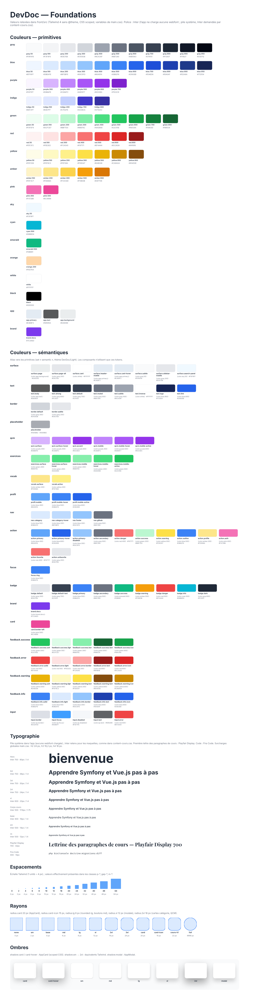
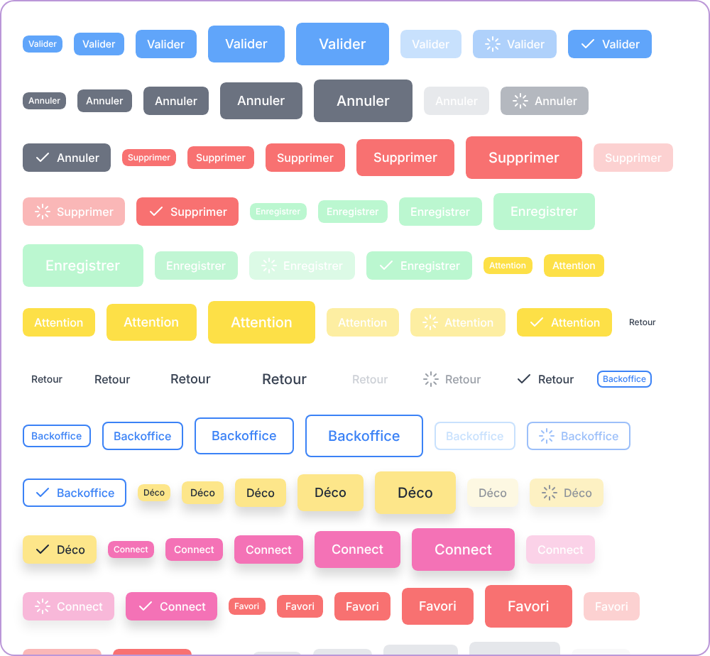
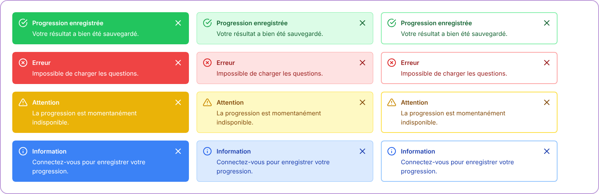

# Design system — DevDoc

> **Design system réalisé a posteriori** les 2026-10-13 et 2026-10-14, à partir du code du front (`front/src/`) et de l'application en local. Il formalise l'existant : il ne précède pas le développement et ne modifie pas l'application. <Status is="local" />

- Outil : [Penpot](https://penpot.app) 2.18.3 auto-hébergé ([`tools/penpot/compose.yaml`](../../tools/penpot/compose.yaml), `make design-up`, voir [Lancer en local](../demarrer/local.md#maquettes-penpot)). Le fichier Penpot n'est pas versionné : il vit dans le volume Docker local. Les exports PNG ci-dessous en sont la trace versionnée.
- Fichier Penpot (projet « Drafts », nom actuel « Nouveau fichier 1 », à renommer « DevDoc — Design system »). Il contient 4 pages : **Foundations** (tokens et planche de spécimens), **Components** (32 composants), **Screens** (24 écrans) et **Captures** (captures de l'application réelle).
- Construction : par l'API de plugin de Penpot, pilotée par un agent IA à travers le serveur MCP de Penpot, section par section. Chaque section a été exportée en PNG et contrôlée visuellement, puis comparée aux captures de l'application.
- Exports versionnés : planches dans [`design-system/`](design-system/), écrans dans [`maquettes/`](maquettes/) (voir [Maquettes](maquettes.md)).

## Principes

- **Fidèle au code, pas inventé.** Chaque valeur provient d'une classe Tailwind, d'une règle CSS ou d'une valeur calculée par le navigateur sur l'application locale. Deux éléments sont absents du code et clairement marqués « proposé » : le Toast et l'écran hors ligne stylé.
- **Deux niveaux de tokens.** Les *primitives* sont les couleurs Tailwind effectivement utilisées et les valeurs brutes. Les *sémantiques* sont des alias par usage (`sem.qcm.surface`, `sem.action.primary`…). Les composants n'utilisent que les tokens sémantiques ou, à défaut, des primitives.
- **Écrans = instances.** Les écrans de la page Screens n'assemblent que des instances de composants, dans des cadres de mise en page. Les textes y sont des surcharges d'instance.

## Foundations

### Tokens

Deux sets Penpot, `primitives` et `semantic`, activés par le thème `DevDoc/Light`. Il n'existe pas de thème sombre : le code bascule bien une classe `.dark` ([`stores/preferences.js`](../../front/src/stores/preferences.js)), mais aucune classe `dark:` ne l'exploite.

| Famille | Tokens | Source |
|---|---|---|
| Couleurs primitives | Palettes Tailwind relevées dans les classes (`gray`, `blue`, `purple`, `indigo`, `green`, `red`, `yellow`, `amber`, `pink`, `sky`, `cyan`, `emerald`, `orange`), variables `color.app.*`, valeurs Element Plus `color.ep.*` | Classes de `front/src/`, [`assets/main.css`](../../front/src/assets/main.css) (lignes 5-9), thème Element Plus |
| Couleurs sémantiques | 88 alias : `surface`, `text`, `border`, `qcm`, `exercices`, `vocab`, `profil`, `nav`, `action`, `focus`, `badge`, `feedback.{success,error,warning,info}`, `input`, `card`, `brand` | Voir le tableau suivant |
| Espacements | `space.0` à `space.64` (échelle Tailwind, 1 unité = 4 px) | Classes `p-*`, `gap-*`, `m-*` |
| Rayons | `radius.lg` 8 (`rounded-lg`), `radius.xl` 12 (modale), `radius.2xl` 16, `radius.card` 20, `radius.card-icon` 15, `radius.cours-h1` 22, `radius.full` | [`AppCard.vue`](../../front/src/components/ui/AppCard.vue), [`content-cours.css`](../../front/src/assets/styles/content-cours.css) |
| Ombres | `shadow.card` (0 15 35 / 10 %), `shadow.card-hover` (0 25 50 / 15 %), `shadow.sm` à `shadow.2xl` (Tailwind), `shadow.modal` | `AppCard.vue`, [`AppModal.vue`](../../front/src/components/ui/AppModal.vue) |
| Typographie | 9 styles (`Hero` 80, `4xl` 36, `3xl` 30, `2xl` 24, `xl` 20, `Corps cours` 17,6 / 1,75, `base` 16, `sm` 14, `xs` 12), familles `Inter` et `Fira Code` | `HomePage.vue`, `content-cours.css`, surcharges `h2`/`h3`/`h4` de `main.css` |

### Couleurs d'usage

| Usage | Token | Valeur | Source |
|---|---|---|---|
| Fond de page | `sem.surface.page` | `#EAEDEE` | `--background-color`, [`main.css`](../../front/src/assets/main.css) |
| Header mobile, survol de carte | `sem.surface.header-mobile` | `#E3EBF3` | `--primary-color` |
| Texte courant | `sem.text.body` | `#58595A` | `--color-text` |
| Logo | `sem.text.logo` | `blue-950` | [`AppHeader.vue`](../../front/src/components/layout/AppHeader.vue) |
| Entrée QCM | `sem.qcm.surface` / `-hover` | `purple-300` / `purple-400` | [`AppNavigation.vue`](../../front/src/components/layout/AppNavigation.vue) |
| Bouton QCM mobile | `sem.qcm.mobile` | `#C084FC` | [`NavFooterMobile.vue`](../../front/src/components/navigation/NavFooterMobile.vue) |
| Entrée Exercices | `sem.exercices.surface` / `-hover` | `green-300` / `green-400` | `AppNavigation.vue`, `NavFooterMobile.vue` |
| Filtres de vocabulaire | `sem.vocab.surface` | `amber-200` | [`SelectfunctionVocabulaire.vue`](../../front/src/components/navigation/SelectfunctionVocabulaire.vue) |
| Catégories de la sidebar | `sem.nav.category` / `-hover` | `blue-100` / `blue-200` | [`CategoryMenu.vue`](../../front/src/components/navigation/CategoryMenu.vue) |
| Barre mobile | `sem.nav.footer` | `blue-300` | `NavFooterMobile.vue` |
| Action principale | `sem.action.primary` / `-hover` | `blue-400` / `blue-600` | [`AppButton.vue`](../../front/src/components/ui/AppButton.vue) |
| Messages | `sem.feedback.*` (`solid`, `light`, `border`, `text`, `icon`) | `green`, `red`, `yellow`, `blue` 100 à 800 | [`AppAlert.vue`](../../front/src/components/ui/AppAlert.vue) |

Le violet `#7C3AED` (`color.brand.docs`) n'est **pas** une couleur de l'application. C'est la couleur de marque de ce site de documentation ([`custom.css`](../.vitepress/theme/custom.css)). L'application n'a pas de couleur de marque unique : le bleu sert aux actions, le violet au QCM, le vert aux exercices.

## Composants

32 composants Penpot, dont 17 jeux de variantes. Les composants de mise en page (Header, Sidebar…) et les blocs de page reprennent la structure des vues Vue correspondantes.

| Composant Penpot | Variantes | Source dans le code | Planche |
|---|---|---|---|
| Button | `Variant` (12 : primary, secondary, danger, success, warning, ghost, outline, profile, auth, favorite, unfavorite, neutral) × `Size` (xs, sm, md, lg, xl), plus `State` disabled / loading et `Icon` left en md (et en sm pour auth et profile) : 98 variantes | [`AppButton.vue`](../../front/src/components/ui/AppButton.vue) | [button.png](design-system/button.png) |
| Badge | `Variant` (8) × `Style` (solid, outline), plus `Dot` : 24 variantes | [`AppBadge.vue`](../../front/src/components/ui/AppBadge.vue) | [badge.png](design-system/badge.png) |
| Alert | `Type` (success, error, warning, info) × `Style` (solid, light, outline) | `AppAlert.vue` | [alert.png](design-system/alert.png) |
| Input | `Size` (large, default, small) × `State` (default, focus, filled, disabled, error) | [`AppInput.vue`](../../front/src/components/ui/AppInput.vue) (Element Plus `el-input`) | [input.png](design-system/input.png) |
| Select | `Size` × `State` (default, filled, disabled, open avec liste) | [`AppSelect.vue`](../../front/src/components/ui/AppSelect.vue) (`el-select`) | [select.png](design-system/select.png) |
| Card | `State` default / hover : rayon 20, padding 24, ombre douce, bordure gauche `pink-500`, liste de cours, pied « N cours » | `AppCard.vue`, [`CourseCard.vue`](../../front/src/components/features/pages/CourseCard.vue) | [card.png](design-system/card.png) |
| CategoryTile | `State` default / hover | [`HomePage.vue`](../../front/src/components/features/home/HomePage.vue) | [category-tile.png](design-system/category-tile.png) |
| Tab | `Onglet` (favoris, notes, progression, stats, apparence) × `Active` | [`Profile.vue`](../../front/src/views/Profile.vue) (onglets écrits dans la vue) | [tab.png](design-system/tab.png) |
| Modal | taille md (500 px), en-tête, corps, pied Annuler / Confirmer en instances de Button | `AppModal.vue` | [modal.png](design-system/modal.png) |
| Toast (proposé) | `Type` success / error / info | Absent : état `toasts` du store [`ui.js`](../../front/src/stores/ui.js) sans interface | [toast.png](design-system/toast.png) |
| QcmChoice | `State` default / hover / selected | [`questionQCM.vue`](../../front/src/views/QCM/questionQCM.vue) | [qcm-choice.png](design-system/qcm-choice.png) |
| QcmFeedback | `Result` correct / wrong (bonne réponse, explication, mauvais choix) | `questionQCM.vue` | [qcm-feedback.png](design-system/qcm-feedback.png) |
| State | `Type` loading / empty / error / offline × `Source` code / proposé | `Profile.vue`, `questionQCM.vue`, [`public/offline.html`](../../public/offline.html) | [state.png](design-system/state.png) |
| HeaderDesktop | `Session` invité / connecté (admin) | `AppHeader.vue` | [header-desktop.png](design-system/header-desktop.png) |
| HeaderMobile | `Session` invité / connecté | [`AppHeaderMobile.vue`](../../front/src/components/layout/AppHeaderMobile.vue) | [header-mobile.png](design-system/header-mobile.png) |
| Sidebar | catégories, QCM, Exercices, filtres de vocabulaire, liens de documentation, bouton replier | `AppNavigation.vue` | [sidebar.png](design-system/sidebar.png) |
| CategoryMenu | `State` fermé / ouvert | `CategoryMenu.vue`, `CategoryMenuItem.vue` | [category-menu.png](design-system/category-menu.png) |
| BottomBar | `Session` invité (QCM, Exos) / connecté (+ Profil) | `NavFooterMobile.vue` | [bottom-bar.png](design-system/bottom-bar.png) |
| Sommaire | onglets Sommaire / Notes, liste, progression | [`TableOfContents.vue`](../../front/src/components/features/pages/toc/TableOfContents.vue) | [sommaire.png](design-system/sommaire.png) |
| CourseBlock | `Type` h1 / h2 / p / code | `content-cours.css` (`.principal`) | [course-block.png](design-system/course-block.png) |
| Blocs de page | HomeHero, CategoryHeader, CourseTitle, CourseNav, QcmStartForm, QcmQuestionCard, QcmResultSummary, QcmResultItem, QcmResultActions, ProfileHeader, ProgressTable, LoginCard | Vues `HomePage.vue`, [`CategoryPage.vue`](../../front/src/views/CategoryPage.vue), [`PageContent.vue`](../../front/src/components/features/pages/PageContent.vue), [`PageQCM.vue`](../../front/src/views/QCM/PageQCM.vue), `questionQCM.vue`, [`resultQCM.vue`](../../front/src/views/QCM/resultQCM.vue), `Profile.vue`, [`login.html.twig`](../../templates/security/login.html.twig) | ex. [qcm-question-card.png](design-system/qcm-question-card.png), [progress-table.png](design-system/progress-table.png), [login-card.png](design-system/login-card.png) |

## Écarts et constats relevés

Ils viennent de la comparaison entre le code, l'application locale et la demande initiale. Aucun n'a été corrigé dans le code.

- **Pas de couleur de marque violette.** Le violet `#7C3AED` est celui du site de documentation. Dans l'application, le violet est réservé au QCM (`purple-300` à `purple-600`).
- **Composants absents du code.** Il n'existe ni Tabs, ni Toast, ni Spinner, ni état vide générique. Les onglets et les états sont écrits directement dans les vues. Le Toast et l'écran hors ligne stylé sont donc des propositions, marquées comme telles.
- **Page hors ligne sans style.** [`public/offline.html`](../../public/offline.html) affiche un simple titre « Vous etes hors ligne » (sans accent) dans la police serif par défaut du navigateur.
- **Icônes invisibles sur l'écran Question.** Les boutons « Réponse », « Question suivante » et « Fin » reçoivent `icon="pi-check"` sans le préfixe `pi ` ([`questionQCM.vue`](../../front/src/views/QCM/questionQCM.vue), lignes 160-177). Ces icônes ne s'affichent donc pas. La maquette les reproduit sans icône.
- **Contraste faible.** La variante `success` d'AppButton met un texte blanc sur `green-200`. Elle est reproduite telle quelle.
- **Typographie.** Aucune webfont n'est chargée : l'application utilise la pile système (Fira Sans sur le poste de capture). Les maquettes utilisent Inter, déjà demandé par `content-cours.css`. Les tailles et graisses suivent le code.
- **Carte de cours transparente.** `.course-card` n'a pas de fond. Dans Penpot, un fond blanc à 40 % la rend lisible sur le fond de catégorie, comme dans le rendu réel.
- **Icônes.** PrimeIcons et Font Awesome ne sont pas disponibles dans Penpot. Les icônes sont des équivalents SVG au trait, et les tuiles de catégorie utilisent une icône générique.
- **Onglet « Apparence ».** Le bouton est affiché mais son contenu est en commentaire (déjà relevé dans [Fonctionnalités](../fonctionnalites/index.md)).

## Reprendre ou étendre le design system

1. `make design-up`, puis ouvrir http://localhost:9001. Le fichier se trouve dans le projet « Drafts ».
2. Ajouter une valeur : créer le token dans le set `primitives` ou `semantic` et l'appliquer au composant. Ne pas saisir de couleur en dur.
3. Exporter la planche ou l'écran modifié en PNG dans `docs/conception/design-system/` ou `docs/conception/maquettes/`, puis mettre à jour cette page.
