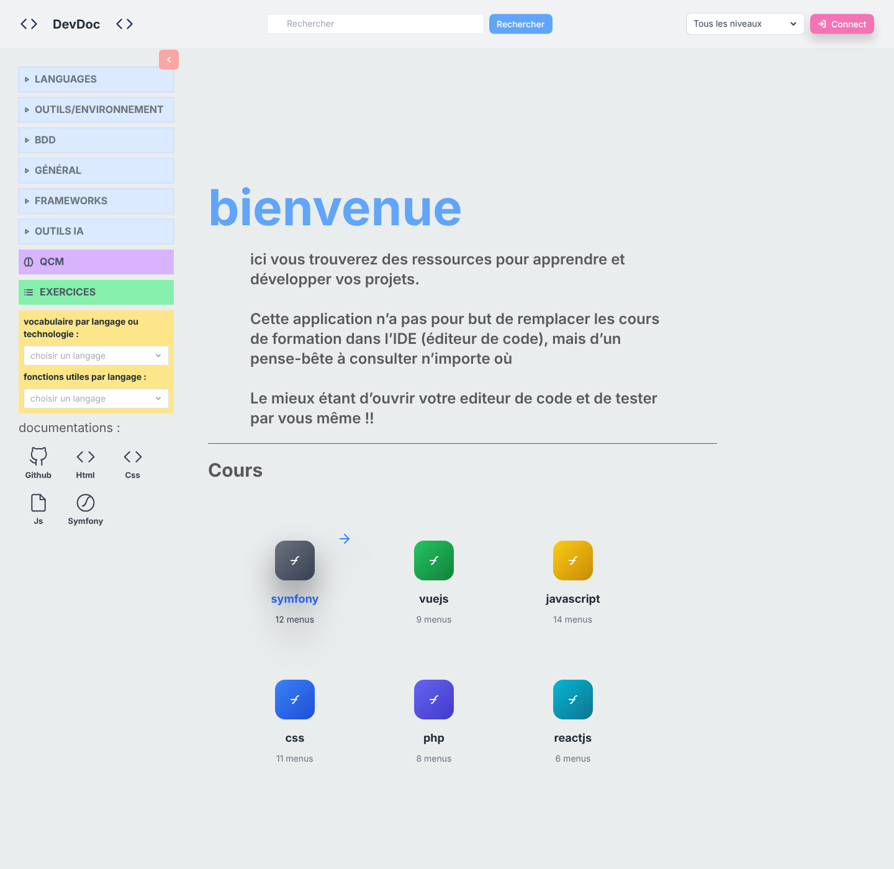
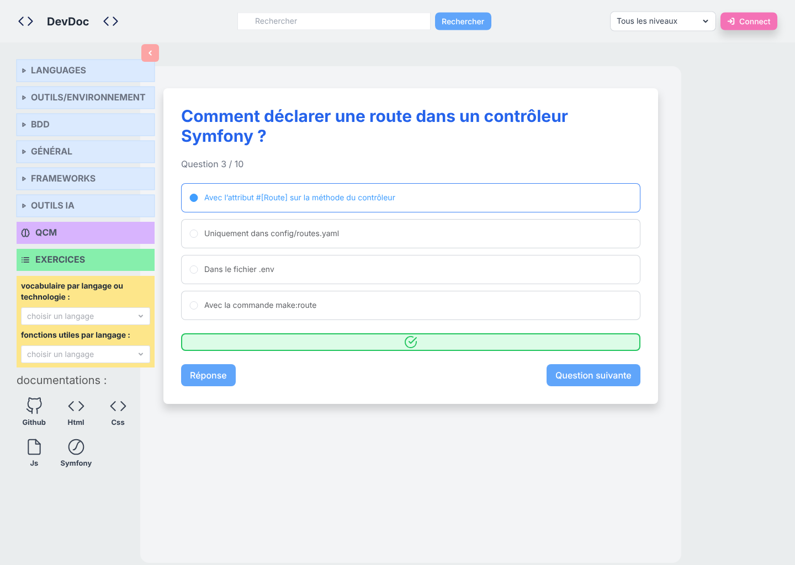
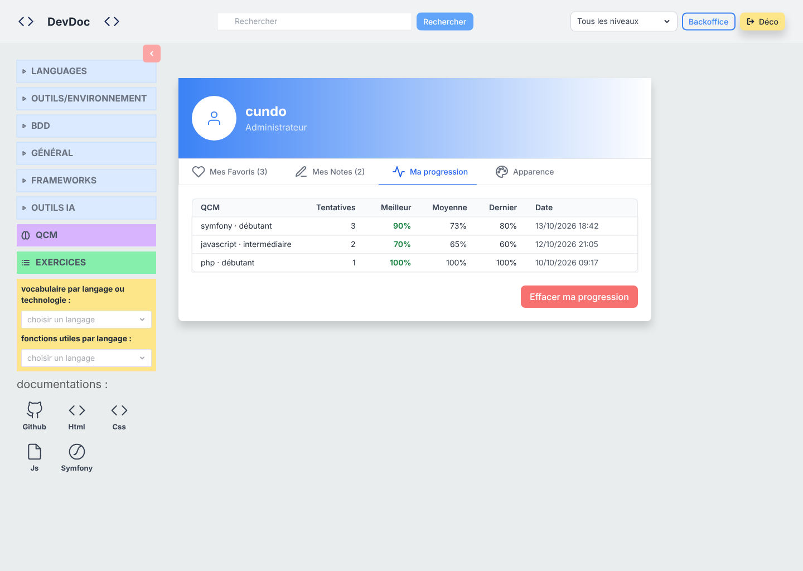
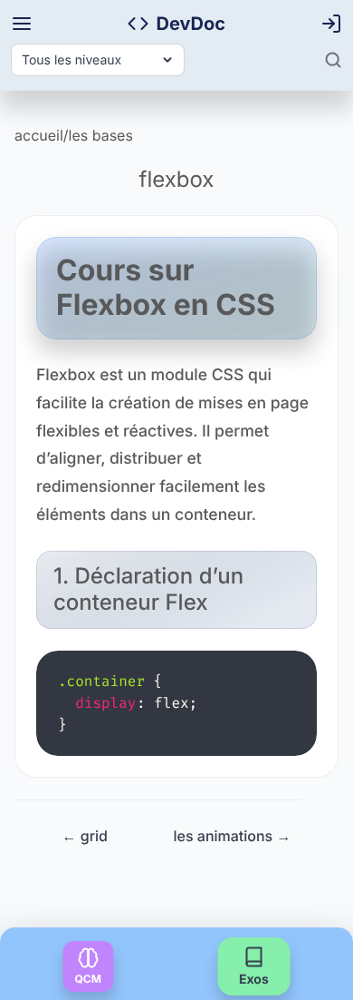
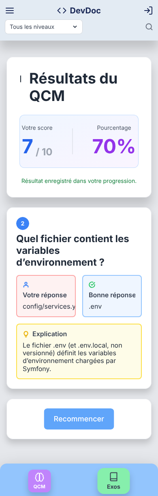
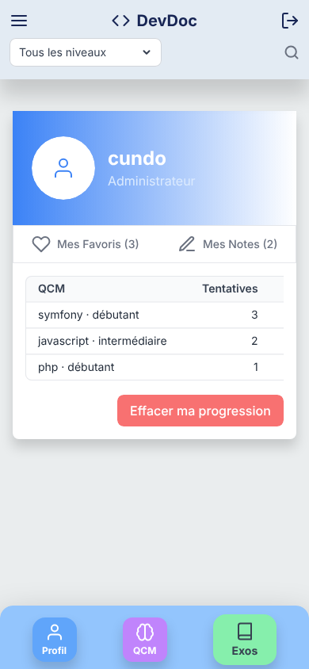

# Maquettes — DevDoc

> **Maquettes haute fidélité réalisées a posteriori** les 2026-10-13 et 2026-10-14, dans Penpot, à partir de l'application existante et du code source (`front/src/`). Elles formalisent les écrans du parcours complet, en desktop (1440 px) et en mobile (390 px), et les relient aux user stories de [besoins.md](besoins.md). Elles ne précèdent pas le développement. <Status is="local" />

- Outil : Penpot auto-hébergé (`make design-up`, voir [Lancer en local](../demarrer/local.md#maquettes-penpot)). Page **Screens** du fichier décrit dans [Design system](design-system.md).
- Construction : chaque écran est un cadre qui assemble **uniquement des instances** des composants du design system (header, sidebar, barre mobile, blocs de page). Les textes sont des surcharges d'instance. Toute modification d'un composant se répercute donc sur les 24 écrans.
- Exports versionnés : [`maquettes/`](maquettes/) (24 PNG, 1×). Captures de l'application réelle : [`captures/`](captures/), prises en local (`http://localhost:8092/spa/`) le 2026-10-12, importées aussi dans la page **Captures** du fichier Penpot.
- Version précédente : 5 maquettes basse fidélité Figma en niveaux de gris, du 2026-10-12 ([fichier Figma](https://www.figma.com/design/yAkKPYcYS6XMhwGVI8RqKX)). Elles sont remplacées par les exports Penpot, mais restent consultables dans l'historique Git (commit `d9e57f1a`).

## Écrans

| Écran | Desktop | Mobile | Réalisation | User stories |
|---|---|---|---|---|
| Accueil | [01-accueil-desktop.png](maquettes/01-accueil-desktop.png) | [01-accueil-mobile.png](maquettes/01-accueil-mobile.png) | [accueil-desktop.png](captures/accueil-desktop.png) | US-01, US-04 |
| Catégorie | [02-categorie-desktop.png](maquettes/02-categorie-desktop.png) | [02-categorie-mobile.png](maquettes/02-categorie-mobile.png) | Vue dans l'application locale (`/spa/category/symfony`), non capturée | US-02 |
| Cours | [03-cours-desktop.png](maquettes/03-cours-desktop.png) | [03-cours-mobile.png](maquettes/03-cours-mobile.png) | [cours-desktop.png](captures/cours-desktop.png), [cours-mobile.png](captures/cours-mobile.png) | US-03, US-09, ENF-01 |
| QCM — choix | [04-qcm-choix-desktop.png](maquettes/04-qcm-choix-desktop.png) | [04-qcm-choix-mobile.png](maquettes/04-qcm-choix-mobile.png) | [qcm-desktop.png](captures/qcm-desktop.png) | US-06 |
| QCM — question | [05-qcm-question-desktop.png](maquettes/05-qcm-question-desktop.png) | [05-qcm-question-mobile.png](maquettes/05-qcm-question-mobile.png) | Non capturé | US-06 |
| QCM — résultat | [06-qcm-resultat-desktop.png](maquettes/06-qcm-resultat-desktop.png) | [06-qcm-resultat-mobile.png](maquettes/06-qcm-resultat-mobile.png) | Non capturé | US-07 |
| Profil — « Ma progression » | [07-profil-ma-progression-desktop.png](maquettes/07-profil-ma-progression-desktop.png) | [07-profil-ma-progression-mobile.png](maquettes/07-profil-ma-progression-mobile.png) | Non capturé (écran réservé aux utilisateurs connectés) | US-09, US-10, US-13 |
| État vide (profil) | [08-etat-vide-profil-desktop.png](maquettes/08-etat-vide-profil-desktop.png) | [08-etat-vide-profil-mobile.png](maquettes/08-etat-vide-profil-mobile.png) | — | — |
| État chargement (profil) | [09-etat-chargement-profil-desktop.png](maquettes/09-etat-chargement-profil-desktop.png) | [09-etat-chargement-profil-mobile.png](maquettes/09-etat-chargement-profil-mobile.png) | — | — |
| État erreur (profil) | [10-etat-erreur-profil-desktop.png](maquettes/10-etat-erreur-profil-desktop.png) | [10-etat-erreur-profil-mobile.png](maquettes/10-etat-erreur-profil-mobile.png) | — | — |
| Connexion | [11-connexion-desktop.png](maquettes/11-connexion-desktop.png) | [11-connexion-mobile.png](maquettes/11-connexion-mobile.png) | Page Twig `/login`, vue dans l'application locale | US-08 |
| Hors ligne | [12-hors-ligne-desktop.png](maquettes/12-hors-ligne-desktop.png) | [12-hors-ligne-mobile.png](maquettes/12-hors-ligne-mobile.png) | — | ENF-02 |

  
  
  

## Prototype interactif

Les écrans de la page **Screens** sont reliés en prototype cliquable (2026-10-14). <Status is="local" />

Pour le lancer : ouvrir le fichier dans Penpot (http://localhost:9001), page **Screens**, bouton **View mode** (▶ en haut à droite), puis choisir le parcours dans la liste des flows.

| Flow | Départ | Parcours |
|---|---|---|
| QCM complet — desktop / mobile | Accueil | Lien « QCM » de la sidebar (desktop) ou bouton QCM de la barre du bas (mobile) → QCM choix → **GO** → question → **Question suivante** → résultat → **Recommencer** → QCM choix |
| Lecture d'un cours — desktop / mobile | Accueil | Tuile « symfony » → Catégorie → premier cours de la carte → Cours |
| Connexion et profil — desktop / mobile | Accueil | **Connect** (desktop) ou icône de connexion du header (mobile) → Connexion → **Se connecter** → Profil « Ma progression » → **Effacer ma progression** ouvre la fenêtre de confirmation en superposition (**Annuler** la ferme, **Confirmer** mène à l'état vide) → **Déco** ou icône de déconnexion → Accueil |

Liens communs à tous les écrans à header : le logo ramène à l'Accueil, le lien ou bouton QCM mène au choix de QCM. Le bouton Profil de la barre mobile n'existe que connecté, comme dans [`NavFooterMobile.vue`](../../front/src/components/navigation/NavFooterMobile.vue) (`v-if="user"`). Les transitions sont des fondus de 250 ms.

Limites : les clics simulent le parcours sans logique (pas de sélection de réponse, pas de saisie dans le formulaire de connexion). La fenêtre de confirmation est un cadre « Overlay — Effacer ma progression » à côté de l'écran Profil. Le prototype vit dans le fichier Penpot, qui n'est pas versionné (volume Docker).

## Données affichées

Les contenus viennent de l'application locale et du code : catégories et cours de la catégorie Symfony, textes de l'accueil, libellés des vues. Les questions de QCM, le score et les lignes du tableau de progression sont des exemples plausibles, avec les colonnes et les formats du code (`Profile.vue`, `resultQCM.vue`). Les états reprennent les messages réels de `Profile.vue` et `questionQCM.vue`.

## Écarts relevés entre maquette et réalisation

- **Fidélité.** Les couleurs, rayons, ombres, espacements et libellés suivent le code. Les maquettes ont été comparées aux captures de l'application : header, sidebar, cartes de catégorie, cours, formulaire QCM et barre mobile.
- **Police.** L'application n'embarque aucune webfont (pile système, Fira Sans sur le poste de capture). Les maquettes utilisent Inter, déjà prévu par `content-cours.css`.
- **Icônes.** PrimeIcons et Font Awesome sont remplacés par des icônes SVG au trait équivalentes. L'écran Question reproduit les boutons sans icône, car leurs icônes ne s'affichent pas dans l'application (préfixe `pi ` manquant).
- **Hors ligne.** La maquette reproduit la page réelle (`public/offline.html`, sans style). Une version stylée est seulement proposée dans le composant State (`Source = proposé`).
- **Tableau de progression sur mobile.** Le tableau garde sa largeur et défile horizontalement (`overflow-x-auto`). La maquette montre la partie visible.
- **Sommaire sur mobile.** Le code prévoit un sommaire replié sur mobile (`TocList.vue`, `collapsedOnMobile`), mais il n'apparaît pas dans la capture. La maquette mobile ne le montre pas non plus.
- **Catégories de l'accueil.** La couleur des tuiles suit les dégradés de `HomePage.vue`, mais l'icône est générique : les logos des technologies ne sont pas reproduits.

Les constats sur le code lui-même (pas de couleur de marque, composants absents, contraste) sont détaillés dans [Design system](design-system.md#écarts-et-constats-relevés).
