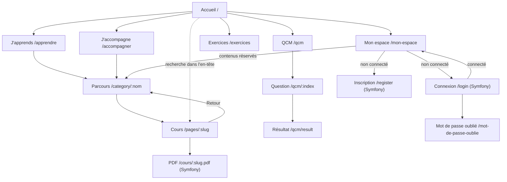
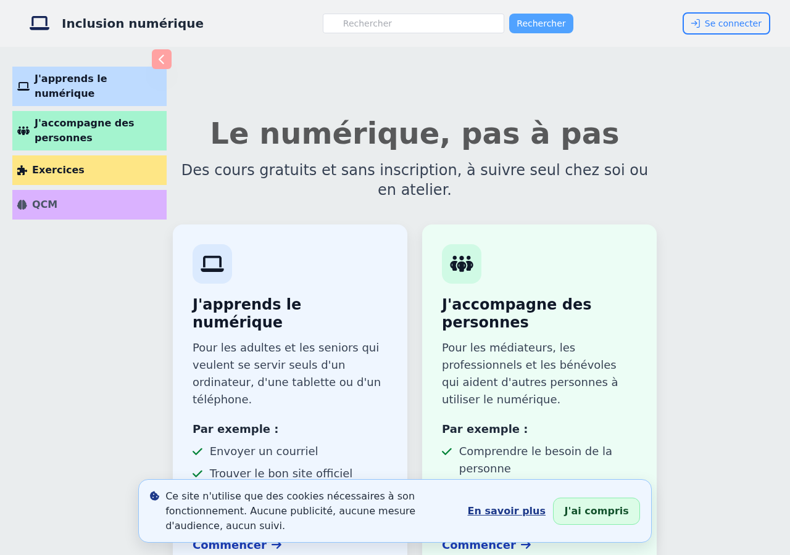
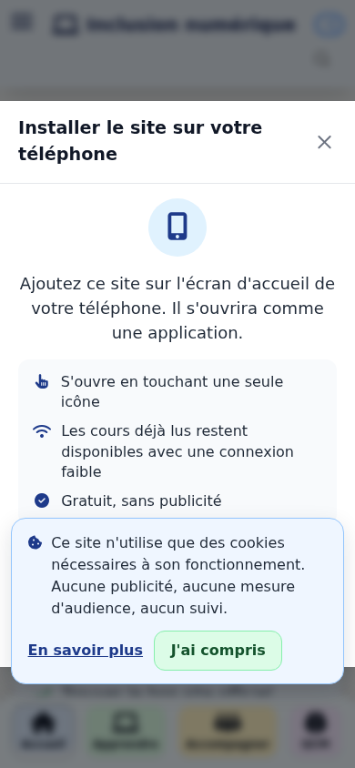
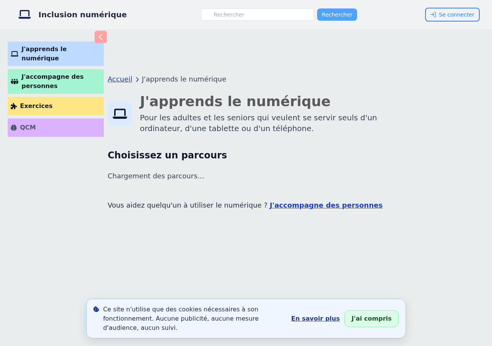
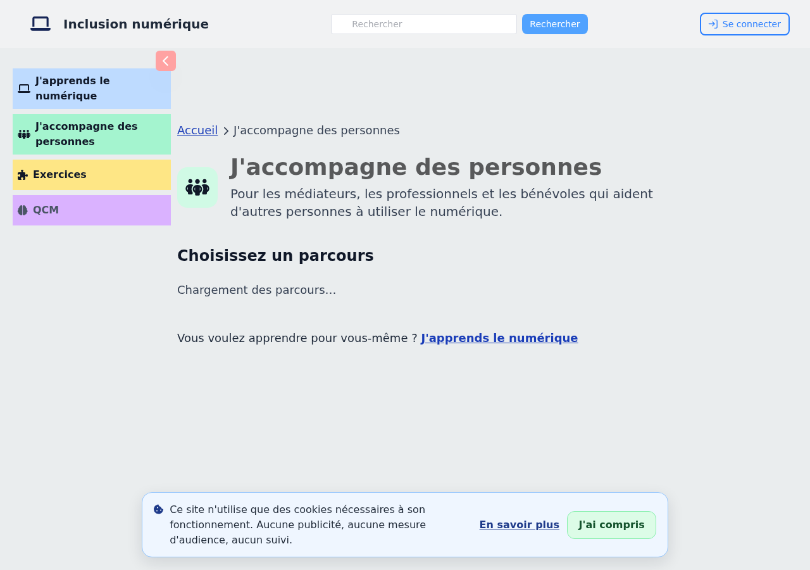
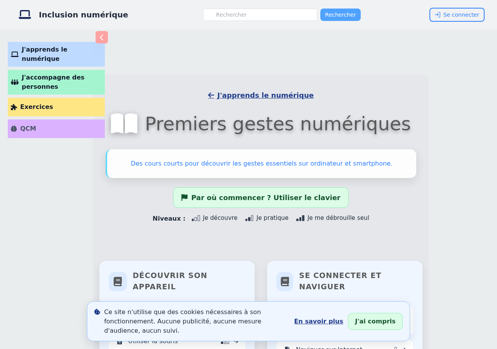
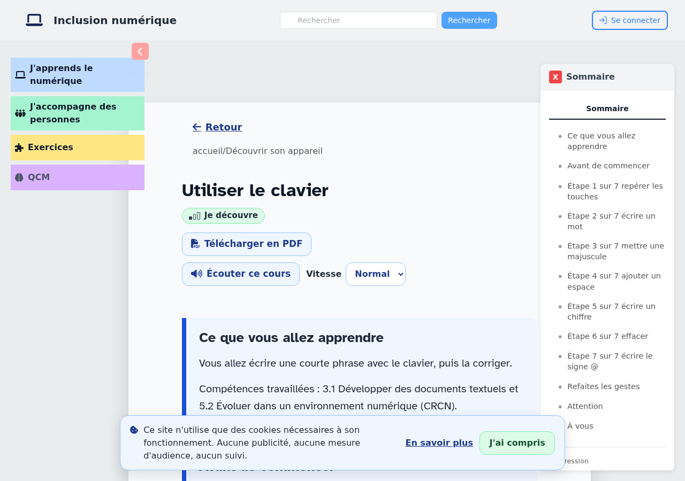
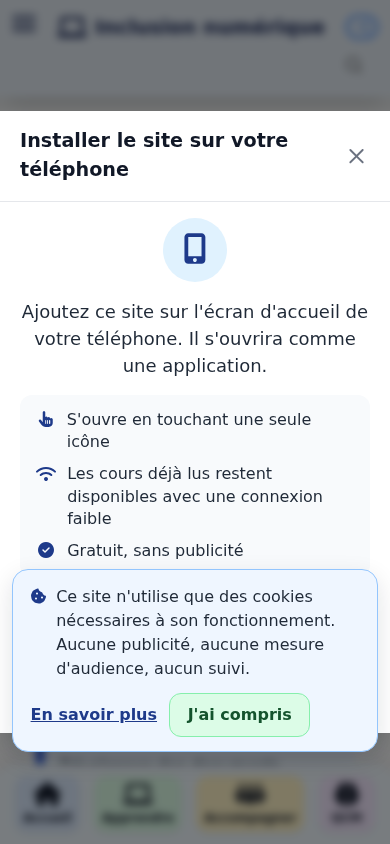
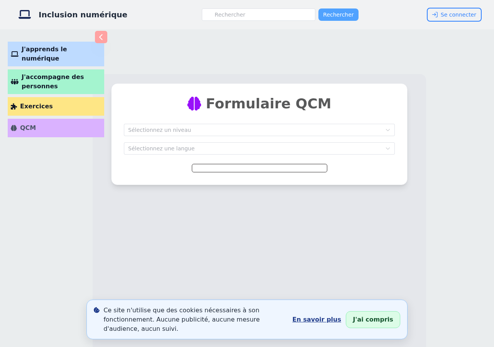
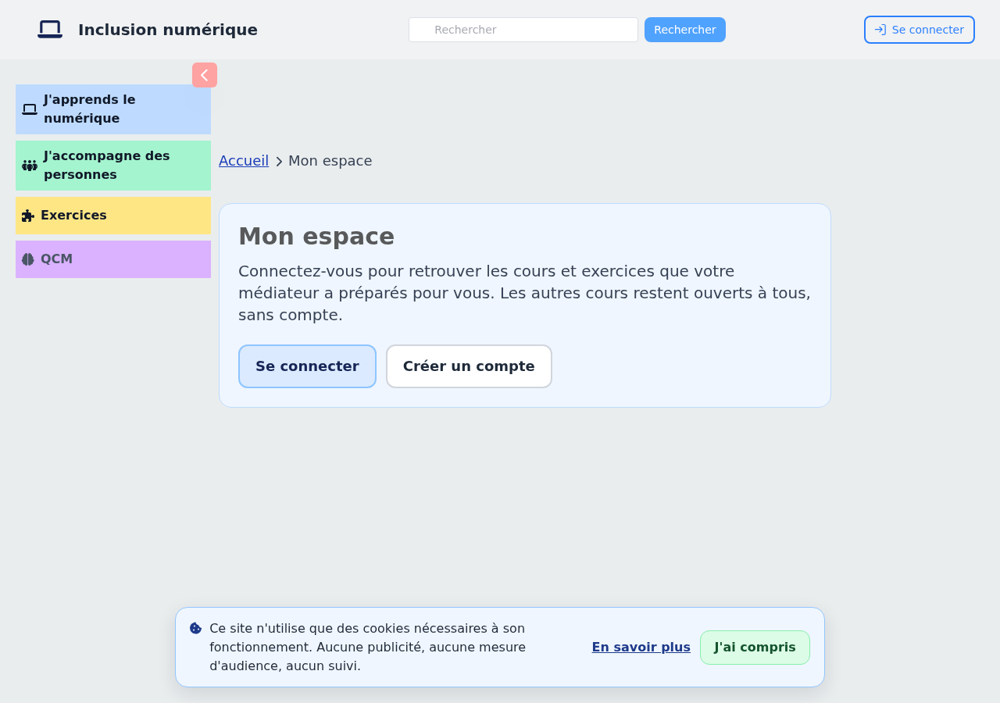

# Écrans et enchaînements

> **Rétrospectif.** Inclusion numérique n'a pas eu de maquette avant son développement : l'interface reprend les composants de DevDoc, adaptés par Médiateur. Cette page, établie le 2026-11-02, décrit les écrans tels qu'ils existent, à partir du routeur (`front/src/router/index.js`) et de captures du site publié. Elle sert de référence de conception a posteriori, pas de preuve de maquettage préalable. <Status is="code" />

Les maquettes Penpot présentes dans l'historique de `main2` (commit `338d54b`, 2026-10-14) appartiennent à DevDoc ; elles ne décrivent pas ce site.

## Enchaînement des écrans

Routes de la SPA (préfixe `/spa`) et pages servies par Symfony.

Toutes les pages partagent un en-tête (nom du site, recherche, connexion), un menu latéral repliable et un pied de page vers les pages légales.

## Captures du site publié

Prises le 2026-11-02 entre 13 h 54 et 13 h 57, sans connexion, sur `https://inclusion-numerique.varascundo.com/spa/` (Chrome sans interface ; journal : [`captures.log`](../../VAE/evidence/2026-11-02-conception/captures.log)). Le bandeau d'information sur les cookies n'a pas été fermé.

### Accueil et entrées

L'accueil propose les deux entrées et rappelle que les cours sont gratuits et sans inscription.

Sur téléphone (390 × 844), une fenêtre propose d'installer le site (PWA) et annonce la lecture des cours déjà lus en connexion faible.

### Parcours et cours

Un parcours indique par où commencer, la légende des trois niveaux (« Je découvre », « Je pratique », « Je me débrouille seul ») et ses modules.

### QCM et espace apprenant

## Observations à vérifier

Relevées sur les captures, sans analyse du code ; à reprendre dans le plan de tests :

- Formulaire QCM : un bouton apparaît sans libellé visible sous les deux listes.
- Une adresse de parcours construite avec un identifiant (`/category/1`) affiche « 1 » et « Ce parcours ne contient pas encore de cours » : les liens de l'application utilisent le nom du parcours, mais une adresse invalide ne renvoie pas d'erreur explicite.
