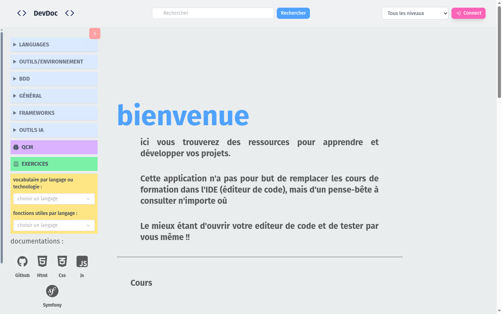
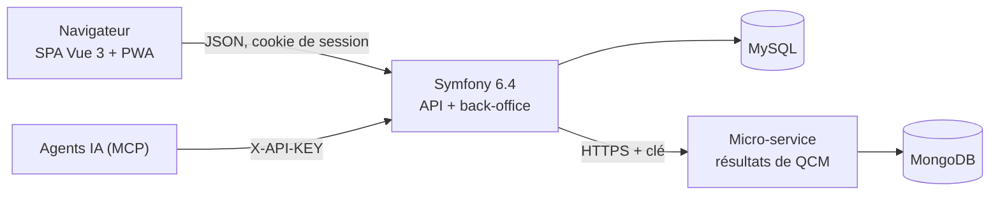

# Présentation

DevDoc est une plateforme pédagogique de documentation pour le développement web, en ligne sur [devdoc.varascundo.com](https://devdoc.varascundo.com/spa/) <Status is="prod" />.

## Ce qu'on y fait

| Qui | Peut… |
|---|---|
| Visiteur | Lire les cours par technologie (Symfony, Vue.js, React, WordPress) et par niveau, faire des exercices et des QCM, rechercher, consulter hors connexion |
| Utilisateur connecté | En plus : notes chiffrées, favoris, historique de visite, progression aux QCM, personnalisation de l'apparence |
| Administrateur | Gérer tous les contenus dans le back-office `/admin`, valider les propositions de cours générées par IA |
| Agent IA externe | Créer et réviser des cours par l'API d'administration, authentifié par clé |

Le détail des besoins (16 user stories) est dans [Besoins](../conception/besoins.md).

## En une image

Le détail est dans [Architecture logicielle](../conception/architecture.md).

## Pile technique

| Couche | Technologies |
|---|---|
| Front | Vue 3, Pinia, Vue Router, Vite, Tailwind 4, Element Plus, PWA (Workbox), IndexedDB |
| Back | Symfony 6.4, Doctrine ORM, API Platform, EasyAdmin, PHP 8.2 en production |
| Données | MySQL (contenus, comptes), IndexedDB (hors ligne), MongoDB (résultats de QCM) |
| Micro-service | Node 22, Fastify 5, pilote MongoDB |
| Outillage | Docker Compose, Makefile, PHPUnit, Vitest, Playwright, PHPStan, ESLint, GitHub Actions |
| Hébergement | OVH mutualisé (application), VPS Netcup avec Coolify (micro-service, prévu) |

## Où est quoi dans le dépôt

| Dossier | Contenu |
|---|---|
| [`src/`](../../src/Kernel.php) | Symfony : `Domain/`, `Application/`, `Infrastructure/` (hexagonal), `Controller/`, `Entity/` |
| [`front/`](../../front/package.json) | Application Vue |
| [`services/qcm-results/`](../../services/qcm-results/README.md) | Micro-service Node + MongoDB |
| [`tests/`](../../tests/bootstrap.php), [`e2e/`](../../e2e/playwright.config.js) | Tests PHPUnit et Playwright (Vitest dans `front/tests/`) |
| [`migrations/`](../../migrations) | Migrations Doctrine |
| `docs/` | Cette documentation |
