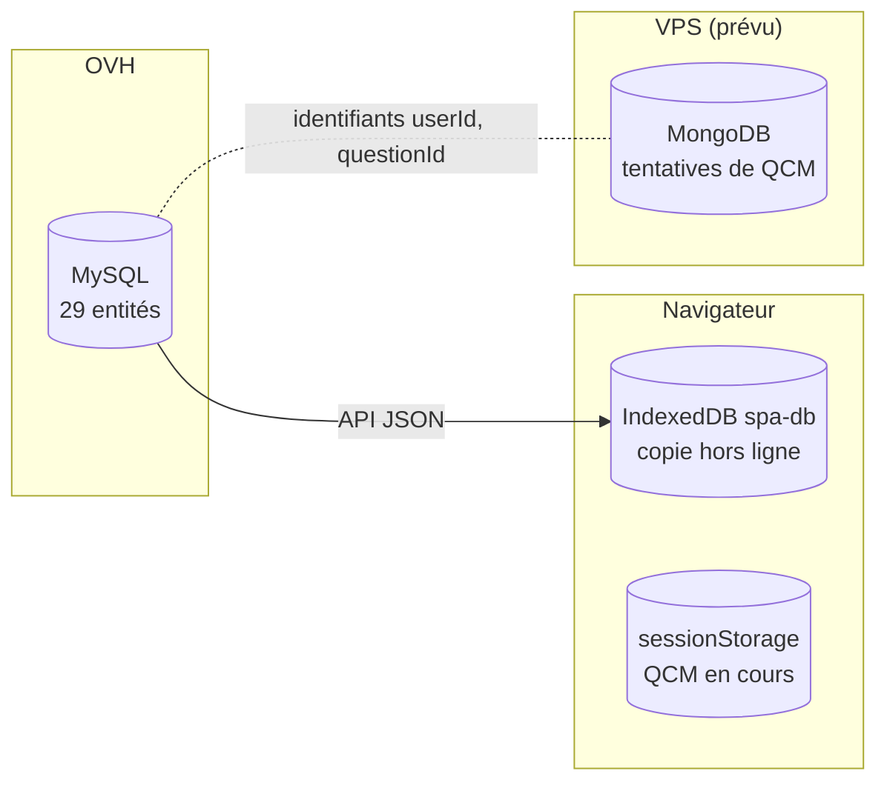

# Données

DevDoc range ses données dans trois bases, chacune pour un besoin précis.

| Base | Type | Contient | Source de vérité ? | Détail |
|---|---|---|---|---|
| **MySQL** | Relationnelle | Cours, menus, exercices, QCM, comptes, notes chiffrées, favoris, visites, personnalisation, propositions IA | Oui | [MCD et MLD](../conception/base-de-donnees.md#2-modèle-conceptuel-mcd--associations-et-cardinalités) |
| **IndexedDB** `spa-db` | NoSQL clé / documents, dans le navigateur | Copie des contenus déjà consultés, pour le hors ligne | Non, copie | [§6](../conception/base-de-donnees.md#6-stockage-nosql-côté-client--indexeddb) |
| **MongoDB** | NoSQL documents | Une tentative de QCM par document, avec ses réponses | Oui, pour les tentatives | [§7](../conception/base-de-donnees.md#7-stockage-nosql-côté-serveur--mongodb-résultats-de-qcm) |

## Règles

- Le schéma MySQL évolue **uniquement par migration Doctrine** ([`migrations/`](../../migrations)), jamais par SQL manuel. Une migration déjà commitée n'est jamais modifiée.
- Les tables portent le préfixe `appy_` (`PrefixedNamingStrategy`).
- Les notes sont chiffrées avant d'être écrites ([`NoteEncryptionService`](../../src/Infrastructure/Note/Service/NoteEncryptionService.php)).
- Le HTML des cours est nettoyé à l'écriture côté serveur et à l'affichage côté client.
- Entre MySQL et MongoDB, il n'y a pas d'intégrité référentielle : MongoDB ne stocke que des faits datés qui renvoient aux identifiants MySQL.

Le document complet, avec les diagrammes de chaque domaine, est [Base de données](../conception/base-de-donnees.md).
