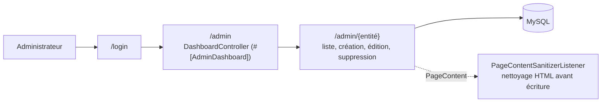

# Back-office

L'administrateur gère tout le contenu du site sans toucher au code, dans un back-office généré par EasyAdmin sous `/admin`.

| Partie | État |
|---|---|
| Accès réservé aux administrateurs | <Status is="prod" /> recette R-07, R-08 |
| Gestion des contenus | <Status is="code" /> |

## Ce qu'on y gère

| Section du menu | Entités |
|---|---|
| Cours | Contenus de page (`PageContent`) |
| Exercices | Contenus d'exercice, exercices, menus d'exercice |
| QCM | Questions, langages, niveaux, choix |
| Navigation | Catégories, pages, menus, positions, super-menus |
| Niveau des cours | `NiveauCours` (avec leur ordre, utilisé par le filtre) |
| Utilisateurs | Comptes, personnalisations ; visites et statistiques si le suivi est activé |
| Docs, logos, SEO | Liens de documentation, logos, balises SEO par page |
| Configuration | Valeurs par défaut de l'apparence (`/admin/site-config`) |

Chaque section est un contrôleur `*CrudController` de [`src/Controller/Admin/`](../../src/Controller/Admin/DashboardController.php) ; le menu est construit dans `DashboardController::configureMenuItems()`.

## Comment ça marche

## Sécurité

- `^/admin` exige `ROLE_ADMIN` ; un visiteur est redirigé vers `/login`, un utilisateur sans le rôle reçoit 403.
- Les routes CRUD n'existent que sous `/admin` (attribut `#[AdminDashboard]`). Avant correction, elles étaient aussi servies hors de ce préfixe, sans authentification (faille corrigée et testée, anomalie AN-01).
- Le HTML des cours est nettoyé à chaque écriture, même saisi par un administrateur.

## Tests

| Fichier | Ce qui est vérifié | État |
|---|---|---|
| [`AccessControlTest`](../../tests/Functional/Security/AccessControlTest.php) | Connexion requise, 403 sans le rôle, routes absentes hors de `/admin`, accès admin | <Status is="ci" /> |
| [`access.spec.js`](../../e2e/tests/access.spec.js) | Visiteur redirigé vers la connexion | <Status is="local" /> |
| Recette R-07, R-08 | Redirection, routes hors préfixe en 404 | <Status is="prod" /> |

## Limites connues

::: warning
- `PageVisitStatsController` étend `AbstractDashboardController` : EasyAdmin le traite comme un **second tableau de bord**. Il déclare une deuxième route `/admin` et duplique toutes les routes CRUD (préfixe `_` au lieu de `dashboard_`) ; c'est l'origine de l'avertissement de dépréciation « does not apply the `#[AdminDashboard]` attribute ».
- Aucun écran pour les propositions de cours IA ni pour les révisions : voir [Propositions de cours IA](propositions-ia.md).
:::
