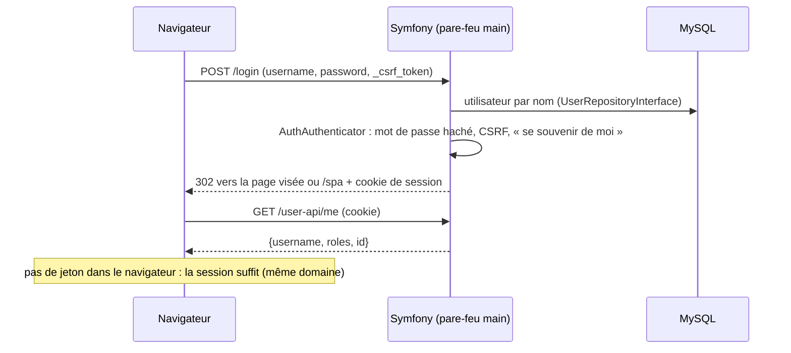

# Compte et connexion

Un visiteur crée un compte ou se connecte sur des pages Symfony (Twig), puis revient dans la SPA, qui reconnaît l'utilisateur par le cookie de session.

| Partie | État |
|---|---|
| Inscription, connexion, déconnexion | <Status is="code" /> |
| Profil interdit aux visiteurs | <Status is="prod" /> recette R-05 |

## Parcours utilisateur

1. Bouton « Connect » de l'en-tête → **`/login`** (formulaire Twig).
2. Pas de compte → **`/register`** : nom d'utilisateur (3 à 180 caractères, unique), mot de passe (6 caractères minimum), acceptation des conditions (`/terms`, `/privacy`). L'utilisateur est connecté dès l'inscription.
3. Après connexion : retour à la page demandée avant la connexion, sinon à la SPA (`/spa`).
4. La SPA appelle **`/user-api/me`** pour connaître le nom, les rôles et l'identifiant ; l'en-tête affiche alors le compte et le lien vers le profil.
5. Déconnexion : `POST /logout` avec jeton CSRF, la session est invalidée.

## Comment ça marche



Les pare-feux d'API (`api_notes`, `api_favorites`…) partagent le contexte `main` : une seule connexion vaut pour toute l'application. Une requête d'API non authentifiée reçoit 401 en JSON (`ApiAuthenticationEntryPoint`) plutôt qu'une redirection vers `/login`.

## Fichiers impliqués

```txt
src/Controller/SecurityController.php        /login, /logout
src/Controller/RegistrationController.php    /register
src/Form/RegistrationForm.php                règles du formulaire
src/Security/AuthAuthenticator.php           authentification par formulaire
src/Security/ApiAuthenticationEntryPoint.php 401 JSON pour l'API
src/Controller/UserApiController.php         /user-api/me
config/packages/security.yaml                pare-feux, rôles, remember_me (7 jours)
templates/security/login.html.twig, templates/registration/register.html.twig
front/src/utils/fetchDataPwa.js              fetchUser (copie hors ligne dans IndexedDB)
front/src/components/features/auth/AuthButton.vue, AuthButtonMobile.vue
front/src/router/guards.js                   authGuard, adminGuard, guestGuard
```

## API

| Route | Accès | Réponses |
|---|---|---|
| `GET /user-api/me` | Connecté | 200 `{username, roles, id}` ; 401 pour un visiteur |
| `PATCH /api/users/{id}` | L'utilisateur lui-même | Nom d'utilisateur seulement ; rôles et mot de passe ignorés |
| `GET /api/users` | Administrateur | Liste des comptes |

## Sécurité

- Mots de passe hachés (`UserPasswordHasherInterface`), connexion et déconnexion protégées par CSRF.
- Profil (`/profile`) protégé côté front par `authGuard` et côté serveur par `ROLE_USER` sur chaque API personnelle.
- Un utilisateur ne peut ni lire la liste des comptes, ni modifier un autre compte, ni changer ses propres rôles (tests ci-dessous).

## Tests

| Fichier | Ce qui est vérifié | État |
|---|---|---|
| [`AccessControlTest`](../../tests/Functional/Security/AccessControlTest.php) | Comptes : lecture refusée aux visiteurs, modification limitée au nom | <Status is="ci" /> |
| [`guards.spec.js`](../../front/tests/unit/router/guards.spec.js) | Gardes du routeur (visiteur, connecté, admin) | <Status is="ci" /> |
| [`access.spec.js`](../../e2e/tests/access.spec.js) | Profil interdit à un visiteur, destination mémorisée | <Status is="local" /> |

## Limites connues

::: warning
- Pour un visiteur, `/user-api/me` répond 401, ce qui produit des erreurs dans la console à chaque chargement. La correction (réponse 204) est sur la branche `fix/qcm-api-and-anonymous-calls`, pas encore fusionnée (anomalie AN-05).
- Pas de réinitialisation du mot de passe ni de vérification d'adresse e-mail : le compte n'a pas d'e-mail.
- Pas de limitation du nombre de tentatives de connexion.
:::
