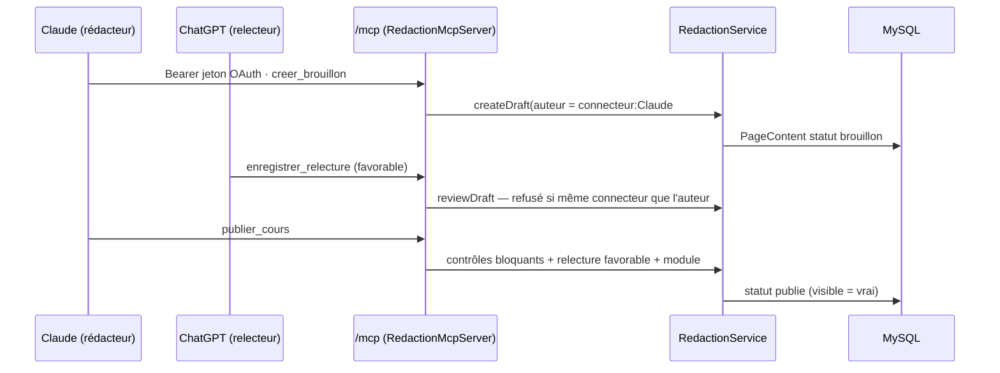

# Connecteurs MCP

Symfony expose deux serveurs MCP en Streamable HTTP, autorisés par OAuth 2.1 depuis claude.ai, Claude Desktop ou ChatGPT, sans clé à copier : un connecteur de **rédaction** pour les administrateurs, un connecteur **apprenant** en lecture seule. Ils sont copiés du gabarit des sites de formation ([`cundovar/app-neutre`](https://github.com/cundovar/app-neutre), commit `a928cf6` du 26 octobre 2026, même code que Formation IA et Les numériques), puis adaptés au catalogue et aux règles de DevDoc. Ils remplacent l'ancien pont Node `MCP/agents-cours` (DeepSeek, appelé par n8n).

| Partie | État |
|---|---|
| Connecteur de rédaction `/mcp` (49 outils) | <Status is="local" /> |
| Connecteur apprenant `/mcp/apprenant` (6 outils) | <Status is="local" /> |
| Serveur OAuth (`/oauth/*`, `/.well-known/*`) | <Status is="local" /> |
| Migration [`Version20261030224418`](../../migrations/Version20261030224418.php) | <Status is="local" /> |
| Mise en service en production | <Status is="prevu" /> |

« Vérifié en local » : `make check` réussi le 30 octobre 2026 (tests fonctionnels PHPUnit avec appels JSON-RPC réels sur `/mcp` et `/mcp/apprenant`, base SQLite) et migration appliquée sur la base MySQL de développement. Aucun connecteur n'a encore été branché depuis claude.ai ou ChatGPT.

| Usage | Adresse | Compte qui autorise | Portée OAuth | Droits |
|---|---|---|---|---|
| Rédaction | `/mcp` | Administrateur (`ROLE_ADMIN`) | `redaction` | Catalogue, cours, QCM, diaporamas, captures, accès réservés |
| Apprenant | `/mcp/apprenant` | Tout compte connecté | `apprenant.read` | Lecture des cours et QCM accessibles à ce compte |

Un jeton donné pour une adresse est refusé par l'autre.

## Parcours : rédiger, faire relire, publier

1. La personne ajoute le connecteur dans Claude (Paramètres → Connecteurs → connecteur personnalisé, adresse `https://<site>/mcp`), se connecte au site, puis accepte la page « Autoriser « Claude » ».
2. Dans Claude, la consigne **`rediger_cours`** (sujet, niveau) lit les règles (`regles/`) et le gabarit, crée un brouillon, lance `verifier_brouillon` et corrige jusqu'à ne plus avoir de contrôle bloquant.
3. Dans un **autre** connecteur (ChatGPT, par exemple), la consigne **`relire_brouillon`** vérifie la justesse technique et les règles, puis enregistre un avis (`favorable`, `reserves`, `defavorable`) sans modifier le cours.
4. Après un avis favorable, `publier_cours` publie le cours. Variante : `soumettre_en_revue`, et une personne publie depuis le back-office (filtre « En revue »).

Toute modification efface la relecture. Les QCM (`rediger_qcm`, `relire_qcm`, `publier_qcm`) et les diaporamas (`rediger_diaporama`, `relire_diaporama`, `publier_diaporama`) suivent le même circuit.



## Outils

**Rédaction** (`devdoc-redaction`) :

| Outil | Rôle |
|---|---|
| `lister_catalogue` | Rubriques, parcours, modules et niveaux, avec leurs identifiants |
| `creer_rubrique`, `creer_parcours`, `classer_parcours`, `creer_module`, `creer_niveau` | Structure du catalogue, à la demande de la personne ; un doublon est refusé avec l'identifiant existant |
| `ordonner_rubriques`, `ordonner_parcours`, `definir_illustration_parcours` | Rang des rubriques et des parcours, miniature d'un parcours |
| `lire_regles`, `obtenir_modele` | Référentiel [`regles/`](../../regles/README.md) et gabarit `cours` |
| `lister_brouillons`, `lister_cours_publies`, `voir_brouillon` | Lecture des cours |
| `creer_brouillon`, `modifier_brouillon` | Crée un brouillon ; modifie un brouillon, un cours à réviser ou un cours publié |
| `verifier_brouillon` | Contrôles automatiques ([`regles/controles.md`](../../regles/controles.md)) |
| `enregistrer_relecture` | Avis d'un connecteur autre que l'auteur |
| `publier_cours`, `soumettre_en_revue`, `mettre_en_brouillon` | Publication, relecture humaine, retrait du site (cours, module ou parcours) |
| `classer_cours` | Range des cours dans un module du même parcours |
| `lister_captures`, `capturer_page`, `preparer_depot_image`, `remplacer_capture` | Images des cours, insérées par le marqueur `[capture:ID]` : capture automatique d'une page publique, dépôt d'une image à usage unique, remplacement dans un cours publié |
| `lister_apprenants`, `attribuer_acces`, `retirer_acces`, `lister_acces`, `ouvrir_a_tous` | Cours, parcours ou QCM réservés à certains comptes du site |
| `lister_catalogue_qcm`, `creer_theme_qcm`, `creer_niveau_qcm`, `lister_brouillons_qcm`, `voir_brouillon_qcm`, `creer_brouillon_qcm`, `modifier_brouillon_qcm`, `verifier_brouillon_qcm`, `enregistrer_relecture_qcm`, `publier_qcm` | Même circuit pour les QCM ([`QcmDraft`](../../src/Entity/QcmDraft.php)) |
| `preparer_diaporama`, `creer_diaporama`, `modifier_diaporama`, `verifier_diaporama`, `enregistrer_relecture_diaporama`, `publier_diaporama`, `lister_diaporamas`, `voir_diaporama` | Diaporama de synthèse d'un cours ou d'un chapitre ([`Diaporama`](../../src/Entity/Diaporama.php)) |

Consignes : `rediger_cours`, `relire_brouillon`, `rediger_qcm`, `relire_qcm`, `rediger_diaporama`, `relire_diaporama`. Ressources : chaque fichier de `regles/` sous `regles:///<fichier>`.

**Apprenant** (`devdoc-apprenant`) : `lister_parcours`, `rechercher_cours` (passages cités : recherche vectorielle si `RAG_VECTOR_URL` est réglé, sinon plein texte MySQL), `lire_cours`, `lister_qcm`, `demarrer_qcm`, `repondre_qcm` (aucun résultat enregistré). `lister_qcm` est propre à DevDoc : sans elle, l'apprenant ne connaît pas les identifiants à passer à `demarrer_qcm`.

## Adaptations par rapport au gabarit

| Gabarit | DevDoc |
|---|---|
| Deux publics par parcours (`apprendre`, `former`) | Un seul public, les développeurs : pas de champ `audience` ; `creer_parcours` ne demande pas de public |
| Règles POS, LIM, ACC, CAP, DIA, DON-04 | Règles RED, COD, SRC, DON-01, QCM, plus CAP et DIA reprises du gabarit ([`06-captures.md`](../../regles/06-captures.md), [`07-diaporamas.md`](../../regles/07-diaporamas.md)) |
| Gabarits `cours-apprendre`, `cours-former`, `fiche-outil` | Gabarit unique `cours` |
| Contrôles du gabarit | Contrôles DevDoc (langage des blocs de code, lien vers la documentation officielle, partie « À vous ») et contrôles des captures du gabarit |
| Module laboratoires | Désactivé (`APP_MODULE_LABORATOIRES=0`) |

## Fichiers impliqués

```txt
src/Controller/McpController.php, LearnerMcpController.php   points /mcp et /mcp/apprenant (Streamable HTTP)
src/Controller/OAuthController.php                            métadonnées, enregistrement, consentement, jetons, révocation
src/Controller/ImageDepositController.php                     dépôt d'une image à usage unique (/depot-image/{jeton})
src/Service/OAuth/OAuthServer.php                             PKCE S256, jetons opaques hachés, rotation, portées
src/Security/OAuthBearerAuthenticator.php                     jeton Bearer → ConnectorUser ou LearnerConnectorUser
src/Mcp/RedactionMcpServer.php, LearnerMcpServer.php          outils, consignes, ressources
src/Service/Redaction/                                        rédaction, contrôles, QCM, diaporamas, accès réservés, Regles
src/Service/Capture/, src/Service/CaptureFileManager.php      captures automatiques (moteur local ou distant) et dépôt d'images
src/Service/Learner/, src/Service/Rag/                        contenu apprenant, session de QCM, index des passages
src/Entity/AccesReserve.php                                   contenu réservé à certains comptes (cours, parcours, QCM)
src/Infrastructure/ApiPlatform/PublishedContentExtension.php  l'API publique ne sert que les contenus publiés et accessibles
src/Controller/Admin/{CourseMedia,QcmDraft,Diaporama}CrudController.php  back-office de ce que produit le connecteur
src/Command/ConnectorsCommand.php                             app:connecteurs (lister, révoquer)
capture/                                                      moteur Playwright des captures (Node, dépendances non installées)
templates/oauth/authorize.html.twig                           page de consentement
regles/                                                       référentiel de rédaction lu par les connecteurs
migrations/Version20261030224418.php                          tables OAuth, qcm_draft, diaporama, acces_*, rag_passage, champs éditoriaux
```

## Mise en service

1. Appliquer la migration (`make migrate`). Elle n'ajoute que des tables et des colonnes ; les cours masqués passent au statut `brouillon`, les images existantes des agents deviennent des illustrations.
2. Dans le `.env` du serveur : `MCP_PUBLIC_URL=https://<site>` (https, sans `/` final). Sans ce réglage, l'adresse vient de la requête et peut être annoncée en `http` derrière un proxy.
3. Vérifier que `https://<site>/.well-known/oauth-authorization-server` répond en JSON.

| Variable | Défaut | Rôle |
|---|---|---|
| `OAUTH_REDIRECT_HOSTS` | `claude.ai,claude.com,chatgpt.com` | Sites vers lesquels la connexion peut revenir |
| `CAPTURE_SERVICE_URL`, `CAPTURE_SERVICE_TOKEN` | vides | Service de capture distant ; vides, le moteur local `capture/` est utilisé s'il est installé |
| `CAPTURE_NODE_BINARY`, `CAPTURE_CHROMIUM_PATH`, `CAPTURE_NO_SANDBOX`, `CAPTURE_HOME` | `node`, vides, `0`, vide | Moteur local |
| `RAG_VECTOR_URL`, `RAG_VECTOR_TOKEN` | vides | Recherche vectorielle de l'assistant apprenant ; vides, recherche plein texte MySQL |

## Sécurité

- Pare-feux `mcp_learner` (`^/mcp/apprenant`) et `mcp` (`^/mcp`) sans session ; `access_control` exige `ROLE_AGENT_APPRENANT` ou `ROLE_AGENT_REDACTION`, rôles portés seulement par un jeton OAuth valide pour cette ressource.
- Seul un administrateur autorise la rédaction ; l'accès s'arrête dès qu'il perd `ROLE_ADMIN`. Jetons d'accès d'une heure, rafraîchissement de 30 jours avec rotation ; seules les empreintes SHA-256 sont stockées ; un code d'autorisation rejoué révoque l'accès.
- Page de consentement protégée par CSRF, interdite en cadre (`X-Frame-Options: DENY`).
- Le statut est toujours fixé par le site ; le HTML est nettoyé à l'enregistrement (`PageContentSanitizerListener`). Un cours « en revue » n'est plus modifiable par un connecteur.
- La publication par un connecteur exige une relecture favorable d'un **autre** connecteur et aucun contrôle bloquant (données réelles ou clé d'API, même dans le code ; lien vers la documentation officielle ; capture inconnue ou balise ``).
- Contenus réservés : l'API publique, le connecteur apprenant et le [sitemap](../../src/Controller/SitemapController.php) ne servent un cours, un parcours ou un QCM réservé qu'à ses destinataires ; un administrateur voit tout.
- La capture automatique refuse les adresses locales ou privées et les adresses `http` ou avec identifiants (règle `CAP-01`).

## Tests

| Fichier | Ce qui est vérifié | État |
|---|---|---|
| [`OAuthFlowTest`](../../tests/Functional/OAuthFlowTest.php) (6) | 401 qui annonce les métadonnées, enregistrement limité aux hôtes des connecteurs, parcours complet jusqu'à la révocation, code à usage unique vérifié par PKCE, refus sur la page de consentement, autorisation réservée aux administrateurs | <Status is="local" /> |
| [`RedactionConnectorTest`](../../tests/Functional/Mcp/RedactionConnectorTest.php) | Outils et consignes offerts, catalogue, brouillons, contrôles, relecture par un autre connecteur, publication, brouillon invisible de l'API publique | <Status is="local" /> |
| [`QcmConnectorTest`](../../tests/Functional/Mcp/QcmConnectorTest.php), [`UnpublishConnectorTest`](../../tests/Functional/Mcp/UnpublishConnectorTest.php), [`CourseClassificationConnectorTest`](../../tests/Functional/Mcp/CourseClassificationConnectorTest.php), [`RubriqueConnectorTest`](../../tests/Functional/Mcp/RubriqueConnectorTest.php) | Circuit QCM, retrait du site, classement, remplacement d'image, rubriques | <Status is="local" /> |
| [`AutomaticCaptureConnectorTest`](../../tests/Functional/Mcp/AutomaticCaptureConnectorTest.php), [`ImageDepositConnectorTest`](../../tests/Functional/Mcp/ImageDepositConnectorTest.php), [`DiaporamaConnectorTest`](../../tests/Functional/Mcp/DiaporamaConnectorTest.php), [`PersonalizedAccessConnectorTest`](../../tests/Functional/Mcp/PersonalizedAccessConnectorTest.php) | Captures (moteur simulé), dépôt d'image, circuit des diaporamas, contenus réservés | <Status is="local" /> |
| [`LearnerConnectorTest`](../../tests/Functional/Mcp/LearnerConnectorTest.php) (4) | Outils en lecture seule, brouillons jamais servis, QCM sans réponse dévoilée, jetons cloisonnés | <Status is="local" /> |
| [`PersonalizedContentApiTest`](../../tests/Functional/PersonalizedContentApiTest.php), [`CaptureApiTest`](../../tests/Functional/CaptureApiTest.php), [`DiaporamaApiTest`](../../tests/Functional/DiaporamaApiTest.php) | API publique et sitemap : contenus réservés, captures, diaporamas publiés seulement | <Status is="local" /> |
| [`DraftCheckerTest`](../../tests/Service/Redaction/DraftCheckerTest.php), [`QcmDraftCheckerTest`](../../tests/Service/Redaction/QcmDraftCheckerTest.php), [`DiaporamaCheckerTest`](../../tests/Service/DiaporamaCheckerTest.php), [`PersonalDataCheckerTest`](../../tests/Service/Redaction/PersonalDataCheckerTest.php), [`PageContentStatusTest`](../../tests/Entity/PageContentStatusTest.php), [`CourseMediaValidationTest`](../../tests/Entity/CourseMediaValidationTest.php) | Contrôles automatiques, statut et `visible`, fiche d'une capture | <Status is="local" /> |
| [`RagIndexTest`](../../tests/Service/Rag/RagIndexTest.php), [`RagCourseSyncListenerTest`](../../tests/EventListener/RagCourseSyncListenerTest.php), [`RemoteCaptureRunnerTest`](../../tests/Service/RemoteCaptureRunnerTest.php), [`NodeCaptureRunnerTest`](../../tests/Service/NodeCaptureRunnerTest.php) | Index des passages, moteurs de capture (les 2 tests du moteur local sont ignorés sans Node ni Playwright) | <Status is="local" /> |
| [`ConnectorsCommandTest`](../../tests/Functional/Command/ConnectorsCommandTest.php) | `app:connecteurs` | <Status is="local" /> |

## Limites connues

::: warning
- **Base de production partagée** : depuis le 30 octobre 2026, le `.env` de production pointe vers `egflbugcundo6`, la base de l'application « médiation numérique », qui contient déjà des tables `oauth_*`, `qcm_draft`, `acces_*` et `password_reset_token`. Ce connecteur ne doit pas être déployé sur cette base tant que les tables de DevDoc n'ont pas leur propre préfixe.
- **Le front ne sait pas encore afficher** les marqueurs `[capture:ID]` dans un cours, ni les diaporamas : les cours et diaporamas qui en contiennent sont créés et publiés côté API, mais leurs images et leurs diapositives ne s'affichent pas encore sur le site.
- **L'ancien circuit reste en place** : l'API `/api/admin` par clé `X-API-KEY` ([Propositions de cours IA](propositions-ia.md)) sert encore au workflow n8n `50-devdoc-course-batch` et au service `MCP/agents-cours`. Ils seront retirés quand le connecteur sera en service.
- Le moteur de capture local (`capture/`) n'est pas installé dans le conteneur PHP : sans `CAPTURE_SERVICE_URL`, `capturer_page` répond que la capture est indisponible.
- Le code porté est organisé en services (`src/Service/Redaction`, `src/Mcp`), pas selon l'architecture hexagonale de `src/AGENTS.md`.
- Le référentiel `regles/` est un premier jet, à valider.
- Le consentement OAuth d'un apprenant (portée `apprenant.read`) n'est pas couvert par un test : `LearnerConnectorTest` part d'un accès déjà accordé.
:::
