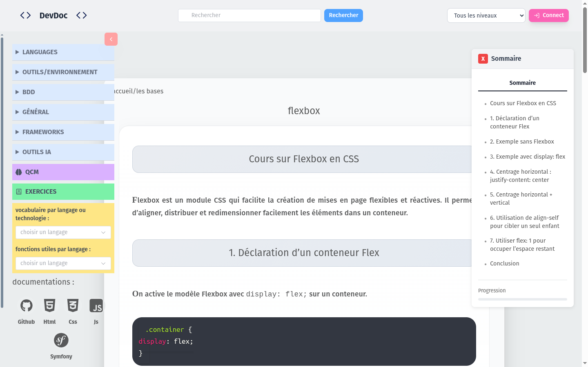
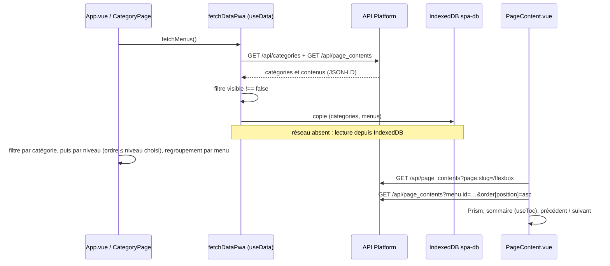

# Cours par catégorie et niveau

Le visiteur choisit une technologie, filtre éventuellement par niveau, puis lit un cours avec sommaire, code coloré et navigation vers le cours précédent ou suivant.

| Partie | État |
|---|---|
| Accueil, catégories, lecture d'un cours | <Status is="prod" /> recette R-01, R-02, R-09 |
| Filtre par niveau | <Status is="code" /> |



## Parcours utilisateur

1. **Accueil `/`** : les technologies et les menus de catégories.
2. **Catégorie `/category/:category`** : les cours de la catégorie, regroupés par menu. Un sélecteur de niveau masque les cours d'un niveau supérieur.
3. **Cours `/pages/:slug`** : contenu, blocs de code colorés (Prism), sommaire cliquable des titres, bouton favori et éditeur de note pour un utilisateur connecté, liens « précédent / suivant » dans le même menu.

## Comment ça marche



**Filtre par niveau** : chaque niveau de cours (`NiveauCours`) a un `ordre`. Choisir un niveau garde les cours dont le niveau (du menu et du contenu) a un ordre inférieur ou égal, ainsi que les cours sans niveau. Choisir à nouveau le même niveau retire le filtre (store `niveauCoursStore`).

**Visibilité** : un contenu, un menu ou une catégorie avec `visible = false` est masqué côté front (`useVisibilityFilter`) ; l'API le renvoie quand même.

## Fichiers impliqués

::: code-group

```txt [Front]
front/src/components/features/home/HomePage.vue      accueil
front/src/views/CategoryPage.vue                     cours d'une catégorie, filtre par niveau
front/src/components/features/pages/PageContent.vue  lecture d'un cours, précédent / suivant
front/src/components/features/pages/toc/             sommaire (useToc)
front/src/stores/niveauCoursStore.js                 niveau choisi
front/src/composables/ui/useVisibilityFilter.js
front/src/utils/fetchDataPwa.js                      chargement + repli hors ligne
front/src/components/layout/SeoHead.vue              balises SEO côté client
```

```txt [Symfony]
src/Entity/Category.php, Page.php, PageContent.php, PageBlock.php, Menus.php, NiveauCours.php
src/Controller/SpaController.php        page d'entrée et SEO calculé côté serveur
src/Service/SeoService.php
src/Service/HtmlSanitizerService.php    nettoyage du HTML des cours
src/EventListener/PageContentSanitizerListener.php   avant chaque écriture de PageContent
```

:::

## Données

`Category` 1–n `PageContent` n–1 `Menus` ; `PageContent` n–1 `Page` (slug) et 1–n `PageBlock` ; `Menus` et `PageContent` n–1 `NiveauCours`. Voir [le modèle des contenus](../conception/base-de-donnees.md#contenu-des-cours).

## API

| Route | Accès | Rôle |
|---|---|---|
| `GET /api/categories`, `/api/page_contents`, `/api/pages`, `/api/menuses`, `/api/niveau_cours` | Public | Lecture des contenus (API Platform) |
| `GET /api/page_contents?page.slug=…`, `?menu.id=…&order[position]=asc` | Public | Un cours, les cours d'un menu |
| Écritures sur ces ressources | Administrateur | Back-office et API d'administration |

## Sécurité

- HTML nettoyé deux fois : à l'écriture (`PageContentSanitizerListener`, `prePersist` / `preUpdate`) et à l'affichage (`SafeHtml.vue`, DOMPurify).
- Écritures anonymes refusées (401) sur toutes les ressources, vérifié en production (R-08).

## Tests

| Fichier | Ce qui est vérifié | État |
|---|---|---|
| [`navigation.spec.js`](../../e2e/tests/navigation.spec.js) | Accueil → catégorie → cours ; accès direct par URL | <Status is="local" /> |
| [`SafeHtml.spec.js`](../../front/tests/unit/components/SafeHtml.spec.js) | Nettoyage du HTML affiché | <Status is="ci" /> |
| [`AccessControlTest`](../../tests/Functional/Security/AccessControlTest.php) | Lecture publique, écriture refusée | <Status is="ci" /> |
| Recette R-01, R-02, R-09 | Accueil, cours, mobile | <Status is="prod" /> |

## Limites connues

::: warning
- `GET /api/page_contents` charge **tous** les contenus au démarrage pour construire les menus et la recherche : le volume grandit avec le nombre de cours.
- Les éléments masqués (`visible = false`) restent lisibles par l'API.
- Le filtre par niveau n'est pas couvert par un test.
:::
