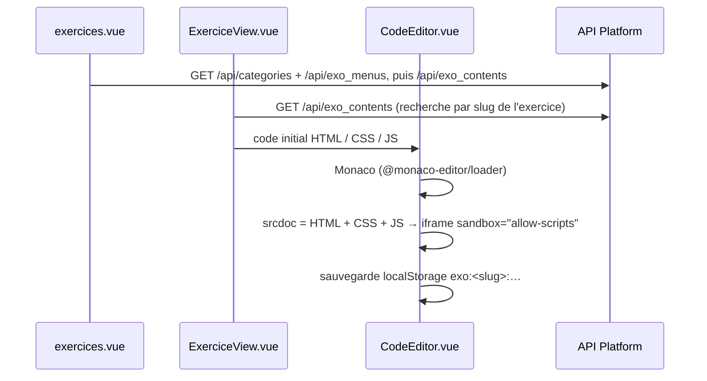

# Exercices

Le visiteur choisit un exercice et le résout dans un éditeur HTML / CSS / JavaScript, avec un aperçu exécuté à côté.

| Partie | État |
|---|---|
| Liste et éditeur | <Status is="code" /> pas de scénario de recette |

## Parcours utilisateur

1. **`/exercices`** : deux sections dépliables, CSS et JavaScript, et dans chacune les exercices en cartes par niveau (libellé du menu d'exercice : base, intermédiaire, avancé).
2. **`/exercices/:slug`** : énoncé, éditeur à onglets (Monaco), aperçu dans une `iframe`, exécution automatique ou manuelle, bouton de réinitialisation.
3. Le code saisi est conservé dans le navigateur pour cet exercice (`localStorage`, clés `exo:<slug>:html|css|js`).

## Comment ça marche



## Fichiers impliqués

```txt
front/src/views/exercices.vue                         liste
front/src/components/features/exercices/ExerciceCard.vue
front/src/components/features/exercices/ExerciceView.vue
front/src/components/features/exercices/CodeEditor.vue   Monaco + aperçu
front/src/utils/fetchDataPwa.js                        fetchExoMenus, fetchExoContents (repli IndexedDB)
src/Entity/Exo.php, ExoContent.php, ExoBlock.php, ExoMenu.php, ExoCategorie.php
```

Données : voir [le modèle des exercices](../conception/base-de-donnees.md#exercices).

## API

| Route | Accès |
|---|---|
| `GET /api/exo_menus`, `/api/exo_contents`, `/api/exos`, `/api/exo_blocks` | Public |
| Écritures | Administrateur (`/admin/exo…`, `/api/admin/exo-contents`) |

## Sécurité

Le code de l'utilisateur s'exécute dans une `iframe` `sandbox="allow-scripts"` sans `allow-same-origin` : il ne peut lire ni les cookies ni le stockage de DevDoc.

## Limites connues

::: warning
- Monaco est téléchargé depuis un CDN par `@monaco-editor/loader` (configuration locale en commentaire) : l'éditeur ne s'affiche pas hors ligne.
- L'exercice est retrouvé en chargeant **tous** les contenus d'exercice puis en filtrant par slug.
- Les sections CSS et JavaScript et les niveaux sont écrits en dur dans `exercices.vue` : une nouvelle catégorie d'exercices n'apparaît pas sans modifier le code.
- Aucun test automatisé.
:::
