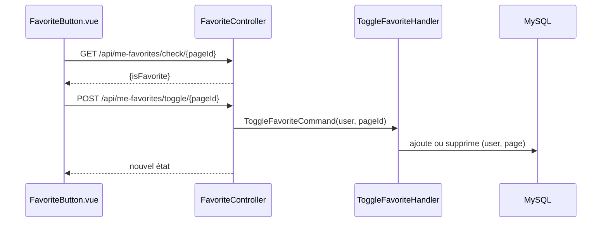

# Favoris

Un utilisateur connecté met un cours en favori d'un clic et retrouve ses favoris dans son profil.

| Partie | État |
|---|---|
| Favoris | <Status is="code" /> ; bouton masqué pour un visiteur <Status is="prod" /> recette R-06 |

## Parcours utilisateur

1. Sur un cours, le bouton cœur (visible seulement connecté) indique si le cours est en favori.
2. Un clic ajoute ou retire le favori.
3. **Profil → Mes Favoris** : la liste, avec retrait ; l'onglet Statistiques en donne la répartition par catégorie.

## Comment ça marche



## Fichiers impliqués

```txt
front/src/components/features/favorites/FavoriteButton.vue
front/src/services/favoriteService.js
front/src/views/Profile.vue                    onglet « Mes Favoris »
src/Controller/Api/FavoriteController.php
src/Application/Favorite/   3 commandes, 3 requêtes, 6 handlers, FavoriteDTO
src/Domain/Favorite/, src/Infrastructure/Favorite/
src/Entity/Favorite.php     contrainte unique (user_id, page_id)
```

## API

| Route | Accès |
|---|---|
| `GET /api/me-favorites/list-my-favorites` | Connecté |
| `GET /api/me-favorites/show-my-favorite/{id}` | Connecté |
| `POST /api/me-favorites/create` | Connecté |
| `POST /api/me-favorites/toggle/{pageId}` | Connecté |
| `GET /api/me-favorites/check/{pageId}` | Connecté |
| `DELETE /api/me-favorites/{id}` | Connecté |

## Sécurité

`ROLE_USER` sur tout le contrôleur ; l'utilisateur vient de la session. La contrainte `user_page_unique` empêche les doublons en base.

## Limites connues

::: warning
- Aucun test des 6 handlers Favorite, contrairement au contexte Note.
- `FavoriteButton.vue` appelle axios directement au lieu de `favoriteService.js`.
:::
