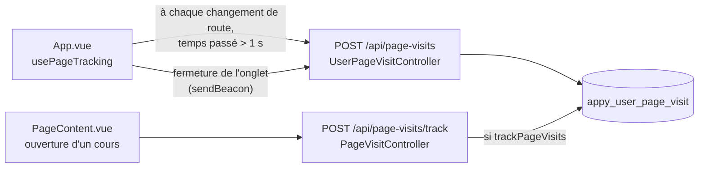

# Historique de visite

Quand le suivi est activé, les pages vues par un utilisateur connecté sont enregistrées : il retrouve son historique et ses statistiques dans son profil, et l'administrateur voit les statistiques globales.

| Partie | État |
|---|---|
| Suivi des visites | <Status is="code" /> **désactivé par défaut** (`USER_PAGE_VISIT_ENABLED=0`, `VITE_ENABLE_PAGE_TRACKING=false`) |

## Activation

Deux interrupteurs, l'un côté serveur, l'autre côté front :

| Variable | Où | Effet si désactivée |
|---|---|---|
| `USER_PAGE_VISIT_ENABLED` | `.env` Symfony → paramètre `app.user_page_visit.enabled` | Les routes répondent sans rien enregistrer (`trackingEnabled: false`) |
| `VITE_ENABLE_PAGE_TRACKING` | `front/.env`, lu au build | Aucun envoi ; onglet « Statistiques » du profil masqué |

Chaque utilisateur peut en plus couper son propre suivi (`User::trackPageVisits`, bouton du profil).

## Parcours utilisateur

1. Navigation normale : chaque changement de page est enregistré avec le temps passé.
2. **Profil → Statistiques** : interrupteur du suivi, nombre de pages vues, historique détaillé, suppression d'une visite ou de tout l'historique, répartition des favoris par catégorie.
3. **Administrateur → `/admin/stats/page-visits`** : nombre total de visites et d'utilisateurs suivis.

## Comment ça marche



## Fichiers impliqués

```txt
front/src/composables/domain/usePageTracking.js
front/src/components/features/pages/PageContent.vue    trackPageVisit
front/src/views/Profile.vue                            onglet « Statistiques »
src/Controller/Api/UserPageVisitController.php         POST /api/page-visits, my-history, my-stats
src/Controller/PageVisitController.php                 /track, my-history, suppression, interrupteur
src/Controller/Admin/PageVisitStatsController.php      statistiques admin
src/Entity/UserPageVisit.php                           URL, titre, temps passé, user agent, IP
src/Domain/UserPageVisit/, src/Infrastructure/UserPageVisit/
```

## API

| Route | Accès | Rôle |
|---|---|---|
| `POST /api/page-visits` | Connecté | Enregistre une visite (ignore `/admin` et `/api/`) |
| `POST /api/page-visits/track` | Connecté | Enregistre une visite si l'utilisateur n'a pas coupé le suivi |
| `GET /api/page-visits/my-history`, `/my-stats` | Connecté | Historique, pages les plus vues |
| `DELETE /api/page-visits/{id}`, `/clear-all` | Connecté | Suppression |
| `POST /api/page-visits/toggle-tracking`, `GET …/tracking-status` | Connecté | Interrupteur personnel |

## Limites connues

::: danger À corriger avant d'activer le suivi
- **`POST /api/page-visits` ne vérifie pas l'interrupteur personnel** : les visites envoyées par `usePageTracking` sont enregistrées même quand l'utilisateur a coupé son suivi. Seule la route `/track` le respecte.
- Cette même route **enregistre l'adresse IP et le user agent**, ce que l'interface ne dit pas : à justifier ou à retirer (RGPD).
:::

::: warning
- Deux routes enregistrent la même visite (`/api/page-visits` et `/api/page-visits/track`) : l'ouverture d'un cours peut être comptée deux fois.
- `GET /api/page-visits/my-history` est déclarée dans les deux contrôleurs ; seule la version de `UserPageVisitController` répond.
- `UserPageVisitController` utilise directement le dépôt, sans handler ; aucun test.
:::
