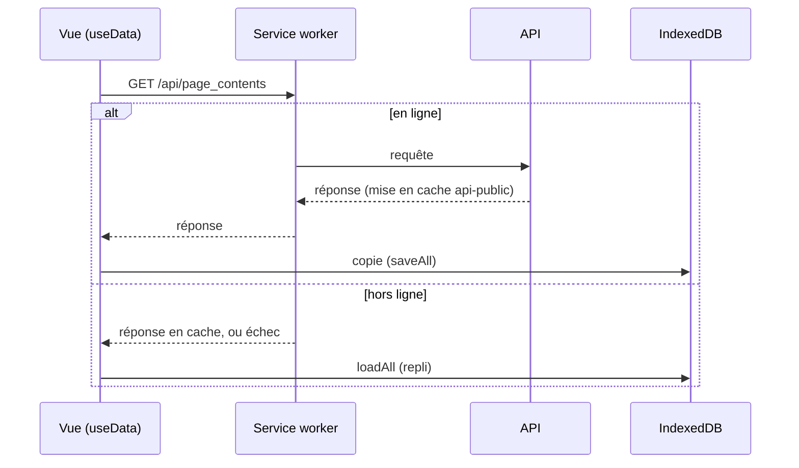

# Hors ligne (PWA)

DevDoc s'installe comme une application et les cours déjà consultés restent lisibles sans réseau.

| Partie | État |
|---|---|
| Service worker, cours rechargé hors ligne | <Status is="prod" /> recette R-12 |

## Parcours utilisateur

1. Première visite en ligne : le service worker `/spa/sw.js` s'installe (portée `/spa/`).
2. Les pages, fichiers compilés et réponses de l'API publique consultés sont mis en cache.
3. Sans réseau : la page de cours se recharge depuis le cache ; les menus et la recherche utilisent la copie IndexedDB.

## Deux mécanismes complémentaires

| Mécanisme | Ce qu'il garde | Où |
|---|---|---|
| **Cache Workbox** (service worker) | Pages de la SPA, fichiers `/build/assets/`, réponses `GET` de l'API publique, polices | [`front/vite.config.js`](../../front/vite.config.js) |
| **IndexedDB `spa-db`** | Copies des catégories, menus, exercices, utilisateur, réponses d'API horodatées | [`offlineDb.js`](../../front/src/utils/offlineDb.js), [`fetchDataPwa.js`](../../front/src/utils/fetchDataPwa.js) |

## Stratégies de cache

| Requêtes | Stratégie | Cache | Limite |
|---|---|---|---|
| Navigation sous `/spa/` | Réseau d'abord | `spa-pages` | 50 entrées |
| `/build/assets/…` | Cache d'abord | `build-assets` | 100 entrées, 30 jours |
| `GET /api/…` public | Réseau d'abord | `api-public` | 200 entrées, 7 jours |
| `/api/categories` | Réseau d'abord | `api-categories-cache` | 5 entrées, 1 heure |
| Google Fonts | Cache d'abord | `google-fonts-cache` | 10 entrées, 1 an |

Les données personnelles ne sont **jamais** mises en cache : la règle de l'API exclut `/api/admin`, `notes`, `me-favorites`, `page-visits`, `customization`, `proposition-ia` et `users`.

## Comment ça marche

Le schéma de `spa-db` et ses migrations sont décrits dans [Base de données §6](../conception/base-de-donnees.md#6-stockage-nosql-côté-client--indexeddb).

## Tests

| Fichier | Ce qui est vérifié | État |
|---|---|---|
| [`offline.spec.js`](../../e2e/tests/offline.spec.js) | Un cours consulté se recharge hors ligne | <Status is="local" /> |
| [`offlineDb.spec.js`](../../front/tests/unit/utils/offlineDb.spec.js), [`fetchDataPwa.spec.js`](../../front/tests/unit/utils/fetchDataPwa.spec.js) | Schéma, opérations, repli hors ligne | <Status is="ci" /> |
| Recette R-11, R-12 | Service worker actif, cours rechargé hors ligne | <Status is="prod" /> |

## Limites connues

::: warning
- Un cours jamais ouvert en ligne n'est pas disponible hors ligne.
- Les éléments supprimés côté serveur restent dans IndexedDB (pas de purge).
- L'éditeur des exercices (Monaco, chargé depuis un CDN) ne fonctionne pas hors ligne.
- Le panneau Sommaire ne s'affiche pas hors ligne (constaté en recette).
:::
