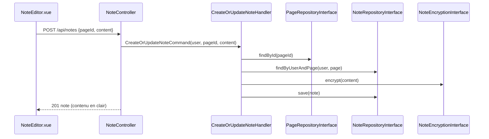

# Notes chiffrées

Sur chaque cours, un utilisateur connecté écrit une note personnelle. Elle est chiffrée avant d'être enregistrée et il la retrouve dans son profil.

| Partie | État |
|---|---|
| Notes | <Status is="ci" /> handlers et chiffrement testés ; pas de recette en production |

## Parcours utilisateur

1. Sur un cours, onglet **Notes** du sommaire : un éditeur, visible seulement connecté.
2. « Enregistrer » crée la note ou remplace la précédente (une note par cours et par utilisateur).
3. **Profil → Mes Notes** : la liste des notes, avec suppression.

## Comment ça marche

C'est le contexte de référence de l'architecture hexagonale du projet.



**Chiffrement** ([`NoteEncryptionService`](../../src/Infrastructure/Note/Service/NoteEncryptionService.php)) : AES-256-CBC avec OpenSSL, clé dérivée du secret de l'application (`SHA-256` de `APP_SECRET`), vecteur d'initialisation aléatoire par note, stocké avec le texte chiffré en base64.

## Fichiers impliqués

::: code-group

```txt [Front]
front/src/components/features/notes/NoteEditor.vue
front/src/components/features/pages/toc/TableOfContents.vue, SidebarToc.vue
front/src/services/noteService.js
front/src/views/Profile.vue        onglet « Mes Notes »
```

```txt [Symfony]
src/Controller/Api/NoteController.php
src/Application/Note/Command/   CreateOrUpdateNoteCommand, DeleteNoteCommand
src/Application/Note/Query/     GetNoteByPageQuery, GetUserNotesQuery
src/Application/Note/Handler/   4 handlers
src/Domain/Note/                ports (dépôt, chiffrement), exceptions
src/Infrastructure/Note/        DoctrineNoteRepository, NoteEncryptionService
src/Entity/Note.php
```

:::

## API

| Route | Accès | Réponses |
|---|---|---|
| `POST /api/notes` `{pageId, content}` | Connecté | 201 ; 400 champs manquants ; 404 page inconnue |
| `GET /api/notes/my-notes` | Connecté | 200 notes déchiffrées |
| `GET /api/notes/page/{pageId}` | Connecté | 200 ; 204 aucune note ; 404 page inconnue |
| `DELETE /api/notes/{id}` | Propriétaire | 200 ; 403 note d'un autre ; 404 |

## Sécurité

- Toutes les routes exigent `ROLE_USER` ; l'utilisateur vient de la session.
- Supprimer la note d'un autre lève `UnauthorizedNoteAccessException` (403).
- Le contenu est illisible en base sans `APP_SECRET`.

## Tests

| Fichier | Ce qui est vérifié | État |
|---|---|---|
| [`tests/Application/Note/Handler/`](../../tests/Application/Note/Handler/CreateOrUpdateNoteHandlerTest.php) (4 fichiers) | Création, mise à jour, lecture, suppression, accès refusé | <Status is="ci" /> |
| [`NoteEncryptionServiceTest`](../../tests/Infrastructure/Note/Service/NoteEncryptionServiceTest.php) | Aller-retour de chiffrement | <Status is="ci" /> |
| [`DoctrineNoteRepositoryTest`](../../tests/Infrastructure/Note/Repository/DoctrineNoteRepositoryTest.php) | Dépôt Doctrine | <Status is="ci" /> |

## Limites connues

::: warning
- **Changer `APP_SECRET` rend toutes les notes illisibles** : la clé en dépend directement, sans clé dédiée ni rotation.
- AES-CBC sans code d'authentification : une modification du texte chiffré en base n'est pas détectée.
- Pas de contrainte d'unicité (utilisateur, page) en base : l'unicité ne tient qu'au handler.
- Un ancien service `src/Service/NoteEncryptionService.php` est encore déclaré dans `services.yaml` (« legacy - à supprimer »).
:::
