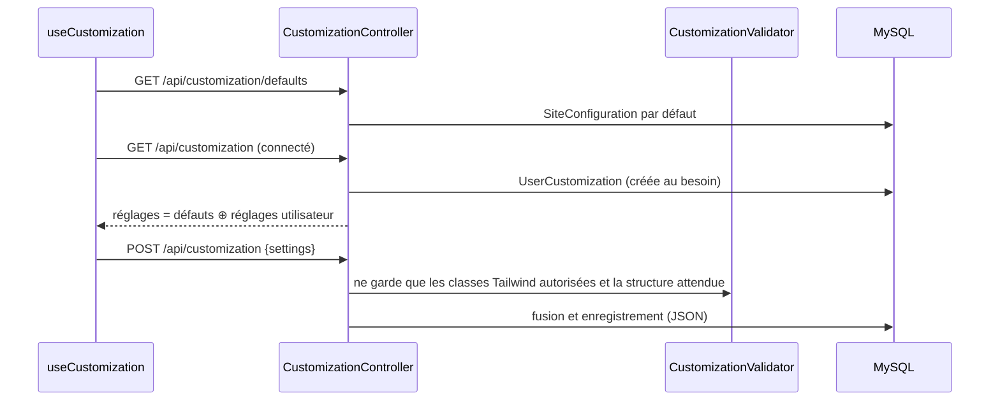

# Personnalisation

L'apparence du site (couleurs de l'en-tête, du fond, des menus, nom du site) suit une configuration par défaut gérée par l'administrateur. Chaque utilisateur peut la surcharger pour lui-même.

| Partie | État |
|---|---|
| Valeurs par défaut du site (back-office) | <Status is="code" /> |
| Personnalisation par l'utilisateur | <Status is="code" /> API présente, **écran désactivé** |

## Parcours utilisateur

1. Au chargement, la SPA lit les valeurs par défaut (`/api/customization/defaults`) et les applique à l'en-tête et au fond.
2. Connecté, elle lit les réglages de l'utilisateur, fusionnés avec les valeurs par défaut.
3. L'administrateur règle les valeurs par défaut dans **`/admin/site-config`**.

::: warning Écran utilisateur désactivé
L'onglet **Apparence** du profil est affiché, mais tout son contenu est en commentaire dans `Profile.vue` : cliquer dessus n'affiche rien. Le code de sauvegarde et de réinitialisation est toujours là.
:::

## Comment ça marche



Les réglages sont des **classes Tailwind** (`bg-blue-600`, `text-white`…) appliquées par les composants. Le validateur refuse toute classe hors de sa liste blanche (`ALLOWED_CLASSES`) : impossible d'injecter du CSS ou du HTML.

## Fichiers impliqués

```txt
front/src/composables/ui/useCustomization.js
front/src/components/layout/AppHeader.vue       applique header.bgColor, textColor…
front/src/views/Profile.vue                     onglet « Apparence » (contenu en commentaire)
src/Controller/Api/CustomizationController.php
src/Service/CustomizationValidator.php          liste blanche des classes
src/Entity/UserCustomization.php, SiteConfiguration.php   réglages en JSON
src/Controller/Admin/DashboardController.php    /admin/site-config
```

## API

| Route | Accès | Rôle |
|---|---|---|
| `GET /api/customization/defaults` | Public (lecture) | Valeurs par défaut du site |
| `GET /api/customization/allowed-classes` | Public (lecture) | Classes autorisées, par catégorie |
| `GET /api/customization` | Connecté | Réglages fusionnés |
| `POST /api/customization` `{settings}` | Connecté | Enregistrer (400 si rien de valide) |
| `POST /api/customization/reset` | Connecté | Revenir aux valeurs par défaut |

## Limites connues

::: warning
- Sur `main`, la règle d'accès `^/api/customization` exige `ROLE_USER` sur tout le préfixe : un visiteur reçoit 401 sur `defaults` et `allowed-classes`. La correction est sur la branche `fix/qcm-api-and-anonymous-calls` (anomalie AN-05), pas encore fusionnée.
- Écran de personnalisation désactivé (voir plus haut).
- Aucun test du validateur.
:::
