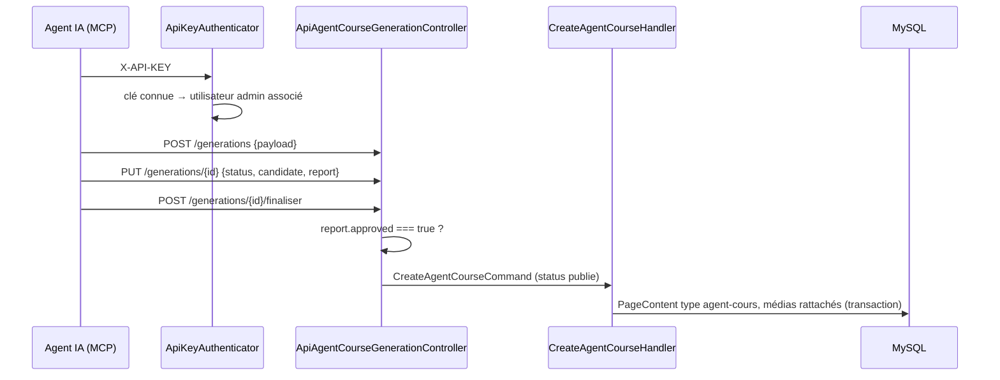

# Propositions de cours IA

Des agents IA externes (serveur MCP, n8n) créent et révisent des cours en passant par l'API d'administration de Symfony, authentifiés par une clé, au lieu d'écrire directement dans MySQL.

| Partie | État |
|---|---|
| API d'administration par clé | <Status is="code" /> |
| Écran de validation des propositions | Absent du dépôt |

## Ce que font les agents

| Étape | Route | Effet |
|---|---|---|
| Lire la structure | `GET /api/admin/menus`, `categories`, `niveau-cours`, `positions-menus`, `super-menus` | Choisir où ranger le cours |
| Suivre une génération | `POST /api/admin/agent-cours/generations`, `PUT …/{id}` | Statut parmi `pending`, `queued`, `generating`, `verifying`, `ready`, `succeeded`, `failed` (tout autre statut est refusé), avec le candidat et le rapport de vérification |
| Joindre des médias | `POST /api/admin/course-media` | Images rattachées à la génération |
| Publier | `POST …/generations/{id}/finaliser` | Refusé (409) si le rapport de vérification n'est pas `approved` ; sinon crée le cours, publié, en transaction |
| Échouer | `POST …/generations/{id}/echouer` | Statut `failed` |
| Créer directement | `POST /api/admin/agent-cours/creer` | Cours de type `agent-cours` |
| Réviser | `POST /api/admin/agent-cours/revisions`, `POST …/revisions/{id}/appliquer` | Remplace le code du cours par la révision |



L'ancien circuit, `/api/proposition-ia` (`PropositionIA` : `pending`, `accepted`, `rejected`, `review`), existe toujours : accepter une proposition crée ou met à jour un `PageContent`.

## Fichiers impliqués

```txt
src/Security/ApiKeyAuthenticator.php                    clé X-API-KEY → utilisateur admin
src/Controller/Api/AdminCrud/                           11 contrôleurs de l'API d'administration
src/Application/AgentCourse/                            CreateAgentCourseHandler, SaveAgentCourseRevisionHandler
src/Entity/AgentCourseGeneration.php, AgentCourseRevision.php, CourseMedia.php
src/Controller/PropositionIAController.php              ancien circuit de propositions
```

La migration des agents vers cette API est décrite dans [Agents de cours (MCP)](../migration-mcp-vers-symfony.md).

## Sécurité

- Pare-feu `api_admin` sans session : seule la clé `X-API-KEY` authentifie. La clé est lue dans le paramètre `api_keys`, sinon dans `N8N_API_KEY`, et associée à un compte administrateur (`API_ADMIN_USER_EMAIL`).
- `^/api/admin` exige `ROLE_ADMIN`.
- `/api/proposition-ia` exige `ROLE_ADMIN` (session).

## Tests

| Fichier | Ce qui est vérifié | État |
|---|---|---|
| [`AgentCourseGenerationTest`](../../tests/Entity/AgentCourseGenerationTest.php) (5) | Statuts refusés, mise en file, échec, nouvelle tentative, passage à `ready` | <Status is="ci" /> |

## Limites connues

::: warning
- **Pas d'écran de validation** : rien dans le back-office ni dans la SPA n'appelle `/api/proposition-ia` ou les révisions. Une génération finalisée est publiée directement, la seule garde étant le rapport de vérification produit par l'agent lui-même.
- Clé comparée par recherche dans un tableau (pas de comparaison à temps constant), sans portée ni expiration.
- Le compte par défaut `cundo2` est écrit en dur si `API_ADMIN_USER_EMAIL` est absent.
- La revue du 2026-09-01 sur la génération de cours a relevé 4 problèmes critiques sans suite tracée.
:::
