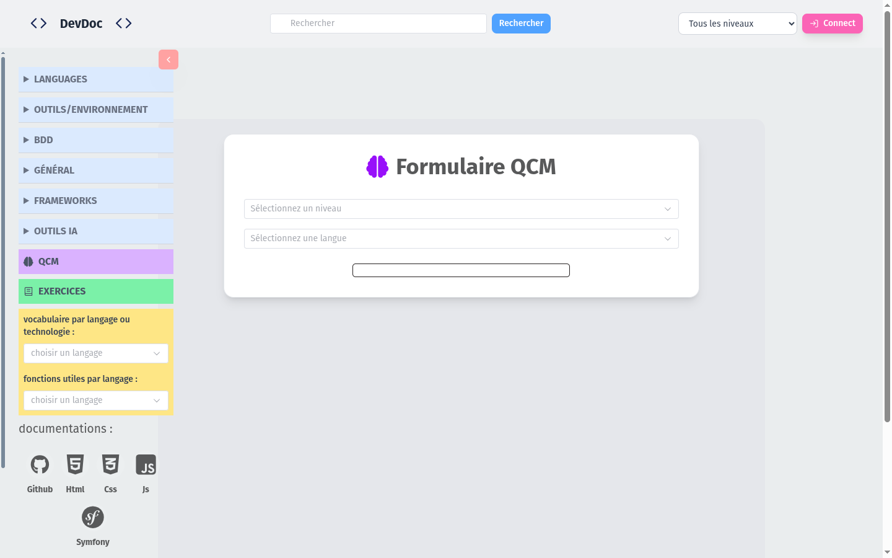
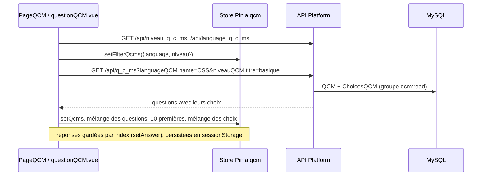
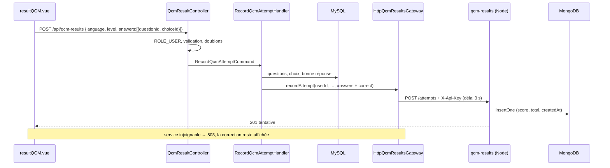

# QCM et progression

Un visiteur choisit un niveau et un langage, répond à 10 questions tirées au hasard, puis voit son score et les corrections. Connecté, son résultat est enregistré et il suit sa progression dans son profil.

| Partie | État |
|---|---|
| Passer un QCM, voir le score | <Status is="prod" /> |
| Enregistrement et progression | <Status is="local" /> micro-service pas encore déployé |



## Parcours utilisateur

1. **`/qcm`** : choix du niveau et du langage (listes chargées depuis l'API), bouton « GO ».
2. **`/qcm/0` à `/qcm/9`** : une question par écran. L'utilisateur choisit, clique « Réponse » et voit tout de suite si c'est juste, avec l'explication. Puis « Question suivante », et « Fin » à la dixième.
3. **`/qcm/result`** : score, pourcentage, et pour chaque question sa réponse, la bonne réponse, l'explication et la solution en code coloré.
4. Connecté : le résultat est enregistré automatiquement (« Résultat enregistré dans votre progression »). Visiteur : une invitation à se connecter s'affiche.
5. **Profil → « Ma progression »** : par langage et niveau, nombre de tentatives, meilleur, moyen et dernier score, date. Bouton pour tout effacer.

## Comment ça marche

### Chargement des questions



### Enregistrement du résultat



Le navigateur n'envoie **que ses choix**. La correction est recalculée côté serveur depuis MySQL : un score envoyé par le client ne serait jamais cru.

## Fichiers impliqués

::: code-group

```txt [Front]
front/src/views/QCM/PageQCM.vue        choix du niveau et du langage
front/src/views/QCM/questionQCM.vue    une question par écran, correction immédiate
front/src/views/QCM/resultQCM.vue      score, corrections, enregistrement
front/src/stores/qcm.js                questions, réponses, filtres, attemptRecorded
front/src/services/qcmResultsService.js  appels /api/qcm-results, buildAttemptPayload
front/src/views/Profile.vue            onglet « Ma progression »
```

```txt [Symfony]
src/Entity/QCM.php, ChoicesQCM.php, LanguageQCM.php, NiveauQCM.php   API Platform
src/Controller/Api/QcmResultController.php       /api/qcm-results
src/Application/QcmResult/Command/RecordQcmAttemptCommand.php
src/Application/QcmResult/Handler/RecordQcmAttemptHandler.php
src/Domain/QcmResult/QcmResultsGatewayInterface.php   port
src/Infrastructure/QcmResult/HttpQcmResultsGateway.php adaptateur HTTP
config/packages/framework.yaml   client HTTP qcm_results.client
```

```txt [Micro-service]
services/qcm-results/src/app.js       routes Fastify, clé d'API, schémas JSON
services/qcm-results/src/attempts.js  accès MongoDB, agrégations
services/qcm-results/src/server.js    démarrage, index, arrêt propre
services/qcm-results/Dockerfile
```

:::

Liens directs : [`QcmResultController.php`](../../src/Controller/Api/QcmResultController.php), [`RecordQcmAttemptHandler.php`](../../src/Application/QcmResult/Handler/RecordQcmAttemptHandler.php), [`HttpQcmResultsGateway.php`](../../src/Infrastructure/QcmResult/HttpQcmResultsGateway.php), [`qcm.js`](../../front/src/stores/qcm.js), [`attempts.js`](../../services/qcm-results/src/attempts.js).

## Données

| Donnée | Où | Détail |
|---|---|---|
| Questions, choix, langages, niveaux | MySQL | `QCM` 1–n `ChoicesQCM`, n–1 `LanguageQCM`, n–1 `NiveauQCM` ; [modèle](../conception/base-de-donnees.md#qcm) |
| Partie en cours | Navigateur | Store Pinia ; `answers`, `filterQcms`, `attemptRecorded` en `sessionStorage` |
| Tentatives | MongoDB | Collection `attempts`, un document par tentative ; [modèle](../conception/base-de-donnees.md#7-stockage-nosql-côté-serveur--mongodb-résultats-de-qcm) |

## API

| Méthode et route | Accès | Rôle | Réponses |
|---|---|---|---|
| `GET /api/q_c_ms?languageQCM.name=&niveauQCM.titre=` | Public | Questions filtrées (jusqu'à 200 par page) | 200 |
| `GET /api/language_q_c_ms`, `/api/niveau_q_c_ms` | Public | Listes des filtres | 200 |
| `GET /api/qcm/…` | Public | API maison (liste, par langage, par difficulté) ; non utilisée par la SPA | 200 |
| `POST /api/qcm-results` | Connecté | Enregistrer une tentative | 201, 400, 401, 503 |
| `GET /api/qcm-results/me?limit=` | Connecté | Dernières tentatives | 200, 401, 503 |
| `GET /api/qcm-results/me/progress` | Connecté | Progression par langage et niveau | 200, 401, 503 |
| `DELETE /api/qcm-results/me` | Connecté | Effacer son historique | 200, 401, 503 |
| `GET /api/qcm-results/stats/questions?language=&level=` | Administrateur | Questions les plus ratées, avec leur intitulé | 200, 401, 403, 503 |

Exemple d'enregistrement :

```json
// POST /api/qcm-results
{ "language": "CSS", "level": "basique",
  "answers": [{ "questionId": 12, "choiceId": 48 }, { "questionId": 15, "choiceId": 61 }] }

// 201
{ "id": "6acd38f781a4c41947c3da0f", "userId": 3, "language": "CSS", "level": "basique",
  "score": 1, "total": 2, "answers": [ … ], "createdAt": "2026-10-12T19:45:59.681Z" }
```

## Sécurité

- `^/api/qcm-results/stats` réservé à `ROLE_ADMIN`, le reste de `^/api/qcm-results` à `ROLE_USER`, avant la règle générale qui réserve les écritures de `/api` aux administrateurs ([`security.yaml`](../../config/packages/security.yaml)).
- L'identifiant utilisateur vient de la session, jamais du corps de la requête : chacun ne lit et n'efface que ses tentatives.
- Chaque question est vérifiée : elle existe, appartient au langage et au niveau annoncés, et le choix appartient à la question.
- Symfony et le micro-service partagent une clé d'au moins 32 caractères, comparée à temps constant. MongoDB n'a pas de port public.

## Tests

| Niveau | Fichier | Ce qui est vérifié | État |
|---|---|---|---|
| Unitaire PHP | [`RecordQcmAttemptHandlerTest`](../../tests/Application/QcmResult/Handler/RecordQcmAttemptHandlerTest.php) (5) | Correction depuis la base, refus des réponses invalides | <Status is="local" /> |
| Adaptateur | [`HttpQcmResultsGatewayTest`](../../tests/Infrastructure/QcmResult/HttpQcmResultsGatewayTest.php) (8) | URL, méthodes, corps ; pannes traduites en indisponibilité | <Status is="local" /> |
| Fonctionnel HTTP | [`QcmResultApiTest`](../../tests/Functional/QcmResult/QcmResultApiTest.php) (14) | Accès, validation, isolation par utilisateur, statistiques admin, 503 | <Status is="local" /> |
| Micro-service | [`app.test.js`](../../services/qcm-results/test/app.test.js) (9) | Clé, schémas, score, agrégations, index, sur un vrai MongoDB | <Status is="local" /> |
| Front | [`qcmResultsService.spec.js`](../../front/tests/unit/services/qcmResultsService.spec.js), [`qcm.spec.js`](../../front/tests/unit/stores/qcm.spec.js) | Payload sans score, store | <Status is="local" /> |
| Bout en bout | [`qcm.spec.js`](../../e2e/tests/qcm.spec.js) | 10 questions, score, invitation à se connecter | <Status is="local" /> |

## Limites connues

::: warning
- **Les bonnes réponses sont visibles** dans la réponse de `GET /api/q_c_ms` (`isCorrect` est dans le groupe `qcm:read`), pour afficher la correction immédiate. Un utilisateur peut donc les lire avant de répondre ; la correction serveur garantit seulement que le score enregistré correspond aux choix envoyés.
- Recharger la page pendant un QCM tire une nouvelle série de questions (rechargement forcé au montage de `questionQCM.vue`), alors que les réponses déjà données restent en `sessionStorage` : elles ne correspondent plus aux questions affichées.
- Micro-service pas encore déployé : en production, l'enregistrement répond 503 tant que le VPS n'est pas en service.
- Pas de parcours connecté dans les tests de bout en bout.
:::
