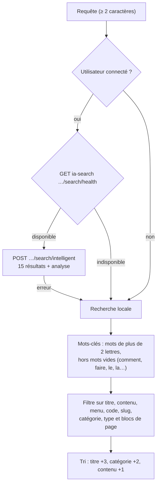

# Recherche

Une barre de recherche (en-tête sur ordinateur, menu sur mobile) trouve un cours par mot-clé. Un utilisateur connecté passe d'abord par le service de recherche IA ; sinon, ou en cas d'échec, la recherche se fait dans le navigateur.

| Partie | État |
|---|---|
| Recherche locale par mots-clés | <Status is="prod" /> recette R-03 |
| Recherche IA (connecté) | <Status is="code" /> service externe `ia-search.varascundo.com` |

## Parcours utilisateur

1. Saisir au moins 2 caractères et valider.
2. La liste des résultats s'ouvre (panneau sur ordinateur, liste plein écran sur mobile).
3. Un clic ouvre le cours ; fermer vide la recherche.

## Comment ça marche



La recherche locale porte sur les contenus déjà chargés pour les menus (`menus` de `useData`) : elle fonctionne aussi hors ligne.

## Fichiers impliqués

```txt
front/src/composables/domain/useSearch.js           logique (IA puis repli local)
front/src/services/intelligentSearchService.js      appels au service ia-search (URL de production en dur)
front/src/components/features/search/SearchInput.vue, SearchResults.vue, SearchResultsMobile.vue, SearchResultItem.vue
front/src/components/layout/AppHeader.vue, AppHeaderMobile.vue
```

## API

| Appel | Accès | Rôle |
|---|---|---|
| `GET /api/page_contents` | Public | Données de la recherche locale (déjà chargées) |
| `GET https://ia-search.varascundo.com/api/search/health` | — | Disponibilité du service IA |
| `POST https://ia-search.varascundo.com/api/search/intelligent` | — | Recherche IA, appelée **depuis le navigateur** |

## Tests

| Fichier | Ce qui est vérifié | État |
|---|---|---|
| [`search.spec.js`](../../e2e/tests/search.spec.js) | Trouver « flexbox » et ouvrir le cours ; une recherche sans correspondance vide la liste | <Status is="local" /> |
| Recette R-03 | « flex » trouve le cours Flexbox | <Status is="prod" /> |

## Limites connues

::: warning
- L'URL du service IA est écrite en dur dans `intelligentSearchService.js` (la ligne locale est en commentaire) : pas de configuration par environnement.
- Le service IA est appelé directement par le navigateur ; son code n'est pas dans ce dépôt.
- Aucun test de la recherche IA ni de la règle de tri.
:::
